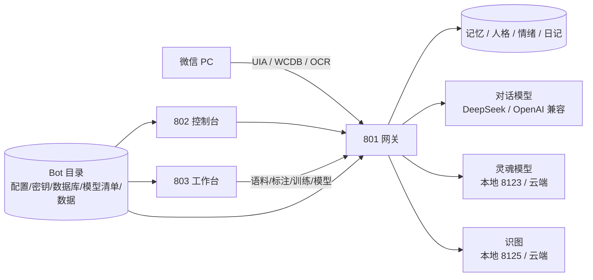

<div align="center">


# 小鱼 · SoulAgent

**微信里真实收发消息的本地 AI 伴侣**

有长期记忆、自己的心情、会主动找人、会写日记、会上网冲浪，也会被你的反馈一点点改变。

大模型负责「会说」，这个项目负责「是谁」——  
记忆、情绪、人格、关系、边界都在模型外面，逐层注入、逐层约束。

[](LICENSE)
[](https://www.python.org/)
[]()
[](docs/quality/开源上手-Bot化验收清单.md)

[快速开始](#-三分钟上手) · [功能](#-它能做什么) · [架构](#-架构) · [文档](#-文档地图) · [边界](#-它不做什么)

</div>

---

## 这是什么

小鱼不是一个「套壳聊天框」，而是一套**本地运行的人格与记忆系统**：

- **微信是真的**：登录你自己的微信 PC 客户端，收发真实消息；
- **记忆是真的**：长期记忆、人格、关系、情绪、日记都落在本地 SQLite；
- **边界是真的**：STOP、引擎开关、白名单、发送模式、限流、夜间静默多层闸门；
- **可换模型**：对话/灵魂/识图都支持云端 OpenAI 兼容 API，也支持本地 llama.cpp；
- **可迁移**：每个 Bot 是一个独立目录，配置、密钥、数据库、模型清单、训练数据互不串。

> ⚠️ 只支持 **Windows 10/11 + 微信 PC 客户端**；只建议用于**你自己的账号**。  
> 微信自动化有账号风险，请自行评估。

---

## 🚀 三分钟上手

### 第 1 步：双击启动

仓库根目录双击：

```text
启动.bat
```

它会自动：

1. 检查 Python 3.12+（缺了尝试 winget/国内镜像安装）
2. 检查主 venv、803 venv、`AGENT_HOME`
3. 缺依赖时用国内源安装
4. 803 没运行就后台启动
5. 打开 <http://127.0.0.1:803/>

只想检查、不安装：

```bat
启动.bat -CheckOnly
```

> PowerShell 脚本 `setup.ps1` 仍保留给高级用户；普通使用双击 `启动.bat` 即可。

### 第 2 步：803 创建 Bot

1. 打开 <http://127.0.0.1:803/>
2. 右上 token 填 `8888`（可在 `IDEA_TOKEN` 改）
3. 左侧 **🤖 Bot** → 选择 Bot 目录（例如 `E:\bots\my-bot`）
4. 填名称、802 登录密码、服务商、模型、API key
5. 点「创建 Bot」

密钥只写入 `<Bot>\secrets.json`，不会提交到仓库。

### 第 3 步：802 加载 Bot

1. 打开 <http://127.0.0.1:802/>
2. 「加载 Bot」→ 选刚才的目录 + 密码
3. 801/802 自动重启到该 Bot 的数据根（约 5–10 秒）

### 第 4 步：接上微信

1. 登录微信 PC 客户端
2. 802 总览 → **刷新联系人**
3. 首次读取 `contact.db` 需要提取密钥，等 10–20 秒
4. 勾选联系人 → 「应用选择」

### 第 5 步：开始运行

- 802 **设置** 里确认总开关/自动回复/发送模式
- 先 `dry_run` 或 `confirm`，稳定后再 `auto`
- 总览 → **开始监听 / 开始运行**

---

## ✨ 它能做什么

| 能力 | 说明 |
| --- | --- |
| 微信收发 | 收：DB 直读 + OCR 回退；发：`wechatauto` 子进程，单一发送入口 |
| 长期记忆 | 抽取/合并/冲突处理/检索；类海马体衰减，默认 dry-run |
| 情绪 | 每轮判心情；mood + 7 维情绪，影响回复和主动程度 |
| 人格 | core（人工批准）/ evolving（证据累积+限速）/ relations 三层 |
| 主动消息 | pacing × initiative × 内驱力；概率/间隔/静默/上限 |
| 日记/周复盘 | 每天写第一人称日记；周日复盘进核心人格 |
| 上网 / B站 | 天气/新闻/搜索；B站插件刷视频、字幕、评论、日报 |
| 内状态 | 0.5B 灵魂模型产出 InnerState；云端/本地可切 |
| 识图 | 本地 Qwen2.5-VL 描述或云端视觉；支持独立 vision provider |
| 802 控制台 | 总览/对话流/记忆/提示词/模型/设置/日记/B站/朋友圈 |
| 803 工作台 | 语料清洗、标注、蒸馏、LoRA/全参训练、模型中心 |
| 多 Bot | 单活跃 Bot；数据/密钥/模型/训练数据完全隔离；切换自动重启 |

### 界面一览

<div align="center">
  
  <p><sub>802 消息分析台 / 803 语料清洗、用户标注、B站、日记</sub></p>
</div>

---

## 🧱 架构



### 端口

| 端口 | 服务 |
| --- | --- |
| `801` | 微信网关（接收 / 生成 / 发送闸门） |
| `802` | Soul Console 控制台 |
| `803` | IDEA 工作台 |
| `8123` | 本地内状态 llama-server（可选） |
| `8125` | 本地识图/文本提取 llama-server（可选） |
| `8126+` | 训练导出自动注册的本地模型 |

### Bot 目录

```text
<Bot>/
├── bot.json          # schema、provider、settings、密码 hash
├── secrets.json      # API key（本机；gitignore 语义；权限收紧）
├── data/
│   ├── wechat/config.json
│   ├── selflearn/    # 联系人库、记忆、人格、情绪
│   ├── diary/
│   ├── prompts.json
│   ├── local_models.json
│   └── train/        # 每日语料 + 打包数据
├── models/models.json
├── datasets/
└── logs/
```

切换 Bot 会重启 801/802 并带 `SOULAGENT_*` 环境；**不同 Bot 的数据库不连通**。

---

## 📦 环境与依赖

| 依赖 | 必需 | 说明 |
| --- | --- | --- |
| Windows 10/11 + 微信 PC | ✅ | UIA/窗口操作，Windows-only |
| Python 3.12+ | ✅ | 3.12/3.14 验证过 |
| 独立 3.12 venv | ✅ | 发送器 `wechatauto` 子进程 |
| DeepSeek / OpenAI 兼容 key | ✅ | 主对话模型 |
| `~/.dsh/bili-duty` | 可选 | B站插件，仓库外；缺了 B站能力降级 |
| llama.cpp + GGUF | 可选 | 本地灵魂/识图；没有就走云端 |
| GPU | 可选 | 无 GPU 按决策只走云端 |

`AGENT_HOME` 默认 `E:\agent`，可用环境变量改；模型与运行数据不随仓库分发。

---

## 📊 当前进度（诚实版）

| 模块 | 状态 |
| --- | --- |
| 开源上手 / Bot 化 Phase 1 | ✅ 可验收 |
| 802/803 双端 + 数据隔离 | ✅ |
| 云端灵魂/识图 provider | ✅ |
| 本地模型工具链（llama.cpp / GGUF 下载） | 🟡 工具就绪，未在干净 VM 完整实测 |
| 训练闭环 | 🟡 自动注册/启动/切换已接，未真实训练端到端 |
| 干净机器一键安装 | 🟡 启动脚本已完成，待 VM 验证 |
| 群聊 | ⏸ 按决策置灰 |

详细逐项验收：[`docs/quality/开源上手-Bot化验收清单.md`](docs/quality/开源上手-Bot化验收清单.md)

---

## 🔒 数据与隐私

- 所有运行数据在本机：`AGENT_HOME` 与 Bot 目录；**仓库里不放用户数据/密钥/模型**；
- API key 只写 `<Bot>/secrets.json`（本机、ACL 收紧、gitignore）；
- 除了你配置的云端 API，没有自建服务端、没有遥测上传；
- 微信/聊天/联系人数据属于你，不要提交、不要共享 Bot 目录。

发布前检查：

```bat
python tools\check_secrets.py
python tools\check_architecture.py
python tools\check_docs_links.py
```

---

## 🧪 开发与测试

```bat
python -m pip install -r requirements.txt
python -m pip install -r idea\requirements.txt

python -m pytest tests -q
python -m pytest agi\tests -q
cd idea && .venv\Scripts\python.exe -m pytest tests -q
```

- 架构守卫：`python tools\check_architecture.py`
- 链接检查：`python tools\check_docs_links.py`
- 状态数字：`python tools\status_report.py`

---

## 🧭 它不做什么

- 不宣称「意识」；做的是行为与叙事上的连续自我；
- 不保证微信自动化的账号安全；只建议自己的账号；
- 不内置模型/插件/用户数据；
- 不支持群聊（当前只置灰保留入口）；
- 不把「发送调用成功」当成「已送达」。

---

## 📚 文档地图

| 文档 | 内容 |
| --- | --- |
| [新用户上手](docs/guides/新用户上手.md) | 从 clone 到第一条消息 |
| [B站插件安装](docs/guides/B站插件安装.md) | 仓库外 `bili-duty` 的安装/检测/排障 |
| [本地模型安装](docs/guides/本地模型安装.md) | llama.cpp、GGUF、断点续传、按 Bot 启停 |
| [架构说明](docs/architecture/ARCHITECTURE.md) | 收/发/记忆/主动/数据层 |
| [验收清单](docs/quality/开源上手-Bot化验收清单.md) | 逐项状态/命令/缺口 |
| [路线图](docs/plans/63-开源上手与Bot化路线.md) | Phase 1–4 规划 |
| [文档总入口](docs/INDEX.md) | 全部文档索引 |
| [803 工作台](idea/README.md) | 语料/标注/训练/模型中心 |

---

## 🤝 参与

- 提 issue 前先看验收清单的「明确未完成」，避免重复；
- 不要提交 `agi/data/**`、Bot 目录、`secrets.json`、模型文件、聊天截图；
- 代码风格/测试/文档约束见 [`CONTRIBUTING.md`](CONTRIBUTING.md)。

## 📄 License

[MIT](LICENSE) © soulNebula
