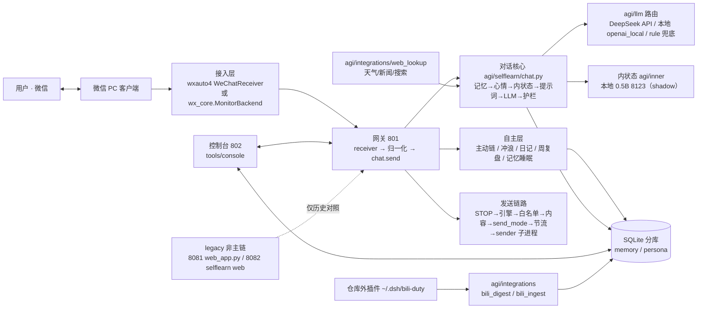

# 小鱼 · 项目架构说明（按代码现状）

> 本文只写**能在代码里核对到的东西**。核对日期：2026-10-29；改了链路请同步改这里，
> 数字类事实用 `python tools/status_report.py` 复算，架构约束用
> `python tools/check_architecture.py` 复验。
>
> 一句话：微信里真实收发消息的本地伴侣；大模型负责「会说」，记忆/心情/人格/关系/欲望
> 都在模型外部，逐层注入与约束。

## 一、一张图



## 二、端口与入口（代码默认值）

| 端口/入口 | 启动命令 | 定位 | 代码依据 |
| --- | --- | --- | --- |
| **801** | `python -m agi.wechat_gateway.server` | 主链：微信网关（收/发/状态/调试 API） | `agi/wechat_gateway/config.py` DEFAULTS `"port": 801` |
| **802** | `python tools/console/server.py --port 802` | 主链：控制台单页应用 | `tools/console/server.py` `--port` 默认 `PORT`（802） |
| 8123 | `llama-server -m <0.5B gguf> --port 8123` | 可选：内状态小模型（shadow，只记录） | `agi/selflearn/mood_judge.py` 内状态地址默认 `http://127.0.0.1:8123` |
| 8125 | `python tools/soul_serve/serve_local3b.py` | 可选：本地 3B（摘要/关键词/提取） | `tools/soul_serve/serve_local3b.py` |
| 8081 | `python web_app.py` | **legacy/非主链**：旧 wx_box 网页端 | `web_app.py` `DEFAULT_PORT = 8081` |
| 8082 | `python -m agi.selflearn.cli serve --port 8082` | **legacy/非主链**：selflearn 自带调试网页 | `agi/selflearn/cli.py` `serve` → `agi/selflearn/web.py` `main()` |

桌面 GUI：`python app.py`（Tk；`--fake` 用 `ui/dev_backend.DevBackend` 演示，真实后端不可用时自动回退假后端）。
`802` 控制台是日常唯一操作入口；`801` 网关是唯一真实收发入口。

## 三、接入层：双后端 + 发送链路

### 3.1 收消息（两套后端，归一到同一事件队列）

| 模块 | 职责 |
| --- | --- |
| `agi/wechat_gateway/receiver.py` | `WeChatReceiver`：消费外部注入的 `wx_core.monitor.MonitorBackend`，做白名单/去重/防抖/过期标记，识别撤回、引用、拍一拍、@ |
| `wx_core/monitor.py` | `MonitorBackend`：可选 `db_source`（WCDB 解密直读，`wx_core/db_source.py`）或 OCR 截图解析（`wx_core/ocr.py` + `wx_core/extract.py`），统一暴露 `events` 队列 |
| `wx_core/db_source.py` | 数据库直读源：只读解密到临时目录 → sqlite `mode=ro`；文字/图片/表情/文件/语音精确对应 |
| `wx_core/ocr.py`、`wx_core/extract.py` | OCR 回退：PrintWindow 截图 + 布局识别 + 整区 OCR |

两个后端最终都归一到同一 `Message`/`events` 队列，再进网关归一化；不要按单后端理解接入层。

### 3.2 发消息（唯一入口 `Gateway._send`，持全局发送锁）

真实外发只走 `Gateway._send`（先拿全局发送锁，串行化 reactive / proactive / 人工三条调用路径），闸门顺序：

```
STOP 文件（最高优先）
→ engine_enabled（手动/force 调试除外）
→ allowed_contacts 白名单（空白名单 fail-closed，不再全放行）
→ 出站文本摘除微信内部 ID
→ policy.check_content（长度/占位/敏感）
→ send_mode（off 拦 / confirm 只落草稿等人工批准 / auto 直发）
→ config.stop 开关
→ min_interval_s（只约束非 reactive 发送）
→ hourly_limit（默认 40）
→ daily_limit（默认 200）
→ reactive 去重（60s 窗口，键 = turn_id:气泡序号）
→ quiet_hours 夜间静默（默认 [23,8]；reactive/force_quiet 不受限）
→ policy.check_send（统一限流/静默复核）→ sender
```

发送器：`agi/wechat_gateway/sender.py` `WxAutoSender`，`send_module` 默认 `wechatauto`（历史值 `wxauto4`），
`send_backend=sender|uia`；真实发送在独立的 Python 3.12 venv 子进程里执行（Python 3.14 主进程不 import wx 系依赖）。
发送结果分类见 `agi/wechat_gateway/sendclass.py`：`sent` / `draft` / `blocked` / `unverified` / `failed`。
**`unverified` 表示「调用返回 ok 但没有送达证据」（如窗口兜底 `verified=False`），不等于送达**，不计 sent、不重置熔断。

## 四、对话核心（`agi/selflearn/chat.py`）

`chat.send()` 一轮的主干（模块名即代码依据）：

| 环节 | 模块 |
| --- | --- |
| 记忆检索 | `retrieval.hybrid()`（类海马体续命在 `memory.retrieve*` + `memory_decay.py`） |
| 心情判定 | `mood_judge.py`：LLM 判 `moodDelta` + 7 维情绪 + reason + confidence；基线 mood 70，mood 半衰期 3h、7 情绪 90min |
| 内状态 | `agi/inner/`：0.5B 输出 stance/intent/monologue；shadow 模式只记录/注入受限字段 |
| 人格与上下文 | `persona_layers.py`（core/evolving/relations）、`skills.py`、`lessons.py`、`interests.py`、`profile.py` |
| 实时资料 | `agi/integrations/web_lookup.py`（天气/新闻/网页搜索；命中才注入） |
| 生成 | `agi/llm/router.py` + `deepseek.py`（主）/ `openai_local.py`（本地）/ `rule.py`（兜底） |
| 护栏 | `guard.py`（网感腔/金句腔/编造故障/主动收尾）+ `textguard.py`（内部 ID/尖括号） |
| 媒体 | `media_quota.py`：最近 10 条里 <2 条带媒体 → 强制；2–3 → 30% 鼓励；≥4 → 不强制 |
| 可观测 | `trace.py` → `turn_traces`（prompt/记忆/内状态/心情/生成/润色/守卫/耗时） |

## 五、记忆 / 内状态 / 心情 / 人格的归属

- **记忆**：`agi/selflearn/memory.py`（抽取/合并/冲突/检索）+ `memory_decay.py`（分层衰减：strength 半衰期
  → compressed → keyword → dormant；`DORMANT_PURGE_DAYS = 200`，清理默认 dry-run）。
- **内状态**：`agi/inner/`（`schema.py` JSON schema、`inject.py` 注入、`render.py` 渲染），模型在仓库外。
- **心情**：`agi/selflearn/mood_judge.py`（判定）+ `affect.py`（快照）+ `state` 表存当前心情；
  与人格库的 `mood_state/mood_timeline` 表并存，是「细粒度心情层」。
- **人格**：`persona_layers.py` 三层 `core`（人工批准）/`evolving`（证据累积+限速）/`relations`；
  安装设定书由 `tools/persona/install_xiaoyu.py` 写入（`agi/persona/xiaoyu/` 素材）。

## 六、自主层（她自己的时间）

### 6.1 主动消息链（唯一真相源：`agi/proactive_registry.py`）

真实调用链（`registry.ENTRIES` 登记，测试静态核对）：

```
Gateway._proactive_loop          常驻线程（proactive_enabled；engine 停则空转）
→ Gateway._proactive_cycle       委托 registry.run_proactive_tick（唯一入口）
→ proactive_registry             登记表 + 引擎开关检查（代码与文档同一真相源）
→ proactive_worker.run_cycle     配置热重载/STOP/开关/熔断/概率/间隔/白名单
→ ticker.run_once                autonomy.gate 闸门
→ proactive.tick                 生成正文并落库（从不直接发送）
→ proactive._tick_impl           按 proactive_style 分流
→ simple_tick.tick_simple        仅当 proactive_style=simple；默认 legacy
```

- **主链唯一对外入口**：`agi/proactive_registry.run_proactive_tick(gateway)`；
  `Gateway._proactive_cycle` 已改为直接委托它（不再各写一套），`tests/test_architecture.py`
  静态核对「server 调用 registry / registry 全仓库只此一处定义 / 登记证据可搜到」。
- **legacy/manual**：`agi/selflearn/web.py` 的 `POST /api/proactive/tick`（8082 调试页）、
  `ticker.loop`（无现役调用者）、`python -m agi.selflearn.cli proactive`（人工触发一次生成）。
- 主动节奏：`pacing.py`（对等）× `initiative.py`（熟悉度/心情/信任 → drive）× `urges`（内驱力队列），
  再受日上限（`pacing_daily_cap` 默认 12，范围 12–100）、静默、连续无回应约束。
- `proactive_style` 默认 `legacy`（`agi/selflearn/simple_tick.py::proactive_style`；可用 config
  或 `PROACTIVE_STYLE` 环境变量切 `simple`）。**不要**再按旧文档写成「现役是 simple_tick」。

### 6.2 其它自主循环（都在网关线程里，互不阻塞）

| 模块/入口 | 周期 | 做什么 |
| --- | --- | --- |
| `Gateway._surf_loop` → `agi/selflearn/surf_worker.py` + `surf.py` | 窗口内投骰 | 网上冲浪、沉淀兴趣/审计；**默认不主动发消息**，不碰发送通道 |
| `Gateway._diary_loop` → `agi/selflearn/diary.py` | 每天 `diary_hour`（默认 23） | 写第一人称日记；engine 停也照写 |
| `Gateway._narrative_loop` → `agi/selflearn/self_narrative.py` | 周日 23:30 后、本周未跑 | 周复盘 → core 人格层「我是谁/我在意什么」 |
| 记忆睡眠 | 每天 `memory_sleep_hour`（默认 3） | `memory_decay.py` 衰减/压缩/休眠；`memory_purge_enabled` 默认 False（dry-run） |

## 七、数据层（SQLite 分库）

- 位置：`agi/data/selflearn/`（运行数据，git 忽略）；按联系人落在 `wechat_contacts/<hash>.memory.sqlite3`
  与 `.persona.sqlite3`，旧单库自动重命名为 `.legacy.sqlite3`。
- 代码：`agi/selflearn/db.py` —— `memory_path()` / `persona_path()` / `legacy_path()` / `connect()`（路由连接）。
- 表（节选，完整 schema 在 `db.py`）：记忆侧 `messages`/`turns`/`user_memories`/`turn_traces`/`mood_state`/
  `mood_timeline`/`interests`/`bili_impressions`/`claims`/`attachments`；人格侧 `persona_layers`/
  `persona_changelog`/`trust_events`/`raw_events` 等。
- `agi/data/**` 一律不入库、不打包；路径解析见 `docs/PATHS.md`（`AGENT_HOME` / `agi/paths.py`）。

## 八、控制台 802、B站与模型

- **控制台**：`tools/console/server.py`（默认 802）+ `trace_api.py`/`media_store.py`/`growth_api.py`/
  `model_admin.py`/`moments_api.py`；单页原生 JS，覆盖总览/对话/推理过程/内状态/素材/记忆/内驱力/B站/模型/训练/设置。
- **B站**：仓库**不包含**插件本体，依赖外部 `~/.dsh/bili-duty`（DSH 侧插件）产出日报与凭证；
  `agi/integrations/bili_digest.py` 读 `~/.dsh/bili-duty/out`，`bili_ingest.py` 读
  `~/.dsh/bili-duty/bili_credential.json`；插件不存在时相关能力降级，不影响主链。
- **模型**：主对话 = DeepSeek API（`agi/llm/deepseek.py`）；内状态 = 本地 0.5B（8123，shadow）；
  本地 3B（8125）做摘要/关键词/提取；模型资产在仓库外（`E:\agent`，由 `agi/paths.py` 的 `agent_home` 解析）。
- **训练**：`tools/train/`（`daily_corpus.py` 收集 → `daily_summary.py` → `train_gate.py` 门禁 →
  `sft_train.py`/`smoke_lora.py` 训练）。门禁 `MIN_SAMPLES=300`、`MIN_DAYS=3`；默认只做计划，
  必须人工 `--execute`，且只产出候选版本，**不自动切换线上**。截至 2026-10-27 的语料门禁：
  可训练样本 96/300、`last_training=null`（未训练、未合并、未切线上，见 `docs/plans/52`）。

## 九、目录（实际存在的）

```
SoulAgent/
├── agi/                   核心包：selflearn(94 个模块)/ inner/ llm/ integrations/
│   │                      wechat_gateway/ soul/ persona/ data(运行数据, git 忽略)
│   └── proactive_registry.py   主动链登记表 + 唯一主动入口
├── tools/                 控制台(802)/ 桌面版/ soul_serve(8125)/ train/ persona/
│   ├── check_architecture.py   架构守卫（死代码/环/行数/分层）
│   └── status_report.py        可复现状态报告（测试数字/代码规模/归档量）
├── wx_core/               wxauto4 封装、WCDB 直读、OCR、发送底座
├── webui/                 legacy 8081 网页端（非主链，仍有测试覆盖）
├── ui/                    Tk 桌面 GUI（app.py 入口）
├── Demo/                  独立工具实现（tools_impl 被 tools/ 动态 import）
├── legacy/                死代码归档区（只 mv 不删，见 legacy/README.md）
├── tests/                 根测试套件
├── scripts/               发布/验证脚本
├── docs/                  文档（plans/ specs/ archive/ sources/）
├── media/                 本地素材（运行数据）
├── app.py / web_app.py    桌面 GUI / legacy 网页端入口
└── README.md
```

## 十、架构守卫与归档（防回流）

- `python tools/check_architecture.py` 四条规则：① 未登记顶层目录/无引用模块（死代码回归）；
  ② `agi` 内部模块级 import 环；③ 单文件行数预算（新增 >1500 行直接 FAIL，存量大文件有各自上限）；
  ④ 分层：`agi/*` 模块级不得 import `tools/*` 或 `webui/*`。
- 已知无 import 边但活着的手动/动态入口（CLI、离线评测脚本、子进程 worker 等）登记在
  `UNIMPORTED_ALLOWLIST`；归档历史见 `legacy/README.md`。
- 归档只允许 `mv`（不 `rm`），内容不改，可原样搬回；`legacy/` 不参与运行、pytest 收集与合规扫描。

## 十一、已知边界（与代码一致）

- 微信侧只能 UIA 操作：群聊未支持；引用/拍一拍是启发式识别（`receiver.py`）。
- 公众号全文受微信 IP 级风控：`web_lookup` 只能搜标题摘要，或由用户复制正文。
- 本地小模型目前只做内状态与提取；「像她」主要靠记忆/人格/护栏，权重层面尚未替换主模型。
- 兜底发送的 `unverified` 只代表无送达证据，不能当「已送达」写进对外说明。
- 8081/8082 仅历史/调试用途，不写入主链操作步骤；`/agi/core*` 旧接口在 `webui/server.py` 返回 410
  （`agi_core_removed`）。