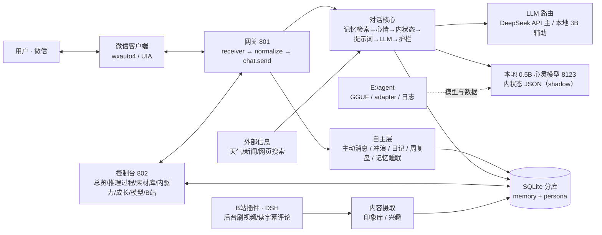

# 小鱼 · 项目架构说明

> 这个项目是一个「会聊天的本地伴侣」：微信里真实收发消息，背后是一个带记忆、情绪、人格、兴趣、主动性和日记的智能体。
> 大模型负责「会说」，项目负责「是谁」——记忆、心情、关系、欲望都在模型外面，逐层注入与约束。

## 一、一张图看懂



## 二、分层

### 1. 接入层（微信）

| 模块 | 职责 |
|---|---|
| `agi/wechat_gateway/receiver.py` | 从 wxauto4（UIA）读消息：白名单、去重、防抖、过期标记；识别撤回/引用/拍一拍的 system 与 text 变体、@提及 |
| `agi/wechat_gateway/server.py` | 网关主进程（HTTP 801）：消息归一化（`[引用]`/`[拍一拍]`/`[对方@了你]`）、审核与发送闸门（STOP 文件、静默时段、小时/日上限、熔断）、引擎启停（`engine_enabled`）、以及各种调试接口 |
| `agi/wechat_gateway/sender.py` / `sticker_native.py` | 文本/图片/贴纸发送；真实发送在 wxauto4 venv 子进程里执行（`agi/data/wechat/.venv`） |

消息进入顺序：**receiver → 归一化 → 引擎/STOP 检查 → chat.send → 发送闸门 → wxauto4 子进程**。

### 2. 对话核心（`agi/selflearn/chat.py`）

每轮 `send()` 的流水线：

```
输入清洗（图片理解 caption / 撤回引用脱敏 / 拍一拍直回"干嘛？"）
  → 记忆检索（hybrid 检索 + 类海马体续命 search_with_revive）
  → 心情快照（mood_state + 7 维 + 衰减）
  → 内状态（0.5B 模型生成 stance/intent/monologue，shadow 模式只记录）
  → 人格层/教训/技能/兴趣/关系种子 → 拼 system prompt
  → 时间上下文（现在是 2026-10-27 22:00 周四 深夜）
  → 实时资料（web_lookup：天气/新闻/网页搜索，命中才注入）
  → LLM 生成（DeepSeek API；可选两段式证据生成，默认关）
  → 护栏（去网感腔 / 去金句腔 / 禁编故障 / 禁主动收尾 / 长度/问号/内心独白）
  → 润色（voice_polish 规则）→ 气泡拆分（心情高时可按逗号连发两条）
  → 媒体配额（每 10 条 ≥2 条带 emoji/贴纸/GIF）→ 记录 turn/trace/记忆
```

关键子模块：

| 模块 | 说明 |
|---|---|
| `agi/llm/` | 模型路由：按用途选后端（`video_understanding` 必须 API；摘要/关键词用本地 3B；回复用 DeepSeek），带回退链与 token 记账 |
| `agi/selflearn/memory.py` | 长期记忆：抽取、合并、冲突处理、遗忘、检索 |
| `agi/selflearn/memory_decay.py` | 类海马体衰减：strength 半衰期 → full/compressed/keyword/dormant；命中续命；200 天可唤醒；夜间睡眠清理 |
| `agi/selflearn/mood_judge.py` | 每轮心情判定（moodDelta + 7 维 + 原因 + 置信度），低置信只记录 |
| `agi/inner/` | 内状态层：本地 0.5B 输出 JSON（心情/能量/亲密/立场/独白） |
| `agi/selflearn/persona_layers.py` | 人格层：core（人工批准）/evolving（自长）/seed，带证据与变更日志 |
| `agi/selflearn/guard.py` | 输出护栏：slang（网感）/canned（金句腔）/false_failure（编造网络故障）/closing（主动收尾）/长度与占位兜底 |
| `agi/integrations/web_lookup.py` | 联网实时信息：天气（wttr.in）、网页搜索（搜狗/必应）、新闻 top3、URL 正文提取、公众号（搜索可用，全文受微信风控） |
| `agi/selflearn/media_quota.py` | 回复媒体配额：≥2/10 带图，连续 3 条软冷却 |

### 3. 自主层（她自己的时间）

| 模块 | 何时 | 做什么 |
|---|---|---|
| `proactive_worker.py` | 每轮调度（静默 22–9 除外） | 主动消息：`pacing`（你我消息量对等）× `initiative`（关系熟悉度×心情×信任→主动度）× `urges`（内驱力队列优先发）→ 候选话题/分享 → 生成 → 护栏 → 发送 |
| `surf.py` / `surf_worker.py` | 10:00–22:00，每 30 分钟投骰 | 骰子≥3 且 ×冲浪因子≥2.4 才冲浪；时长 3–12 分钟、条数 ≤20；产出 my_take → 兴趣库，并向内驱力队列 push |
| `diary.py` | 每天 23:00 | 读当天对话/主动/冲浪/心情/兴趣，第一人称写 300–600 字日记 → `agi/data/diary/YYYY-MM-DD.txt` |
| `self_narrative.py` | 每周日 23:30 | 汇总一周日记与心情 → 周记 → 提炼 ≤120 字"我是谁/我在意什么" → core 人格层 → 注入日常 prompt |
| `memory_decay.py` | 每天 03:00 | 记忆衰减/压缩/休眠与清理（dry-run 默认），模拟"睡眠整理" |

### 4. 数据层（SQLite 分库）

`agi/data/selflearn/wechat_contacts/<哈希>.memory.sqlite3` + `.persona.sqlite3`（旧单库自动重命名为 `.legacy.sqlite3`）：

| 域 | 表 |
|---|---|
| memory | `messages` `turns` `user_memories` `claims` `attachments` `mood_state` `mood_timeline` `turn_traces` `surf_sessions` `urges` `skills` `lessons` `interests` `bili_impressions` |
| persona | `persona_layers` `state` `trust` `user_profile` `mood_*`（人格侧） |

`db.connect()` 是透明路由连接：按表名路由到对应文件，跨库查询走 `CrossDomainQuery`。

### 5. 控制台（`tools/console`，802）

单页应用（原生 JS）：总览（启停引擎/状态灯）、对话流、推理过程（每条回复 8 段链路，含 reasoning 原文）、内状态/心情、媒体、素材库（增删改类型/含义/标签/软删）、记忆、B站、模型（启停/外部进程识别）、训练/成长、日志、设置。

### 6. 内容世界（B站）

`~/.dsh/bili-duty` 插件（DSH 侧）后台在峰谷时段刷视频、读字幕/评论 → 写日报与归档；本项目用 `agi/integrations/bili_digest.py` 解析日报、`bili_ingest.py` 做视频理解（走 API）与分享文案，产出进入兴趣库与主动话题。

### 7. 模型与训练

- **主意识**：DeepSeek API（`agi/selflearn/llm.py`），负责对话生成。
- **潜意识**：本地 Qwen2.5-0.5B（llama-server 8123），只产内状态 JSON。
- **本地 3B**（8125）：摘要/关键词/视频提取等高频便宜任务。
- **后训练闭环**：`tools/train/` 每天 03:00 收集语料（正/负/修正样本 → SFT/DPO jsonl）→ 累计 ≥300 条且距上次 ≥3 天 → LoRA 增量训练（0.5B/1.5B）→ 黄金集评测 → 只标 candidate，不自动上线。
- 模型资产在 `E:\agent`（GGUF/adapter/日志），**独立于项目目录**。

## 三、关键机制

1. **记忆分层 + 类海马体衰减**：hot/warm/cold + strength 半衰期；文字逐步压成一句、再到关键词、最后休眠；被提起即续命。
2. **心情系统**：每轮判定（不靠 LLM 拍脑袋的单值，而是 7 维 + 原因 + 置信度）；衰减有半衰期；下降只能因为"担心你/自己难过"。
3. **人格三层**：seed（安装设定书）→ evolving（互动中长，需证据）→ core（人工批准，如"你教她的那段话"）。
4. **主动性三因子**：对等（pacing）、关系与心情（initiative → drive）、内驱（urges）→ 再被日上限/静默/连续无回应三重保护约束。
5. **护栏**：网感腔、金句腔、编造故障、主动收尾四类硬规则，命中重写一次，仍命中删分句；所有被拦内容留 trace。
6. **可观测**：每条回复落 `turn_traces`（system/user prompt、记忆、内状态、心情、生成含 reasoning、润色、守卫、耗时），控制台可逐段查看。

## 四、目录

```
SoulAgent/
├── agi/                     # 核心包（selflearn/ inner/ llm/ integrations/ wechat_gateway/）
│   └── data/                # 运行数据（DB、媒体、日记、训练语料、缓存）【git 忽略】
├── wx_core/                 # wxauto4 封装与监控
├── tools/                   # console / desktop / soul_serve / train / persona / bili_patch
├── tests/ ui/ webui/ Demo/  # 测试与旧前端/演示
├── docs/                    # 说明文稿、架构图、plans、specs、分析
├── plans/                   # 迭代计划（按编号）
├── run.bat / 启动桌面版.bat   # 启动入口
└── README.md
```

## 五、端口与进程

| 端口 | 进程 | 说明 |
|---|---|---|
| 801 | `python -m agi.wechat_gateway.server` | 微信网关（收发、状态、调试 API） |
| 802 | `python tools/console/server.py --port 802` | 控制台 |
| 8123 | `llama-server -m soul_qwen25_05b_v1b-q4_k_m.gguf` | 内状态（潜意识） |
| 8125 | `python tools/soul_serve/serve_local3b.py` | 本地 3B（提取/摘要） |

## 六、已知边界

- 微信侧只能通过 UIA 操作：群聊未支持；引用/拍一拍为启发式识别。
- 公众号全文受微信 IP 级风控（302 验证码），只能搜索标题摘要，或由用户复制正文。
- "真意识"不存在；目标是把"连续的自我叙事 + 有因果的情绪 + 自己的兴趣 + 会主动 + 记得关系"做出来，让人相处时觉得她像个有自己生活的存在。
