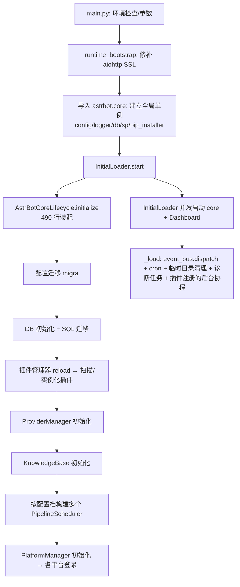

# AstrBot 架构分析报告

> **分析对象**：`AstrBot-master`（AstrBot v4.29.3，`pyproject.toml:3`），本地路径 `C:\Users\Administrator\Desktop\AGI\AstrBot-master\AstrBot-master`
> **分析方式**：纯静态源码走读（read / grep / glob），**未运行程序、未执行测试**；所有结论均标注真实的 `文件:行号` 证据；读不到或推断的部分显式标注「未验证」。
> **分工**：本报告由 Lead 汇总 5 个分区子报告（`sections/00`–`sections/06`）而成，分区报告保留了更细的证据链与图表。
> **日期**：2026-10-26

---

## 摘要：10 条核心判断

1. **它不是"聊天机器人脚本"，而是"IM 侧的 Agent 运行时平台"**：3 个进程入口、9 阶段消息管线、44+ LLM/TTS/向量 Provider、18 个平台适配器、可执行代码的 Agent 沙箱——规模已经是一个中型平台产品。
2. **架构主线非常清晰**：`平台适配器 → 事件队列 → 按配置档分派的管线 → 9 阶段洋葱链 → Agent 工具循环 → 结果装饰 → 发送`。每一层都有抽象接口，读起来不费劲。
3. **全仓库最漂亮的设计是"异步生成器洋葱管线"**（`pipeline/scheduler.py:46-82`）：用 `yield` 把"后续所有阶段"包成可插入的块，一个机制同时拿到了前置/后置钩子和短路能力。
4. **它最大的隐藏 bug 面是"并发语义与主人以为的不一样"**：同一会话的消息默认并发进入管线，只有 LLM/Agent 段有会话锁（`event_bus.py:73`、`internal.py:239`）；插件命令、限流、白名单都在锁外。
5. **可用性单点明确**：`EventBus.dispatch` 的 `while True` 没有任何 try/except（`event_bus.py:55-75`），一次异常就永久停止收消息，进程却还活着——表现就是"机器人在线但失联"。
6. **Agent 这一层"能力齐全但边界不严"**：工具串行执行、无框架级沙箱、无全局 deadline（`tool_loop_agent_runner.py:1197`、`astr_agent_tool_exec.py:742-745`）；上下文压缩与终止条件各有三套机制互不知情。
7. **插件体系是产品护城河，也是稳定性的软肋**：插件主类靠 `Star.__init_subclass__` **自动注册**（`@star.register` 已废弃，`star/base.py:53-64`），入口只需 1 个 `@filter.command`，一个 hello-world 插件 = 2 个文件约 12 行；公共 API 面薄（`api/all.py` 仅 55 行转出口）。但全局注册表 + 共享 site-packages 意味着**零隔离**。
8. **WebUI 是一等公民，也是最大的一坨**：553 条 HTTP 路由（v1 328 + legacy 225）、186 个 Vue 组件，`Chat.vue` 2925 行；双轨 API 与两份 OpenAPI 真相源之间没有一致性门禁。
9. **工程化"高于预期、短板在门禁"**：tier 化测试、3 OS × 5 Python 冒烟、i18n 门禁、发布脚本、211 份 changelog 都有；但缺类型检查门禁、覆盖率阈值、可复现构建（无 `uv.lock`）。
10. **总体评价**：**架构 B+ / 工程质量 B / 可维护性 C+ / 可观测性 A-**。它是一个"能力扩张速度长期快于结构治理速度"的项目——这既是它功能丰富的原因，也是它风险的来源。

---

## 1. 项目全景

### 1.1 定位与三种身份

官方定义（`README_zh.md:41`）：*"开源的一站式 Agent 聊天机器人平台，可接入主流即时通讯应用"*。实际代码显示它同时是三样东西：

| 身份 | 用户 | 对应代码 |
| --- | --- | --- |
| 开箱即用的机器人 | 个人/非程序员 | `uv tool install astrbot` + WebUI 点选配置 |
| 机器人开发框架 | 插件开发者 | `core/star/**` + `api/**` + 1000+ 插件市场 |
| Agent 基础设施 | 团队/企业 | `core/agent/**`、`core/computer/**`（沙箱）、`core/knowledge_base/**` |

### 1.2 规模画像（实测）

| 指标 | 数值 | 指标 | 数值 |
| --- | --- | --- | --- |
| 可见文件 | 1871 | Python 文件 | 755 |
| Vue 组件 | 186（`dashboard/src`） | 测试文件 | ~116（+ conftest 405 行） |
| 运行时依赖 | 64 | CI Workflow | 12 |
| 平台适配器 | 18 个 sources / 17 个注册分支 | LLM/TTS/向量 Provider | 46 个适配文件 / 44 个注册适配器 |
| 管线阶段 | 9 | HTTP 路由 | 553（v1 328 + legacy 225） |
| 后端路由/服务模块 | 26 / 29 | 变更日志 | 211 个版本文件 |
| 最大单文件 | `config/default.py` 4964 行 | 次大 | `Chat.vue` 2925、`sqlite.py` 2746、`star_manager.py` 2237 |

### 1.3 技术栈

Python 3.12+ / 全异步；FastAPI + Hypercorn（另有 Quart 兼容垫层）；Vue 3 + Vuetify + Vite + Pinia；SQLite + SQLModel；FAISS + BM25 + RRF 混合检索；MCP 协议；进程沙箱（bubblewrap / seatbelt / Docker / 远程 Shipyard）；hatchling 打包（构建时把前端 dist 塞进 Python 包）。

### 1.4 仓库地图

```
main.py / runtime_bootstrap.py   进程入口（SSL 修补 → InitialLoader）
astrbot/core/                    运行时内核（约 30 个子包）
├─ core_lifecycle.py             装配 15+ 管理器 + 任务表 + 启停
├─ event_bus.py                  事件队列消费 + 按 UMO 选配置档 + 并发派发
├─ pipeline/                     9 阶段洋葱管线
├─ platform/                     平台抽象 + 18 个适配器
├─ agent/ + astr_agent*.py       Agent 运行时（循环/上下文/工具/MCP/handoff）
├─ provider/                     LLM/TTS/STT/Embedding/Rerank 抽象 + 44 实现
├─ star/                         插件加载、注册表、过滤器、上下文
├─ knowledge_base/               解析→切块→向量化→混合检索→注入
├─ computer/                     Agent 的"手"：文件/Shell/浏览器/Python + 沙箱
└─ db/ config/ cron/ backup/ utils/
astrbot/api/                     插件可见公共 API 面（all.py 聚合）
astrbot/builtin_stars/           内置插件 + Skills
astrbot/dashboard/               WebUI 后端（26 路由 + 29 service）
dashboard/                       前端源码（独立 pnpm 工程，186 组件）
tests/ docs/ changelogs/         测试 / 文档站 / 版本日志
```

### 1.5 演进史（从仓库痕迹读出）

v3 → v4 是一次大重构（`db/migration/migra_3_to_4.py`、211 份 changelog）；能力扩张顺序为 **LLM 对话 → 插件生态 → 多平台 → 知识库/人格 → Agent 工具/MCP → 代码执行沙箱 → 子 Agent/Skills → 桌面端**。今天的功能面是这条路径的叠加，`umo_alias`、`asgi_runtime`、`desktop_runtime`、`sentinels` 都是迁移留下的"疤痕组织"。

---

## 2. 运行时架构

### 2.1 启动装配：一个 490 行的"手工 DI 容器"



关键事实：

- **模块级单例在 import 时就建立**（`astrbot/core/__init__.py:28-44`）：读配置、建数据库对象、建共享偏好、建 pip 安装器。任何 `import astrbot.core` 都有副作用。
- **装配顺序是隐式契约**：插件先于 Provider 加载、Provider 先于平台；插件里在 `__init__` 里拿 provider 会拿到空。
- **停止路径**（`core_lifecycle.py:381+`）只覆盖 `curr_tasks`；平台任务在 `PlatformManager._platform_tasks`、另有若干 fire-and-forget 任务（`core_lifecycle.py:294`）不在任何表里。
- **优雅关闭只在 `CancelledError` 分支成立**（`initial_loader.py:53-57`）：Dashboard 端口被占用时是 `raise Exception`（`dashboard/server.py:676-687`），进程退出但不执行 `stop()`，插件不 terminate、DB engine 不 dispose。

### 2.2 事件驱动：名不副实的 EventBus

它**不是发布订阅**，而是"单消费者队列 + 每事件一个 Task"：

- 平台适配器把 `AstrMessageEvent` 放进同一个 `asyncio.Queue`（`core_lifecycle.py:208`）。
- `EventBus.dispatch` 是唯一消费者：取事件 → `get_conf_info(umo)` 选配置档 → `pipeline_scheduler_mapping[conf_id]` → `create_task(scheduler.execute(event))` → 回到循环（`event_bus.py:55-75`）。
- 强引用防 GC 做了（`_pending_tasks`，`event_bus.py:52,74`），但**循环体没有 try/except**。`get_conf_info` 或 `_apply_session_isolation` 抛错 → dispatch 协程死亡 → 队列继续堆积、进程仍在运行 → **机器人"在线但失联"**。外层 `_task_wrapper` 只记日志不重启（`core_lifecycle.py:339-355`）。

### 2.3 九阶段洋葱管线

顺序硬编码在 `pipeline/stage_order.py:3-13`：`WakingCheck → WhitelistCheck → SessionStatusCheck → RateLimit → ContentSafety → PreProcess → Process → ResultDecorate → Respond`。

洋葱模型（`scheduler.py:46-82`）的机制是：`Stage.process()` 若返回异步生成器，调度器在**每次 `yield`** 时递归执行后续全部阶段，返回后再继续生成器内部逻辑。

- **优点**：一个阶段同时拥有"前置/后置"两个钩子，可以包裹整条后续链；比中间件列表更紧凑。
- **代价（真实存在的重入语义）**：生成器 yield N 次，后续阶段就完整执行 N 次；生成器结束后外层循环还会再进入 i+1 一次。`RespondStage` 因此需要 `_streaming_finished` 标记与"重复文本去重"补丁来防重复发送（`respond/stage.py:199-235`）。**也就是说，管线的正确性部分依赖各阶段的幂等性。**

### 2.4 并发与顺序的真相

| 环节 | 是否串行 | 证据 |
| --- | --- | --- |
| 事件进入管线 | **并发**（每事件一 Task） | `event_bus.py:73` |
| 唤醒/白名单/会话开关/限流/内容安全/预处理 | **并发**（无会话互斥） | 各 stage 无 per-UMO 锁（限流内部有锁但只保护自身计数，`rate_limit_check/stage.py:26,62-85`） |
| 插件命令 handler | **并发** | `process_stage/stage.py:47-60` |
| LLM/Agent 调用 | **串行**（按 UMO 加锁） | `agent_sub_stages/internal.py:239` + `utils/session_lock.py:16-30` |
| 流式输出 | 与管线解耦，由适配器 `send_streaming` 承担 | `respond/stage.py:241-309` |
| 管线级超时 | **不存在** | 无对应实现；`RespondStage.send` 只捕异常不设超时（`respond/stage.py:363-404`） |

**结论**：官方语义里"同一会话严格串行"并不成立。对普通聊天影响有限（LLM 段有锁），但**多插件监听的同会话事件、命令与 LLM 的竞争、流式与非流式的交错**都可能出现顺序问题。

### 2.5 多配置档（Profile）= 运行时分区

`AstrBotConfigManager` 维护 `default + UUID 档案`，`UmopConfigRouter` 用 `fnmatch` 维护 `umo → conf_id` 映射（`umop_config_router.py:38-61`），`EventBus` 在派发前完成选档。**每套配置档对应一个独立的 `PipelineScheduler` 实例**（`core_lifecycle.py:460-474`）。因此"按平台/按群/按用户走不同人格、模型、插件集"是在**调度层**完成的，管线本身无感知——这是全仓库最优雅的一处解耦。

---

## 3. Agent 与 LLM 能力栈

### 3.1 分层

`ProcessStage → AgentRequestSubStage → Internal/ThirdParty SubStage → build_main_agent → BaseAgentRunner → Provider`

- runner 抽象让本地 ToolLoop 与 Dify/Coze/DashScope/DeerFlow 四个第三方 Agent 走同一入口（`third_party.py:336-347`）。
- 真正的复杂度集中在两个文件：`tool_loop_agent_runner.py`（1660 行）与 `astr_agent_tool_exec.py`（889 行），它们承担了循环、流式、中断、回填、溢出落盘、压缩触发、hook 共 7 类职责——**单文件职责严重过载**。

### 3.2 工具循环与终止条件

一轮循环：组装上下文 → 调 LLM（流式）→ 解析 `tool_calls` → **串行** `await` 执行每个工具（`tool_loop_agent_runner.py:1197`）→ 结果回填 → 再调。

终止条件是**三套互不知情的机制**：

1. `run_agent` 外层 `max_step + 1` 强制收尾，末步摘掉工具并注入 `MAX_STEPS_REACHED_PROMPT`（`astr_agent_run_util.py:136-153`）；
2. runner 内 `_step_budget` 在 50%/80%/100% 注入提醒（`tool_loop_agent_runner.py:814-815,1040-1069`）；
3. `step_until_done` 自有循环（`:1146-1176`）——SDK 与子代理走这条，第三方 runner 甚至忽略 `max_step`（`dify_agent_runner.py:99-104`）。

### 3.3 上下文与压缩

`ContextManager` **名不副实：它只压缩，不拼装**。prompt 拼装在 `astr_main_agent.py`（人格、知识库、技能、工具、历史都在那 2039 行里），裁剪/压缩在 `agent/context/`。

压缩链路：按轮截断 → token 阈值 0.82 → 策略压缩（LLM 摘要 / 按轮丢弃）→ 双检后再丢最旧轮、保最新轮（`manager.py:46-156`）。

**最薄弱的环节是 token 计数**：它是估算（且对 JSON/代码按 0.3 token/char 会低估，`token_counter.py:85-91`），并会在 `trusted_token_usage` 命中时直接跳过真实计数（`:59-60`）——即"压缩决策建立在可能失真的数字上"。压缩失败时 `except Exception: return messages` 直接放弃（`manager.py:75-82`），用户侧无感知。

### 3.4 Provider：收敛策略非常成功

**"一套 OpenAI 兼容实现 + 两个特例"**：16 个 chat 适配器只维护 3 份真实实现，其余都是配置/字段差异。这是 44 个实现还能维护得住的根本原因。

代价在错误处理：错误映射靠**字符串匹配**（`"429" in str(e)`、`"maximum context length"`，`openai_source.py:1091,1112,1165-1170`），供应商改文案即失效；重试是**外层 10 次 key 轮换 × 内层 5 次 tenacity**（`openai_source.py:1224,1231` × `request_retry.py:19`），最坏 50 次调用且**无全局 deadline**——单条消息可以把会话锁占很久。

### 3.5 MCP / Subagent / RAG

- **MCP 是这层做得最扎实的部分**：3 种传输、重连、超时分级、stdio 启动器白名单校验（`mcp_client.py:215-248,727-774`）。
- **Subagent 不是独立运行时**：它是 `HandoffTool → 递归 tool_loop_agent`（`astr_agent_tool_exec.py:323-402`），因此天然继承主 Agent 的全部缺陷（串行工具、无沙箱）。
- **RAG 的融合策略有真实工程考量**：稠密向量全局 min-max、BM25 库内归一、`0.9*dense + 0.1*sparse`、RRF 仅做同分稳定（`rank_fusion.py:39,111-166`）；比"直接上 RRF"更稳。但 `dense_weight=0.9` 硬编码、`top_k` 分散两处配置。

### 3.6 第三方 Agent 平台的取舍

切到 Dify/Coze/DashScope/DeerFlow 后，**本地的工具、上下文、压缩能力整体失效**（工具与上下文由对方负责），只保留消息通道与结果装饰。这是一个清晰但需要用户理解的边界：**"接第三方 Agent" ≠ "增强本地 Agent"**。

---

## 4. 插件生态与开发者 API

### 4.1 插件模型

- `Star` 基类 + `metadata.yaml` + 目录约定；加载/卸载/重载由 `star_manager.py`（2237 行）负责，含 pip 依赖安装、`sys.modules` 前缀清理、热重载。
- 内置插件用 `reserved=True` 享受豁免：不可卸载（`star_manager.py:1699`）、不受会话级禁用（`session_plugin_manager.py:86-88`）、不受 `plugin_set` 白名单限制（`star_handler.py:182`）——**"内置与第三方不同权"是一处明确的技术债**。

### 4.2 注册与过滤器链

handler 入口装饰器极简：`@filter.command`、`@filter.regex`、`@filter.event_message_type`、`@filter.permission_type`、`@filter.llm_tool`；而**插件主类的注册已不需要装饰器**——`Star.__init_subclass__` 在子类定义时就写入 `star_map`/`star_registry`（`star/base.py:53-64`），`@star.register` 已废弃、只在首次使用时告警（`register/star.py:8-45`），metadata 由 `metadata.yaml` 覆盖（`star_manager.py:1176-1196`）。**所以最小插件 = 4 行 yaml + 约 8 行类代码；一条命令只需要一个装饰器。**

所有 handler 进入**进程级全局注册表** `star_handlers_registry` + `star_map`，按 priority 降序全量重排（`star_handler.py:19-26`），event filter 按声明顺序形成 AND 短路链（`waking_check/stage.py:169-195`）。

- 优点：插件作者体验极好，十来行就能跑通；插件注册的 `llm_tool` 与内置工具进同一张表 → **"插件即工具"** 是它能玩出花的关键。
- 代价：无隔离、无法并行加载两个版本、热重载靠"清表+重扫"；每个事件要遍历全部 handler 做过滤，无倒排索引。
- 具体泄漏点：`Context.registered_web_apis` 是**类属性**且卸载时不清理（`context.py:133` vs `star_manager.py:1799-1861`）→ 插件卸载/热重载后旧 Web 路由悬挂。

### 4.3 对外 API 面

`astrbot/api/all.py` 只有 55 行，全是 re-export——**这是一层刻意做薄的"公共门面"**：内部重构不影响插件，插件只需认这一份契约。配合 `astrbot/core/star/README` 与文档站，这层设计是成熟的。

插件常用能力（20 项清单见 `sections/04` §4）：发消息/图片/文件、`event.request_llm`、`context.llm_generate`、`context.tool_loop_agent`、KV 存储、配置读取、`register_web_api`（给插件开 Web 面板）、`message_components` 23 个组件类。

### 4.4 扩展性评估

**能做的**：命令、正则/事件监听、权限分级、LLM 工具、平台适配器（整类可插件提供）、Web 面板、定时任务、后台协程。
**做不到的**：插入/替换管线阶段（`register_stage` 未对外暴露，`STAGES_ORDER.index()` 不容忍未列名阶段，`pipeline/stage.py:10-16`、`scheduler.py:25-27`）、隔离第三方依赖。

---

## 5. WebUI 与 HTTP API

### 5.1 形态

Dashboard 与 Core **在同一个事件循环里并列**：`InitialLoader` 先起 core，再 `asyncio.gather(core_task, dashboard_server.run())`（`initial_loader.py:26-54`）。`AstrBotDashboard.run()` 只做三件事：解析 host/port/SSL、端口占用检查、Hypercorn `serve()`（`server.py:621-731`）。

分层是标准的 **route（校验/鉴权/envelope）→ service（29 个）→ core**。业务状态落在 service + DB + 内存队列，HTTP 层很薄。

### 5.2 双轨 API 与两份 OpenAPI 真相源

- **553 条路由**：`/api/v1` 328 条 + legacy `/api` 225 条。legacy 全部 `include_in_schema=False`，是"静默腐化区"：新能力要在同一文件里写两遍（`api/chat.py` 13+13、`api/knowledge_bases.py` 16+16）。
- **两份契约**：运行时 OpenAPI 由 FastAPI 装饰器生成；前端 SDK 与公开文档由**手写** `openspec/openapi-v1.yaml`（241 path 条目）生成（`package.json:13-14`）。328 条实现 vs 241 条 spec，缺口靠"别名 + 不写进 schema"解释，**没有 CI 校验二者一致**。
- 前端 `api/v1.ts`（1910 行）在生成 SDK 之上做业务门面，并在 v1 404/"missing api key" 时**自动回退 legacy**（`v1.ts:228-269`）——兼容做得很务实，但意味着两套 API 都要长期维护。

### 5.3 鉴权与安全

三层凭证：Dashboard JWT（HVAC + httponly cookie + **同时写 localStorage**）、API Key（13 个 scope、DB 存 hash）、插件页 asset token（URL 路径段、TTL 7 天）。

关键事实：**中间件对 `/api/v1` 一律放行**（`server.py:333-334`），鉴权完全下移到每个路由的 `Depends(ScopeDependency(...))`——"328 个路由各自写对"是约定而非强制，已有先例（`api/files.py:75-80` token 下载无 scope、`api/platform.py:90-101` webhook）。

其他安全事实：PBKDF2 双哈希过渡 + 默认密码强制轮换 + TOTP/恢复码 + 登录 3s 延迟 + IP 令牌桶限流（仅 6 个端点）+ 上传三重体积限制 + 插件页 iframe CSP/postMessage origin 白名单。**安全意识明显高于同类项目**，缺口集中在 URL 即凭证、localStorage token、v1 自律。

### 5.4 实时链路

默认 **SSE**（`transportMode` 未设置时走 SSE，`Chat.vue:819-826`），带 `revision` 断点续传与 256 队列背压；WS 是可选加速路径（`/api/v1/unified-chat/ws`）。渲染用 `markstream-vue` 流式 Markdown + shiki 裁剪包；T2I 是**服务端出图**，前端只编辑模板并用 `shiki_runtime.iife.js` 做实时预览（前后端共用同一份 runtime，很聪明）。

### 5.5 版本协同

前端 dist 内 `assets/version` 必须与 core `VERSION` **严格相等**，否则桌面端拒绝加载、非桌面端 warn（`dashboard_assets.py:179-227`）；缺失时从专用 release 仓库下载补包。CI 用 commit SHA 盖版本戳。**前后端强耦合是显式设计**，代价是升级必须是成对的。

---

## 6. 工程质量（摘要，详见 `sections/06`）

| 面向 | 结论 |
| --- | --- |
| 测试 | 分层（unit/integration + tier_c/d + `--test-profile blocking`），116 个测试文件覆盖平台/Provider/管线/安全/CLI/安装脚本；**测试投入与风险分布对齐** |
| CI | 12 个 workflow，含 3 OS × Python 3.10–3.14 冒烟、CodeQL、i18n 门禁、安装脚本回归、发布流水线；**Windows 车道 `continue-on-error`** |
| 代码卫生 | 仅 19 处 `TODO/FIXME/HACK`（罕见地干净）；但 **966 处 `except Exception`** |
| 门禁强度 | 只有 ruff；pyright 未进 CI；覆盖率上报但**无阈值**；**构建不可复现**（无 `uv.lock`，Docker 构建时才 lock，`Dockerfile:31-33`） |
| 文档 | VitePress 中英双语 + 211 份 changelog + `AGENTS.md`（给人和 AI 共用的编码契约，含 KISS/反过度抽象/路径规范/版本三处同步） |

---

## 7. 横切主题（跨模块综合）

### 7.1 并发模型："全局状态 + 每事件 Task"

系统的心智模型是：**一个进程、一个事件循环、多个全局注册表、每个事件一个 Task**。会话串行只在 LLM 段局部实现。这让它"吞吐好、隔离差"：

- 任何一次阻塞（SDK 同步调用、文件 IO、重试链）都会拖慢整个事件循环；
- 缺少管线级超时，单事件可以永久挂起（`_pending_tasks` 不释放）；
- 多 worker 部署不可行（内存态 `chat_runs`、`webchat_queue_mgr`、全局注册表），这是**隐式单进程约束**。

### 7.2 错误处理哲学："宁可降级，也不中断"

966 处宽泛捕获不是偷懒，而是产品取向：**一个平台挂了不能拖垮整个机器人**。代价有三：

1. 故障不可见（多数只 `logger.error`），用户只看到"没回复"；
2. 错误分类粗糙（不区分可恢复/不可恢复、模型错/工具错/网络错）；
3. 同一个策略用在关键路径上会放大问题——迁移失败继续启动（`core_lifecycle.py:196-205`）、压缩失败原样发送（`manager.py:75-82`）、分发循环反而**没有**兜底（`event_bus.py:55-75`）——**该兜底的地方没兜，不该静默的地方静默**。

### 7.3 可观测性：全仓库最强的一部分

- 全链路 `trace` 落 SQLite 并能经 LogBroker 推 SSE（`/logs/live` 支持 `Last-Event-ID` 续传），前端有 Console/Trace 两个专门页面；
- 事件循环卡顿监控 + 卡死栈转储（`utils/event_loop_diagnostics.py:218-260`）；
- 每次 handler 执行都记 `handler_start/handler_end`（含插件名/priority），插件异常有专门 `OnPluginErrorEvent`；
- token 用量、Provider 调用、agent stats 都有统计入口。

**缺口**：没有 `/health` `/ready` 探针，没有迁移状态记录，没有"管线阶段耗时"指标——可观测性偏"调试视角"而非"运维视角"。

### 7.4 安全：意识强、边界散

正面：沙箱化代码执行（bubblewrap/seatbelt/Docker/Shipyard）、TOTP、13 个细粒度 scope、上传三重限制、插件页 CSP + origin 白名单、错误脱敏、路径穿越双防护。

风险：URL 即凭证（会进历史/代理/Referer）、localStorage 存 JWT（XSS 可直接窃取）、`/api/v1` 鉴权靠自律、核心更新包 `extractall` 无 zip-slip 校验（`zip_updater.py:261`，而 WebUI 包有成员级校验 + 回滚）、无依赖漏洞扫描门禁。

### 7.5 扩展性：装饰器极强，抽象有泄漏

- 强：插件装饰器 + 公共 API 门面 + 平台适配器可整类插件提供；
- 泄漏：**平台差异没有真正下沉**——管线里至少 7 处按 `get_platform_name()` 特判（唤醒/白名单/结果装饰/发送），`support_streaming_message` 能力位只覆盖流式一条线（`waking_check/stage.py:76-81`、`result_decorate/stage.py:209-213,300-311,415-426`、`respond/stage.py:165-170`）；
- 封闭：阶段集合不可插拔；阶段间靠 `event._extras` 字符串键通信（键名笔误=静默降级）。

### 7.6 可维护性：三座大山

| 文件 | 行数 | 为什么是瓶颈 |
| --- | --- | --- |
| `core/config/default.py` | 4964 | 配置 DSL：默认值 + 面板元数据 + i18n key。任何新功能都改它，diff 冲突高发 |
| `core/star/star_manager.py` | 2237 | 插件加载/卸载/安装/依赖/市场全在一个类；插件系统是最易出兼容事故的地方 |
| `Chat.vue` + `chat_service.py` | 2925 + 2099 | 聊天域前后端各一个巨物，双传输 + 线程/项目/工作区/语音全在一个域 |

### 7.7 抽象质量：好抽象与坏抽象的分界线

**好抽象**（值得学）：`Platform`/`AstrMessageEvent`（协议翻译）、`Provider` 能力矩阵（厂商收敛）、`BaseAgentRunner`（本地/第三方 Agent 同构）、`api/all.py`（公共门面）、`components.py` 的 `toDict()` 多态（适配器无需大 switch）。

**坏抽象**（应治理）：`ContextManager`（名不副实）、`message_event_result` 的字符串内容类型、`_extras` 字符串总线、`asgi_runtime` 的 Flask 兼容垫层（715 行，迁移未完成的化石）、`rmtree+move` 式更新器。

---

## 8. 风险 Top 10（按"真出事"概率 × 影响排序）

| # | 风险 | 证据 | 影响 | 修复成本 |
| --- | --- | --- | --- | --- |
| 1 | 分发循环无兜底，一次异常永久停止收消息 | `event_bus.py:55-75`；`core_lifecycle.py:339-355` | 机器人"在线但失联"，只能重启 | 低（包 try/except + 重启协程） |
| 2 | 无管线级超时；发送无超时 | `respond/stage.py:363-404`；无对应实现 | 单事件永久挂起，`_pending_tasks` 泄漏 | 中 |
| 3 | 迁移/配置演进不可观测 | `migra_helper.py:504-535`（每步吞异常）、`do_migration_v4` 无调用者 | 升级"带病运行"，排障只能翻日志 | 低-中 |
| 4 | 三座大山（配置/插件/聊天） | 4964 / 2237 / 2925 行 | 每次迭代回归面大、合并冲突高 | 高（需分期） |
| 5 | `/api/v1` 鉴权靠约定 + URL 凭证 + localStorage token | `server.py:333-334`、`server.py:343-349`、`stores/auth.ts:25` | 一个漏写 Depends 即裸奔；XSS 可窃取令牌 | 低-中 |
| 6 | 双轨 API + 两份 OpenAPI 真相源无一致性校验 | 553 路由 vs 241 spec；`package.json:13-14` | 契约漂移，SDK 与实现不一致只能靠人发现 | 中 |
| 7 | 平台差异泄漏进管线（7 处特判）+ 洋葱重入补丁 | `waking_check/stage.py:76-81`、`respond/stage.py:201-235` | 新增平台要改核心；重复发送/装饰风险 | 中 |
| 8 | 工具串行 + 无框架级沙箱 + 重试无全局 deadline | `tool_loop_agent_runner.py:1197`、`astr_agent_tool_exec.py:742-745`、`openai_source.py:1224` | 长工具链延迟叠加、会话锁被长期占用 | 中-高 |
| 9 | 构建不可复现（无 `uv.lock`） | `Dockerfile:31-33` | 同源码不同时间构建结果不同 | 极低 |
| 10 | 全局注册表/单例导致零隔离 | `core/__init__.py:28-44`、`star.py:9-10` | 无法多实例、无法并行版本、测试耦合 | 高（结构性） |

---

## 9. 改进路线图（按投入产出比）

**第一周（低风险、高收益）**

1. 提交 `uv.lock`，Docker 改 `uv sync --frozen`；镜像改多阶段 + 非 root + HEALTHCHECK。
2. `EventBus.dispatch` 包一层 per-event try/except + 协程自愈（异常退出时重建 dispatch 任务），并加 `/api/health` 探针（队列积压、最近成功时间、插件数）。
3. 核心更新包加 zip-slip 成员级校验（照抄 `dashboard_assets.py` 的现成实现）。
4. 启动期断言：所有 `/api/v1` 路由必须声明 `ScopeDependency` 或在显式白名单里。

**第一个月**

5. 补类型检查门禁（pyright 只报新增错误）+ 覆盖率阈值（先 60%，逐季抬升）；把 Windows 车道的已知失败逐条修掉或显式 skip 并记录。
6. 迁移框架化：给每次迁移写版本标记 + 结果状态 + 失败可见（启动摘要日志/健康端点），删除或接通 `do_migration_v4`。
7. 抽 `ConfigSchema`：把 `default.py` 按域拆成多个模块注册合并，UI 元数据与默认值分离。
8. 统一错误契约：`error()` 返回真实 4xx/5xx；前端只判 HTTP code；补全局 deadline（管线级 timeout + provider 总预算）。

**第一个季度**

9. 拆 `ToolLoopAgentRunner`：把"循环状态机 / 流式转发 / 工具执行 / 上下文压缩触发"拆成 4 个协作对象，工具执行改并发（`asyncio.gather` + 每工具超时）。
10. 收口平台差异：把 7 处 `get_platform_name()` 特判提升为适配器能力位（`supports_*`），管线只查能力位。
11. 前端拆 `Chat.vue`：容器只做编排，消息列表/输入/工具栏/会话树独立；删除 `MessageListDEPRECATED.vue`。
12. 插件隔离路线：先给 `registered_web_apis` 加归属与卸载清理，再把插件依赖装到 `--target` 隔离目录（桌面路径已有实现，`pip_installer.py:1053-1067`）。

---

## 10. 值得学 / 不要照抄

**值得学（8 条）**

1. **异步生成器洋葱管线**：一个抽象拿到前置/后置/短路三件事（但必须同时设计幂等语义）。
2. **配置档即运行时分区**：调度层完成 UMO→配置路由，管线无感知。
3. **Provider 能力矩阵 + 收敛实现**：44 个 provider 只维护 3 份真实 chat 实现。
4. **公共 API 门面（api/all.py）**：55 行挡住内部重构冲击。
5. **Runner 抽象统一本地/第三方 Agent**：切换只改配置。
6. **可观测性内建**：trace + 日志 SSE 续传 + 事件循环诊断。
7. **tier 化测试策略**：`--test-profile blocking` 让主干 CI 稳定，扩展档另跑。
8. **给 AI 与人共用的工程契约**（`AGENTS.md`）：KISS、反过度抽象、路径规范、版本三处同步。

**不要照抄（5 条）**

1. 模块级单例 + import 副作用构建全局状态（测试与多实例的噩梦）。
2. 全局可变注册表承载插件热重载（"清表重扫"会漏）。
3. 用宽泛 `except` 代替错误分类与可观测出口。
4. 双轨 API + 手写 spec 与实现并存且无一致性校验。
5. 把 5000 行配置 DSL 当成"配置面板自动生成"的唯一方案。

---

## 11. 上手路径

| 预算 | 目标 | 读什么 |
| --- | --- | --- |
| 30 分钟 | 知道东西怎么被装起来 | `main.py` → `initial_loader.py` → `core_lifecycle.py` 的 `initialize()` |
| 1 小时 | 知道消息怎么流动 | `pipeline/scheduler.py` + `stage_order.py` + `process_stage/stage.py` |
| 半天 | 能写第一个插件 | `star/star_manager.py` 加载流程 + `api/all.py` + `builtin_commands/main.py` |
| 1 天 | 能改 Agent 行为 | `astr_main_agent.py` 的 build → `tool_loop_agent_runner.py` → `context/manager.py` |
| 2 天 | 能接新模型/新能力 | `provider/provider.py` + `sources/openai_source.py` |
| 按需 | 能接新 IM 平台 | `platform/platform.py` + 任一 `sources/*`（注意管线里的平台特判） |

---

## 12. 方法与局限（重要）

**方法**：5 个分区并行静态走读（运行时内核 / 消息管线与平台 / Agent 与 LLM / 插件与 API / WebUI），Lead 负责总览、工程质量与交叉验证。所有数字来自 glob/grep/读文件首行（总行数）；所有结论带 `file:line`。

**局限**：

1. **未运行任何代码、未执行测试**，因此"行为"层面的结论都是静态推断；标注「未验证」的项（如 kook 是否重写 `send_streaming`、前端单测覆盖、多 worker 表现）需要跑起来确认。
2. 本次会话的 shell 被 Windows 文件权限问题挡住（工作区根目录归属不属于当前用户），因此没有做 `wc -l`/依赖树/实际启动验证，规模数字来自文件清单与逐文件行数读取。
3. 平台适配器 18 个中深读了 5 个代表（aiocqhttp/qqofficial/lark/dingtalk/webchat），其余按结构与共性描述。
4. 部分结论依赖子报告中未被我二次核验的行号；我逐条核验了进入本报告 Top 10 的关键断言，并**修正了一处误判**（见下）。

**勘误（Lead 复核）**：子报告 01 初稿称"`migra()` 形参 4 个、调用点只传 3 个导致 TypeError、整套迁移失效"。复核 `core_lifecycle.py:197-202` 实际传了 4 个实参（`db, config_mgr, umop_config_router, config_mgr`），与 `migra_helper.py:487-489` 签名一致，**不存在 TypeError**。真实问题是"5 个迁移步骤各自吞异常、无状态记录"，报告已按后者修正。另更正：任务书假设的 `astrbot/core/db/repository.py` 不存在，数据层契约是 `BaseDB` ABC（`db/__init__.py:34`）。

---

## 附录：分区报告索引

| 文件 | 内容 |
| --- | --- |
| [sections/00-总览与架构主线.md](sections/00-总览与架构主线.md) | 定位、技术栈、代码地图、两条主干链路、9 个关键设计决策、阅读路径 |
| [sections/01-启动与运行时内核.md](sections/01-启动与运行时内核.md) | 启动时序、生命周期、EventBus、配置档、数据层、定时任务、更新器、18 条风险 |
| [sections/02-消息管线与平台适配.md](sections/02-消息管线与平台适配.md) | 9 阶段契约、端到端链路、平台抽象与 5 形态对比、会话并发语义、15 条风险 |
| [sections/03-Agent与LLM能力栈.md](sections/03-Agent与LLM能力栈.md) | 类图、一轮对话时序、上下文压缩、工具/MCP/Subagent、Provider 体系、RAG、13 条风险 |
| [sections/04-插件系统与开发者API.md](sections/04-插件系统与开发者API.md) | 插件模型与生命周期、自动注册与过滤器、20 项常用 API、内置插件与 Skills、最小插件示例 |
| [sections/05-WebUI与HTTP-API.md](sections/05-WebUI与HTTP-API.md) | 后端分层、553 条路由清单、三层鉴权、前端架构、SSE/WS 链路、构建协同、12 条风险 |
| [sections/06-工程质量与工程化.md](sections/06-工程质量与工程化.md) | 规模画像、构建与依赖、规范与门禁、测试与 CI 全景、质量度量、安全合规、P0-P2 建议 |