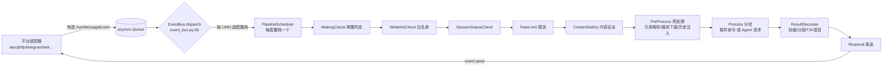
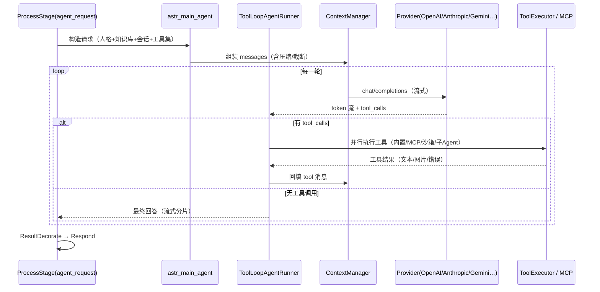

# 00 总览与架构主线

> 本章回答三个问题：AstrBot 是什么、它的代码怎么组织、一条消息在系统里是怎么走完的。
> 各子系统的深度分析见 `sections/01`–`sections/05`；工程化与质量见 `sections/06`。

## 1. 项目定位

官方定义（`README_zh.md:41`）：**"开源的一站式 Agent 聊天机器人平台，可接入主流即时通讯应用，为个人、开发者和团队提供可靠、可扩展的对话式 AI 基础设施"**。

拆开看，它同时是三样东西：

| 身份 | 体现 | 目标用户 |
| --- | --- | --- |
| 开箱即用的聊天机器人 | `uv tool install astrbot` 三条命令跑起来，WebUI 里点选大模型和平台即可 | 个人用户、非程序员 |
| 机器人开发框架 | 插件（Star）体系 + 装饰器 API + 1000+ 插件市场 | 插件开发者 |
| Agent 基础设施 | 工具调用循环、MCP、Skills、知识库 RAG、代码执行沙箱、子 Agent | 想把 Agent 接入自有 IM 的团队 |

关键数字（本仓库 v4.29.3 实测）：**18 个平台适配器、46 个 LLM/语音/向量 Provider、9 阶段消息管线、191 个前端组件、211 个版本 changelog、116 个测试文件**。

## 2. 技术栈与运行形态

| 层 | 选型 | 证据 |
| --- | --- | --- |
| 语言/运行时 | Python 3.12+，全异步（asyncio） | `pyproject.toml:7` |
| Web/API | FastAPI + ASGI（另有 Quart 依赖） | `pyproject.toml:27,45`；`astrbot/dashboard/server.py` |
| 前端 | Vue 3 + Vite + Vuetify + Pinia，产物体打进 Python 包 | `dashboard/package.json`；`pyproject.toml:130-136` |
| 存储 | SQLite + SQLModel/SQLAlchemy(async)，FAISS 向量库 | `pyproject.toml:50-51,26`；`astrbot/core/db/` |
| 检索 | FAISS 向量 + BM25(`rank-bm25`) + jieba + RRF 融合 | `astrbot/core/knowledge_base/retrieval/` |
| Agent 协议 | MCP（`mcp>=1.8`）、工具调用、Skills | `pyproject.toml:32` |
| 沙箱 | 本地进程沙箱（bubblewrap/seatbelt）、Docker、远程 Shipyard | `astrbot/core/computer/` |
| 打包 | hatchling + 自定义钩子（构建时编前端） | `pyproject.toml:134-140` |

四种部署形态共用同一份核心：`python main.py`（源码/uv）、Docker、桌面端（`astrbot.core.desktop_runtime`）、`astrbot` CLI（`astrbot/cli/`）。

## 3. 代码地图

```
main.py / runtime_bootstrap.py        ← 进程入口：SSL 环境修补 → 日志/DB → InitialLoader
astrbot/
├── core/                             ← 运行时内核（约 30 个包）
│   ├── core_lifecycle.py             ← 装配器：初始化 15+ 管理器，跑事件总线/定时任务
│   ├── event_bus.py                  ← 事件队列消费 + 按配置档分派到管线
│   ├── initial_loader.py             ← 核心 + Dashboard 并发启动
│   ├── pipeline/                     ← 9 阶段消息处理管线（洋葱模型）
│   ├── platform/                     ← 平台抽象 + 18 个 sources 适配器
│   ├── agent/                        ← Agent 运行时（runners/context/tool/mcp/handoff）
│   ├── astr_main_agent*.py           ← Agent 主链路编排（约 2000 行）
│   ├── provider/                     ← LLM/TTS/STT/Embedding/Rerank 抽象 + 46 个 source
│   ├── star/                         ← 插件（Star）加载、注册表、过滤器、上下文
│   ├── knowledge_base/               ← 解析→切块→向量化→混合检索
│   ├── computer/                     ← Agent 的"手"：文件/Shell/浏览器/Python + 沙箱
│   ├── db/ config/ cron/ backup/     ← 存储、配置 DSL、定时任务、备份
│   └── utils/                        ← 路径、锁、trace、T2I 渲染、上传……
├── api/                              ← 插件作者可见的公共 API 面（all.py 聚合导出）
├── builtin_stars/                    ← 内置插件：主 Agent 能力 + 命令 + Skills
├── dashboard/                        ← Dashboard 后端（FastAPI 路由 + service 层）
└── cli/                              ← astrbot 命令（init/run/plug/password）
dashboard/                            ← 前端源码（独立 pnpm 工程）
tests/                                ← pytest 分层测试
docs/                                 ← VitePress 文档站（中英）
```

## 4. 两条主干链路

### 4.1 消息链路：从平台回调到回复发出



关键实现事实：

- 事件由适配器放进**同一个 `asyncio.Queue`**（`core_lifecycle.py:208`），`EventBus.dispatch` 是唯一的消费者，为每个事件 `create_task(scheduler.execute(event))` 后立即回到循环（`event_bus.py:55-75`）——**天然并发，单会话内不保证顺序**，串行化要靠阶段内的锁（见 02 章）。
- **管线是洋葱模型**：`Stage.process()` 返回异步生成器时，调度器在 `yield` 处递归进入后续阶段，返回后再执行后置逻辑；返回普通协程则线性执行（`pipeline/scheduler.py:46-82`）。这让每个阶段都有"前置/后置"两个钩子点，同时支持 `event.stop_event()` 短路。**这是全仓库最值得学的设计之一**。
- **阶段顺序是硬编码常量**（`pipeline/stage_order.py:3-13`），不是配置项。
- 同一进程内可以有多套配置档（profile），每套档位对应独立的 `PipelineScheduler` 实例（`core_lifecycle.py:460-474`）——这是"一个 AstrBot 服务多套人格/模型/插件集"的实现基础。

### 4.2 Agent 链路：LLM 工具循环



- 编排入口 `astr_main_agent.py`（2039 行），循环实现 `agent/runners/tool_loop_agent_runner.py`（1660 行）；另有 Dify/Coze/DashScope/DeerFlow 四个"外部 Agent"runner，**把工具与上下文的责任交给第三方平台**（`agent/runners/*/`）。
- 上下文由 `agent/context/` 分层管理：`manager` 组装、`compressor` 压缩、`truncator` 截断、`token_counter` 计量。
- 工具来源收口在 `provider/func_tool_manager.py`，插件用装饰器注册的 handler 也折算成 LLM 工具——**插件生态与 Agent 工具是同一套注册表**，这是它"插件即工具"的关键。

## 5. 已识别出的九个关键设计决策

1. **洋葱式阶段管线**：用异步生成器换取统一的前置/后置钩子，比"中间件列表"更简洁，比"事件回调"更可控。
2. **配置档（profile）即运行时分区**：一套配置 → 一个 PipelineScheduler，插件/模型/人格按档位隔离，多租户雏形。
3. **UMO（统一消息来源标识）作为全局寻址主线**：会话、限流、人格、插件开关、配置路由都以 UMO 为键（`core/umo_alias.py`、`core/umop_config_router.py`）。
4. **Provider 能力矩阵**：把 chat / embedding / rerank / tts / stt 拆成独立能力接口（`provider/modalities.py`、`provider/entities.py`），46 个实现可以自由组合，不绑定单一厂商。
5. **插件装饰器 + 全局注册表**：作者只写 `@filter.command("hi")`，注册表全局可查（`star/star_handler.py`）；代价是隔离性。
6. **Agent 运行时是可插拔的**：本地 ToolLoop 与 Dify/Coze/DashScope/DeerFlow 平级，切换只需改配置。
7. **配置即 DSL**：`config/default.py` 用 4964 行的默认值 + 元数据同时驱动后端默认值与前端配置面板（自动生成表单）。
8. **给 Agent 配"手"+ 沙箱**：`core/computer/` 提供文件/Shell/浏览器/Python 能力，并用进程沙箱或远程容器隔离（`computer/process_sandbox/`）——这是它区别于"聊天壳"的地方。
9. **一切可视化**：30 个后端路由模块 + 191 个前端组件覆盖插件市场、配置、人格、知识库、会话、日志、追踪，目标是"不写代码也能运营"。

## 6. 演进线索（从仓库痕迹读出来的）

- **v3 → v4 是一次大重构**：`db/migration/migra_3_to_4.py`、`changelogs/v4.0.0.md` 等 211 个版本文件记录了从"配置驱动"到"Agent 平台"的迁移；`astrbot/core/*` 下的兼容层（`umo_alias`、`desktop_runtime`、`sentinels`）都是迁移留下的疤痕组织。
- **能力扩张顺序**：LLM 对话 → 插件生态 → 多平台 → 知识库/人格 → Agent 工具与 MCP → 代码执行沙箱 → 子 Agent/Skills → 桌面端/ChatUI。今天的功能面是这个顺序的叠加。
- **多形态压力**：同一份核心要跑在服务器、Docker、桌面 App、Launcher 四种环境，`runtime_env`/`desktop_runtime`/`dashboard_assets` 这些模块就是为抹平差异而生。

## 7. 建议的阅读路径

| 时间预算 | 读什么 | 目的 |
| --- | --- | --- |
| 30 分钟 | `main.py` → `core/initial_loader.py` → `core/core_lifecycle.py`（initialize） | 搞清"东西是怎么被装起来的" |
| 1 小时 | `core/pipeline/scheduler.py` + `stage_order.py` + 一个 stage（如 `process_stage/stage.py`） | 搞清"消息怎么流动" |
| 半天 | `core/star/star_manager.py` 的加载流程 + `astrbot/api/all.py` + 一个内置命令插件 | 搞清"插件怎么接进来"，能写第一个插件 |
| 1 天 | `astr_agent_tool_exec.py` → `agent/runners/tool_loop_agent_runner.py` → `agent/context/manager.py` | 搞清"Agent 循环与上下文"，能改 Agent 行为 |
| 2 天 | `core/provider/provider.py` + `provider/sources/openai_source.py` | 能接一个新模型/新能力 |
| 按需 | `core/platform/platform.py` + 任一 `sources/*` | 能接一个新 IM 平台 |

## 8. 适合谁 / 不适合谁

**适合**：想要"一个程序同时接 QQ/Telegram/飞书并挂上大模型"的个人与团队；想用插件快速验证 Bot 玩法的人；想把 Agent 工具能力暴露到 IM 里、又不想自己写平台适配的人；想学"异步管线 + 插件框架 + 多厂商 LLM 抽象"怎么落地的工程师。

**不适合**：需要强多租户与资源隔离的 SaaS 场景（进程内全局注册表 + 模块级单例不支撑）；对启动时间/镜像体积极度敏感的边缘部署；只需要一个极简 OpenAI 转发壳的场景（它的抽象与依赖会成为负担）。