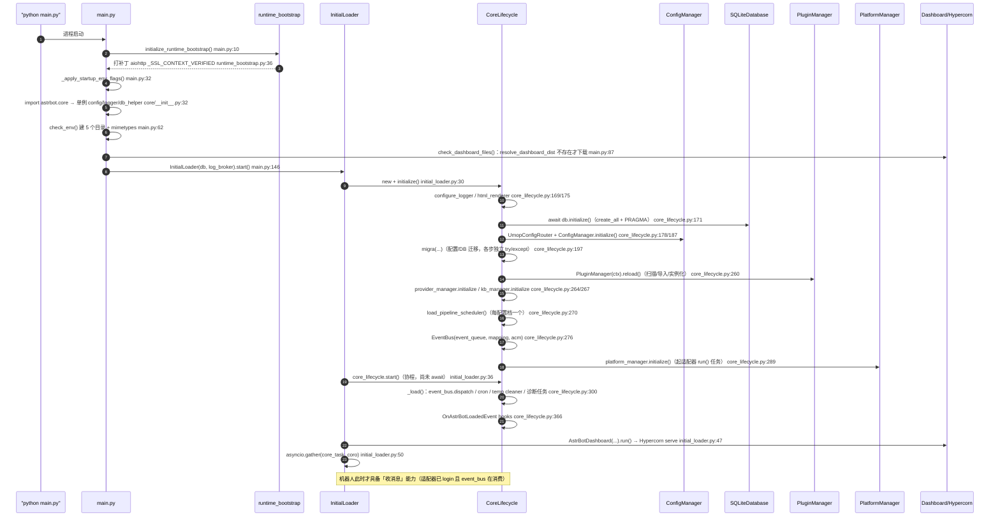

# 01 启动流程与运行时内核

> 分析对象：AstrBot v4.29.3（仓库 `AstrBot-master/AstrBot-master`）。本文档只描述**实际读到的代码**；行号为真实读取位置，未确认之处标注「未验证」。
> 说明：任务书假设存在 `astrbot/core/db/repository.py` 作为数据仓储抽象，但该文件不存在。实际存在的 `astrbot/core/repository.py` 是**插件/更新用的 GitHub/Git 仓库地址解析器**（`astrbot/core/repository.py:43` `GitHubRepository`）。数据层没有独立的 repository 抽象，`BaseDatabase` 的 ABC 即是数据访问契约（`astrbot/core/db/__init__.py:34`）。

## 1. 职责与边界

本层负责三件事：**把进程拉起来**（引导、路径、日志、单例装配）、**把组件按顺序接上**（配置 → DB → 插件 → Provider → Pipeline → 平台 → WebUI）、**把事件循环里的长跑任务管住并优雅收尾**。

- 进程入口有三个，互不复用：
  - `python main.py`：`main.py:151-176`，走 `asyncio.run(main_async(...))`，`--webui-dir` / `--reset-password` 由 argparse 解析（`main.py:152-167`）。
  - CLI：`astrbot.cli.__main__`（click group，`astrbot/cli/__main__.py:20-57`）→ `cmd_run.run`（`astrbot/cli/commands/cmd_run.py:38-66`），CLI 路径多了一层 `FileLock` 单实例锁（`cmd_run.py:63-65`）。
  - 容器：`Dockerfile:41` `CMD ["python", "main.py"]`，`compose.yml:13` 映射 6185。
- 边界：本层**不做**消息语义（属 `core/pipeline/**` 各 Stage）、不做协议编解码（属 `core/platform/sources/**`）、不做 HTTP 路由实现（属 `astrbot/dashboard/**`）。它提供的是「生命周期 + 全局单例 + 任务表」。
- 全局单例在**导入期**建立：`astrbot/core/__init__.py:32-44` 一次性构造 `astrbot_config`、`logger`、`db_helper`、`sp`、`pip_installer`。这意味着任何 `import astrbot.core` 的副作用包含「读配置、配日志器、建 DB 对象、`os.makedirs(data)`」。

## 2. 关键模块与类

| 模块 | 职责 | 关键类/函数 | file:line |
| --- | --- | --- | --- |
| `main.py` | 进程入口：引导、env 标记、dashboard 资源解析、启动 `InitialLoader` | `check_env` / `check_dashboard_files` / `main_async` | `main.py:62` / `main.py:87` / `main.py:131` |
| `runtime_bootstrap.py` | 启动前替换 aiohttp 的已验证 SSLContext（走 certifi） | `initialize_runtime_bootstrap` | `runtime_bootstrap.py:47` |
| `core/initial_loader.py` | 装配「核心生命周期 + Dashboard」两个长期协程 | `InitialLoader.start` | `initial_loader.py:26` |
| `core/core_lifecycle.py` | 组件装配、任务表、启动 hook、停止/重启 | `AstrBotCoreLifecycle.initialize/start/stop/restart` | `core_lifecycle.py:157/357/381/429` |
| `core/event_bus.py` | **单消费者队列调度器**（非发布订阅），按 conf_id 选 PipelineScheduler 并起任务 | `EventBus.dispatch` / `stop_platform` | `event_bus.py:55` / `event_bus.py:77` |
| `core/astrbot_config_mgr.py` | 多配置档（ABConf）管理：default + UUID 档案，UMO→conf 路由 | `AstrBotConfigManager._load_conf_mapping` | `astrbot_config_mgr.py:103` |
| `core/config/astrbot_config.py` | 配置读写：默认值补全、完整性校验、原子落盘 | `AstrBotConfig.__init__/save_config_async` | `astrbot_config.py:45/294` |
| `core/config/default.py` | 默认配置与版本常量 | `DEFAULT_CONFIG` / `VERSION` / `DB_PATH` | `default.py:90/36/38` |
| `core/db/__init__.py` | 数据访问抽象（ABC）+ async engine/session 工厂 | `BaseDatabase` | `db/__init__.py:34` |
| `core/db/sqlite.py` | SQLite 实现：建表、PRAGMA 调优、手写 ALTER 兜底、全部 CRUD | `SQLiteDatabase.initialize` | `sqlite.py:84` |
| `core/db/po.py` | SQLModel 表定义（会话/人格/定时任务/平台会话等） | `ConversationV2` / `CronJob` / `CommandConfig` | `po.py:72/186/532` |
| `core/db/migration/*` | v3→v4、4.5→4.6、token_usage、webchat session 迁移 | `do_migration_v4` / `migrate_45_to_46` | `db/migration/helper.py:37` / `migra_helper.py:498` |
| `core/utils/migra_helper.py` | 配置迁移（agent_runner 重构、provider→source）+ 启动迁移调度 | `migrate_config_on_load` / `migra` | `migra_helper.py:302/487` |
| `core/backup/*` | 备份/恢复：表导出为 JSON、目录打包、校验和、恢复前清库 | `AstrBotExporter.export_all` / `AstrBotImporter.import_all` | `backup/exporter.py:68` / `backup/importer.py:365` |
| `core/cron/manager.py` | APScheduler 封装：basic/active_agent 两类任务，DB 为准 | `CronJobManager.start/sync_from_db` | `cron/manager.py:116/136` |
| `core/updater.py` | 核心/WebUI 更新：下载 ZIP、校验、应用 | `AstrBotUpdater.update/ensure_dashboard` | `updater.py:138/327` |
| `core/zip_updater.py` | 更新包下载/解压/替换基类 | `_extract_archive` | `zip_updater.py:256` |
| `core/dashboard_assets.py` | WebUI dist 选择与安全替换（含回滚） | `resolve_dashboard_dist` / `_extract_package` | `dashboard_assets.py:179/377` |
| `core/process_restart.py` | 进程级重启（exec / Windows 新控制台） | `restart_process` | `process_restart.py:125` |
| `core/desktop_runtime.py` | 桌面托管态判定与本地会话密钥校验 | `is_desktop_managed_backend` | `desktop_runtime.py:14` |
| `core/log.py` | logging→loguru 桥、WebUI 日志广播、按插件分级 | `LogBroker` / `LogManager` | `log.py:241/371` |
| `core/utils/astrbot_path.py` | 所有数据目录的唯一来源 | `get_astrbot_root` / `get_astrbot_data_path` | `astrbot_path.py:29/38` |
| `core/utils/event_loop_diagnostics.py` | 事件循环卡顿监控 + 卡死栈转储线程 | `create_event_loop_diagnostic_tasks` | `event_loop_diagnostics.py:218` |
| `core/utils/session_lock.py` | 按事件循环隔离的按会话互斥锁 | `SessionLockManager` | `session_lock.py:33` |
| `core/utils/metrics.py` | 匿名指标聚合上报（TickStats） | `Metric.upload` | `metrics.py:216` |
| `core/utils/trace.py` | 单条消息 trace（OTel span + SQLite 持久化 + SSE 广播） | `TraceSpan` / `trace_execution` | `trace.py:62/423` |
| `dashboard/server.py` | ASGI + Hypercorn 承载 WebUI，认证/限流/静态资源 | `AstrBotDashboard.run` | `dashboard/server.py:621` |
| `cli/**` | click 子命令 `init/run/plug/conf/password` | `cmd_run.run` / `cmd_init.initialize_astrbot` | `cmd_run.py:38` / `cmd_init.py:21` |

## 3. 启动与关闭时序

关闭路径（`initial_loader.py:55-57` 捕获 `CancelledError` 后调用 `core_lifecycle.stop()`，`core_lifecycle.py:381-427`）：

1. 停临时目录清理器（`:383`）→ 2. `cancel()` 全部 `curr_tasks`（`:387-388`）→ 3. `cron_manager.shutdown()`（`:391`，`scheduler.shutdown(wait=False)` 见 `cron/manager.py:131`）→ 4. `shutdown_local_booter()`（`:393`）→ 5. 逐个 `_terminate_plugin`（`:395-402`）→ 6. provider/platform/kb 的 `terminate()`（`:404-406`）→ 7. `sp.close()`（`:408`）→ 8. `dashboard_shutdown_event.set()`（`:409`，唤醒 `server.py:733` 的 `shutdown_trigger`）→ 9. 再逐个 `await task` 收尸（`:412-418`）→ 10. `close_trace_store` + `engine.dispose()`（`:421-427`）。

### 3.1 取消与等待语义

- 取消是「自上而下」：`stop()` 遍历 `curr_tasks` 逐个 `cancel()`（`core_lifecycle.py:387-388`），但这些 `curr_tasks` 装的是 `_task_wrapper` 包装任务而不是原始任务（`core_lifecycle.py:332-335`），因此取消传播要经过 wrapper 的 `await task` 一层。
- 等待分两轮：第一轮只发取消（`:387-388`）与关闭 manager，第二轮才 `await` 每个任务并吞 `CancelledError`（`:412-418`）。中间那段是为了让 cron/plugin 的关闭逻辑在任务真正消失前先跑。
- 平台适配器不走 `curr_tasks`：它们由 `PlatformTasks(run, wrapper)` 双任务记录在 `_platform_tasks`（`platform/manager.py:17-20/61-64`），`terminate()` 时先 `cancel` 再 `gather(..., return_exceptions=True)`（`:81-84`）。
- `EventBus` 侧另有独立取消通道：`stop_platform()` 会清空队列中该平台的事件、取消对应 pipeline 任务并 `gather`（`event_bus.py:83-102`），这是「删除/重载单个适配器」时的细粒度关闭，与全局 `stop()` 互不调用。
- cron 使用 `AsyncIOScheduler`，关闭用 `shutdown(wait=False)` + `await asyncio.sleep(0)` 让出一次循环（`cron/manager.py:127-134`），不等待正在执行的 job；正在跑的 job 任务记录在 `_running_tasks`（`:114`），未见关闭时统一取消（未验证是否有其它清理路径）。
- Dashboard 的关闭是「事件 + 触发器」：`stop()` 里 `dashboard_shutdown_event.set()`（`core_lifecycle.py:409`），Hypercorn 的 `shutdown_trigger` 等这个事件（`dashboard/server.py:733-735`），从而让 `serve()` 正常返回而不是被强杀。

关键实现细节：
- `EventBus.dispatch` 是**唯一的队列消费者**：`await self.event_queue.get()` 后取对应 scheduler 并 `asyncio.create_task(scheduler.execute(event))`（`event_bus.py:57/73`），并用 `_pending_tasks` 持有强引用防止 GC（`event_bus.py:52/74`）。
- 平台适配器不是 `core_lifecycle.load_platform()` 拉起的（该方法 `core_lifecycle.py:447` 无调用者），而是 `PlatformManager.initialize()`（`platform/manager.py:104`）内 `load_platform` → `_start_platform_task`（`manager.py:243/52`）为每个适配器起 `run_task` + `wrapper_task` 两个任务，日志上下文由 `_run_platform` 绑定（`manager.py:66-75`）。
- 并发任务全集：事件总线 1 个、cron 1 个、temp cleaner 1 个、诊断 2 个（lag monitor + watchdog）、插件 `register_task` 遗留任务 N 个、每个平台 2 个、dashboard 1 个协程、外加 `update_llm_metadata()` 的 fire-and-forget 任务（`core_lifecycle.py:294`，未持有引用）。

## 4. 数据与配置流

**配置流**（三条来源合并）：

1. 默认值来自 `DEFAULT_CONFIG`（`config/default.py:90`，`config_version: 5`）；`AstrBotConfig` 构造时若文件不存在则整份写入并标记 `first_deploy`（`astrbot_config.py:66-70`），随后按默认值递归补全缺失键、纠正键序（`astrbot_config.py:113` → `check_config_integrity:192-280`），有变化才回写（`:128-129`）。
2. 磁盘文件 `data/cmd_config.json`（`astrbot_config.py:22`），读取时去 BOM（`:72-77`），并先跑 `migrate_config_on_load`（`:91`，实现见 `migra_helper.py:302`：trace 键迁移、agent_runner 重构、`config_version` 升到 5）。
3. 多配置档：`AstrBotConfigManager.confs` 是 `uuid|default → AstrBotConfig` 字典（`astrbot_config_mgr.py:43-45`），档案元数据（`abconf_mapping`）存 SharedPreferences（`:60`），档案文件放 `data/config/<path>`（`:93`）。**UMO→档案的路由已从配置档里剥离**，改由 `UmopConfigRouter` 提供（`:121`），配置档元数据里的 `umop` 字段加载时会被 `pop` 掉（`:126`）。

- 写入：`save_config()` 同步写（`astrbot_config.py:282`），`save_config_async()` 用 `asyncio.to_thread` + 版本号比较避免旧快照覆盖新快照（`:294-313`、`_write_config_snapshot:333-377` 走 `tempfile.mkstemp` + `fsync` + `os.replace`）。
- 热重载：配置对象被各处共享（`Context._config`、`PipelineContext.astrbot_config`），因此「保存」即近似「生效」；`EventBus` 每次派发都重新 `get_conf_info(umo)`（`event_bus.py:61`），所以档案切换无需重启。插件配置按 `_conf_schema.json` 注入（`star_manager.py:212`）。
- 插件侧读取配置的容错极宽：`AstrBotConfig.__getattr__` 缺键返回 `None` 而非抛错（`astrbot_config.py:379-383`）。

**数据流**：

- 路径唯一来源是 `astrbot_path.py`；`get_astrbot_root()` 优先 `ASTRBOT_ROOT`，桌面打包态落到 `~/.astrbot`，否则 **`os.getcwd()`**（`astrbot_path.py:29-35`）；DB 文件 `data/data_v4.db`（`default.py:38`）。
- `SQLiteDatabase.initialize()` 一次事务内完成：`create_all` → WAL / busy_timeout=30000 / synchronous=NORMAL / cache_size / temp_store / mmap_size / optimize（`sqlite.py:86-94`），再跑 5 个手写的前向兼容补列与两个索引（`:96-104`）——即「SQLModel 建表 + 手写 ALTER 兜底」双轨。
- Engine 层为 SQLite 单独把 `connect_args={"timeout": 30}` 打开，理由是单写者（`db/__init__.py:46-53`）。
- 业务 CRUD 全在 `SQLiteDatabase` 一个类里（`sqlite.py:229-2746`，100+ 方法），`BaseDatabase` 用 1000+ 行 ABC 声明契约（`db/__init__.py:60-1016`）。
- 迁移：配置文件级迁移在 `AstrBotConfig` 构造期（`astrbot_config.py:91`）；DB 级迁移需要已初始化的 DB 与配置管理器，集中在 `migra()`（`migra_helper.py:487-535`），依次跑 `migrate_45_to_46` / `migrate_webchat_session` / `migrate_token_usage` / `finalize_config_migrations` / `_migra_provider_to_source_structure`，**每一步各自 try/except 后仅 `logger.error`**。
- 向量库：`BaseVecDB` 抽象（`db/vec_db/base.py:11`）+ FAISS 实现（`db/vec_db/faiss_impl/`），生命周期由 `KnowledgeBaseManager` 管理，不参与主启动链路（本文未深入，未验证其初始化时机）。
- 备份/恢复：导出把各表**序列化为 JSON** 而非拷贝 db 文件（`backup/exporter.py:99-104`、`_export_main_database:211`），带 manifest 与 checksum（`:414`）；恢复前先 `_clear_main_db`（`importer.py:548`），并按 SQLModel 字段类型回填 datetime（`importer.py:977`）。`dashboard_trusted_devices` 明确排除在备份外（`backup/constants.py:71-73`）。

**配置优先级（从高到低，实测于代码）**：

| 层级 | 来源 | 生效点 | 覆盖范围 |
| --- | --- | --- | --- |
| 1 | 环境变量（`DASHBOARD_PORT/HOST/SSL_*`、`ASTRBOT_*`） | `dashboard/server.py:632-650` | 端口/监听地址/SSL，也间接决定能否跳过默认密码 |
| 2 | 会话绑定的配置档（ABConf） | `astrbot_config_mgr.py:152-165`、`event_bus.py:61` | 平台/Provider/人格/限流等「按会话」配置 |
| 3 | 默认配置档 `data/cmd_config.json` | `astrbot_config_mgr.py:43-45`、`default_conf` 属性 `astrbot_config_mgr.py:167-170` | 全局兜底，也是 Provider 的共享池 |
| 4 | 代码内 `DEFAULT_CONFIG` | `config/default.py:90` | 缺键时补齐 |

- 「配置档」只有在 `data/config/<path>` 文件存在时才被加载，缺失只 `warning` 后跳过（`astrbot_config_mgr.py:94-101`），因此档案文件丢失会静默退化为默认配置。
- `platform_settings` 是**强制取自默认档**的特例：`PlatformManager` 注释明确要求所有 `unique_session` 引用都用默认配置（`platform/manager.py:32-38`），而 `EventBus` 做会话隔离时用的却是**选中档案**的 `platform_settings`（`event_bus.py:115-124`）——两处语义不同，改造时需注意。

**启动阶段的同步 I/O / 阻塞点清单**：

1. `import astrbot.core` 时读配置 + 建日志器 + `os.makedirs`（`core/__init__.py:28/32-38`）。
2. `check_env()` 里 5 次 `os.makedirs`（`main.py:75-79`）。
3. `check_dashboard_files()` → `AstrBotUpdater().ensure_dashboard()`，可能在启动关键路径上**同步等待网络下载并解压 dist**（`main.py:113`、`updater.py:327-383`），失败则整个 WebUI 不可用但进程继续（`main.py:134-139`）。
4. `AstrBotConfig` 构造期的默认值补齐与整份回写（`astrbot_config.py:113-129`）。
5. `PluginManager.reload()/load()` 的 import、`requirements.txt` 依赖安装（`star_manager.py:333-380`），首个插件缺依赖时会现场 pip 安装（细节未深入，未验证耗时）。
6. WebUI dist 的拷贝/替换：`shutil.copytree` / `Path.replace`（`dashboard_assets.py:353/427`）。

## 5. 设计模式与扩展点

- **生命周期门面（Facade）**：`AstrBotCoreLifecycle` 是唯一装配点，所有 manager 以属性形式暴露给 Dashboard/插件（`core_lifecycle.py:211-280`）。
- **管理器组合（Manager 组合根）**：Provider/Platform/Conversation/Persona/KnowledgeBase/Cron 各自「构造时注入依赖，`initialize()` 时生效」，无 DI 容器。
- **队列 + 调度器（生产者-消费者）**：平台适配器只往 `event_queue` 塞事件（`platform/manager.py:24` 构造入参），`EventBus` 单点消费并按配置档选 `PipelineScheduler`（`event_bus.py:66-73`）。
- **洋葱模型管道**：Stage 返回 `AsyncGenerator` 时递归处理后续阶段（`pipeline/scheduler.py:53-72`），前置/后置逻辑靠 `yield` 切分。
- **钩子（Hook）扩展点**：`OnPlatformLoadedEvent` 在适配器加载后触发（`platform/manager.py:247-257`）、`OnAstrBotLoadedEvent` 在 `start()` 里触发（`core_lifecycle.py:366-376`），都由 `star_handlers_registry` 注册表驱动。
- **注册表（Registry）**：`star_handlers_registry` / `star_map` / `star_registry` 是插件能力的全局可改注册表，`PluginManager.reload()` 会整体 `clear()` 再重建（`star_manager.py:1054-1056`）。
- **工厂 + 延迟导入**：平台适配器按 `platform_config["type"]` 走 `match/case` 逐类型 import（`platform/manager.py:153-200`），避免启动即加载全部 SDK。
- **双轨 Schema 演进**：`SQLModel.metadata.create_all` + `PRAGMA table_info` 判活后 `ALTER TABLE`（`sqlite.py:96-104/128-223`）。
- **原子替换**：配置文件（`astrbot_config.py:351-377`）与 WebUI dist（`dashboard_assets.py:393-452`，含失败回滚）都用「临时目录 + replace」。
- **注册任务兼容层**：`Context.register_task`（已 deprecated，`star/context.py:940-953`）把协程塞进列表，由 `_load()` 统一 create_task（`core_lifecycle.py:319-321`）。

## 6. 问题、风险与技术债

| # | 现象 | 证据 file:line | 影响 |
| --- | --- | --- | --- |
| 1 | **迁移失败只落日志、无状态记录**：`migra()` 内 5 个迁移步骤各自 `try/except Exception` 后仅 `logger.error`，外层 `initialize()` 再包一层 try；「迁移是否成功、走到哪一步、要不要补偿」用户与运维均无从得知（无版本标记、无重试、无健康信号） | `migra_helper.py:504-535`、`core_lifecycle.py:196-205` | 升级后若某步失败（字段不兼容、旧数据异常），系统会带病运行：表现为配置项缺失或历史会话异常，而不是明确报错；排障只能翻启动日志。另：`db/migration/helper.py:37` 的 v3→v4 入口 `do_migration_v4` 全仓库无调用者（已核实），旧库升级路径实际不可达 |
| 2 | `EventBus` 名不副实：没有 `publish/subscribe`，只有单消费者 `while True: get()`；`dispatch` 循环体内无 per-event try/except | `event_bus.py:55-75` | 单个事件的配置查询/`create_task` 抛错即终止整个分发协程（`_task_wrapper` 只记日志不重启），此后所有平台消息静默堆积在队列里 |
| 3 | 关闭只在 `CancelledError` 分支触发；其它异常（如 Dashboard 端口占用 `raise Exception`）直接穿透 | `initial_loader.py:53-57`、`dashboard/server.py:676-687` | 端口冲突/初始化后异常时进程退出但不执行 `stop()`：插件不 terminate、DB 引擎不 dispose、`curr_tasks` 被 asyncio 粗暴取消 |
| 4 | 单实例保护不一致：CLI 有 `FileLock`，`python main.py` 与 Docker 路径没有 | `cmd_run.py:63-65` vs `main.py:151-176`、`Dockerfile:41` | 同目录双实例会同时写 `data_v4.db` 与 `cmd_config.json`（虽有 30s busy_timeout，仍可能互相覆盖配置） |
| 5 | `AstrBotCoreLifecycle.load_platform()` 是死代码（全仓库无调用者），平台启动实际在 `PlatformManager.initialize()` 内完成 | `core_lifecycle.py:447`；调用链 `platform/manager.py:104-117/243` | 误导：读代码者会以为平台任务归 `curr_tasks` 管，实际归 `_platform_tasks`，两套任务表并存 |
| 6 | 核心更新包解压**无 zip-slip 校验**：`z.extractall(target_dir)` 直接展开，而 WebUI 包解压逐个成员校验路径 | `zip_updater.py:261`（对比 `dashboard_assets.py:405-409`） | 恶意/损坏的 GitHub zipball 可写到目标目录之外；核心更新还先 `rmtree` 再 `move`（`zip_updater.py:330-333`），无备份、无回滚 |
| 7 | `stop()` 里先 `cancel()` 全部任务再关 manager；`_task_wrapper` 对 `CancelledError` 直接 `pass` | `core_lifecycle.py:387-388`、`core_lifecycle.py:348-349` | 取消与关闭谁先谁后无保证，插件 `terminate` 看到的可能是已被取消的上下文；任务内异常全部只落日志，退出码始终为 0 |
| 8 | `Context._register_tasks` / `registered_web_apis` 是**类级可变属性** | `star/context.py:133/138`，消费点 `core_lifecycle.py:320-321` | 所有 Context 实例共享同一列表；`start()` 二次调用（如重启路径复用）会把已 await 过的协程再 `create_task`，抛 "cannot reuse already awaited coroutine" |
| 9 | 指标上报把主机名与安装 ID 发给第三方，且请求与解析异常全部静默吞掉 | `metrics.py:192`（`tickstats.soulter.top`）、`:198`（`hn`）、`:212-213`、`:45-46`（`~/.astrbot/.installation_id`，写在 data 目录之外） | 隐私面（默认开启，需 `disable_metrics` 或 env 才关，`:28-37`）；上传失败无任何可观测信号；安装 ID 落在非受控路径 |
| 10 | 事件循环内做同步磁盘/网络 I/O 的路径仍在：`save_config()` 被大量同步调用（含 `platform/manager.py:136` 在 async 函数内）、`restart_process` 里 `time.sleep(3)` | `astrbot_config.py:282` vs 异步版 `:294`；`process_restart.py:139` | 配置保存时事件循环被阻塞（配置文件越大越明显），重启窗口期消息处理停摆 |
| 11 | DB 初始化非幂等：`SQLiteDatabase.initialize()` 不设置 `inited`，只有 `BaseDatabase.get_db()` 会置位 | `sqlite.py:84-105`、`db/__init__.py:63-70` | 启动时 `core_lifecycle.py:171` 显式初始化后，首个 `get_db()` 会再次执行整套 `create_all` + PRAGMA + `commit` |
| 12 | `db.initialize()` 失败没有本地兜底：`db.initialize()` 抛错会向上冒到 `InitialLoader` 的 try，只打印并 `return` | `initial_loader.py:29-34` | 初始化失败时进程静默退出（无 exit code 区分），容器 `restart: always` 会无限重启刷日志 |
| 13 | WebUI dist 解析做了两遍：`main.py` 先 `resolve_dashboard_dist` 得到路径，`AstrBotDashboard.__init__` 再 `resolve_dashboard_dist` 一次 | `main.py:100-128`、`dashboard/server.py:275` | 两遍之间若下载/替换发生，实际服务目录可与日志打印的不一致；解析逻辑（Desktop 拒绝不匹配版本）重复实现 |
| 14 | `update_llm_metadata()` / `Metric` 的 flush 任务 / `awatch` 热重载任务都是**不持有引用、不纳入 `curr_tasks`** 的 fire-and-forget 任务 | `core_lifecycle.py:294`、`metrics.py:104-106`、`star_manager.py:222-223` | 任务可能被 GC（Python 官方警告无法保留引用时任务可能消失），`stop()` 也不等待它们，关闭阶段可能仍在写库 |
| 15 | `stopped_platforms` 只增不减由 CoreLifecycle 自己管，清理动作却在 Dashboard 服务层手工 `discard` | `event_bus.py:53/83`、`dashboard/services/config_service.py:1399/1457` | 跨层耦合：任何绕开配置服务的适配器重建路径都会让该平台 ID 永久「拒收消息」 |
| 16 | 根路径默认取 `os.getcwd()` | `astrbot_path.py:35` | 换个 cwd 启动就换了一套 data/配置/插件，Dockerfile 靠 `WORKDIR /AstrBot`（`Dockerfile:2`）隐式保证；systemd/计划任务里极易踩 |
| 17 | `db/migration/helper.py` 的 v3→v4 迁移入口 `do_migration_v4` 无任何调用者 | `db/migration/helper.py:37`（全仓库仅自引用） | v3 老库的迁移能力实际已不可达，与风险 1 叠加后「升级即迁移」的承诺不成立 |
| 18 | Docker 镜像以 root 运行、无 `USER`、无 healthcheck；构建期用 `curl -fsSL … \| bash -` 拉 NodeSource 源 | `Dockerfile:19-20`、`Dockerfile:1-41`（无 USER/HEALTHCHECK） | 容器逃逸面与供应链风险；`restart: always` 下无法区分「健康」与「启动即崩」 |

补充（不算缺陷但需知悉）：`initial_loader.py:36` 把 `core_lifecycle.start()` 协程创建后**未立即 await**，若 `AstrBotDashboard` 构造抛错，该协程从未被调度，Python 会打印 "coroutine was never awaited" 并连带跳过 `stop()`。

## 7. 关键结论

- 启动链路是**强顺序的手写装配**，没有容器/依赖图：`initialize()` 一个函数 130 行内串起 12 个组件（`core_lifecycle.py:157-294`），顺序错了就是运行期 `AttributeError`。
- 真正让机器人「能收消息」的最小闭环是三步：`platform_manager.initialize()` 起适配器 `run()` 任务（`core_lifecycle.py:289`）→ `EventBus.dispatch` 已在消费队列（`core_lifecycle.py:300`）→ `PipelineScheduler` 已按配置档就绪（`core_lifecycle.py:270`）。WebUI 是否可用**不阻塞**消息能力（`main.py:134-139` 仅告警）。
- **迁移是「尽力而为」而非「要么成功要么失败」**：`migra()` 的 5 个步骤各自吞异常（`migra_helper.py:504-535`），外层再吞一次（`core_lifecycle.py:196-205`）；`do_migration_v4` 无调用者。启动能过，但「迁移成功」这件事既没被记录也没被验证——这是启动链路上最值得补的可观测性缺口（Lead 已核对：调用点 4 个实参与签名一致，不存在 TypeError）。
- `EventBus` 是「单消费者 + 每事件一 Task」的调度器，不是发布订阅总线；它的容错边界只在任务层（`_on_task_done` 记日志，`event_bus.py:126-133`），**分发循环本身没有异常隔离**。
- 关闭路径的健壮性取决于异常类型：`CancelledError` 才走 `stop()`，任何其它启动后异常都会跳过清理（`initial_loader.py:55`）。这是「优雅关闭」的主要缺口。
- 任务管理有三套并存：`curr_tasks`（核心，`stop()` 会 cancel + await）、`_platform_tasks`（平台，由 `PlatformManager.terminate` 管理）、以及无引用的 fire-and-forget（metrics/热重载/llm metadata）。三者生命周期不统一。
- 配置系统是「默认值即 Schema」的双层结构：`DEFAULT_CONFIG` 提供基线，`check_config_integrity` 递归补全并纠正键序（`astrbot_config.py:192-280`），落盘用 revision + `os.replace` 保证多写者下不倒退（`:315-377`）。
- 数据层是**单类独大**：`SQLiteDatabase` 2746 行承载全部仓储职责，`BaseDatabase` 用 ABC 声明 1000+ 行契约；没有 repository/mapper 分层，DB 迁移靠手写 `PRAGMA table_info` + `ALTER TABLE` 兜底而非版本化迁移框架。
- 更新机制分两套质量档位：WebUI 包有成员级路径校验、版本校验、失败回滚（`dashboard_assets.py:377-455`）；核心包只有 `extractall` + `rmtree` + `move`（`zip_updater.py:256-345`），无回滚。
- 进程重启依赖 `psutil` 杀子进程 + `execv`/`Popen`（`process_restart.py:19-122`），桌面托管态直接拒绝并抛错（`:135-137`）；重启不经过 `stop()`，走的是 `core_lifecycle.restart()` 的简化清理（`core_lifecycle.py:429-445`）。
- 可观测性是本层的亮点：事件循环卡顿监控 + 卡死栈转储（`event_loop_diagnostics.py:218-260`）、trace 全链路落到 SQLite 并经 LogBroker 推 SSE（`trace.py:62/205`）、日志按插件分级（`log.py:564-584`）。
- 部署形态只有一个假设：**cwd 即 AstrBot root**（`astrbot_path.py:35` + `Dockerfile:2`）。所有「换目录就换数据」的行为都由此派生，是运维侧最容易被忽视的隐式契约。