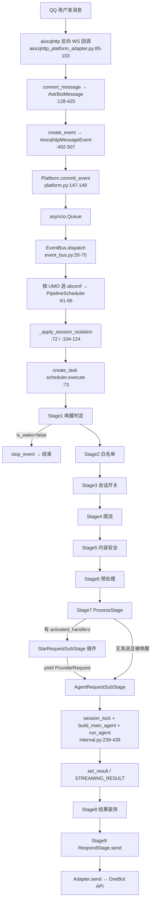

# 02 · 消息管线与平台适配

> 分析对象：AstrBot v4.29.3（仓库根 `AstrBot-master/AstrBot-master`），Python 3.12+。
> 行号均指相对仓库根的路径:行号，均为本次实际读取所得。标注「未验证」的为推断或未读到实现。
> 本分区只读分析，未修改仓库任何文件。

## 1. 职责与边界

本层负责"从平台回调到回复发出"的全部编排，边界清晰：

- **入口侧**：每个平台适配器把平台原始事件翻译成统一的 `AstrBotMessage`，包成 `AstrMessageEvent`，通过 `Platform.commit_event()` 投递到同一个 `asyncio.Queue`（`astrbot/core/platform/platform.py:147-149`、`astrbot/core/platform/sources/aiocqhttp/aiocqhttp_platform_adapter.py:509-510`）。
- **调度侧**：`EventBus.dispatch()` 消费队列，按 UMO 选择配置档（abconf）对应的 `PipelineScheduler`，**为每个事件创建一个独立 asyncio 任务**执行管线（`astrbot/core/event_bus.py:55-75`）。
- **管线侧**：9 个固定阶段顺序串成链，采用"异步生成器 + 递归"的洋葱模型（`astrbot/core/pipeline/scheduler.py:38-82`、`astrbot/core/pipeline/stage_order.py:3-13`）。
- **出口侧**：`RespondStage` 调用 `event.send()`，由各平台适配器子类完成真正的协议写入（`astrbot/core/pipeline/respond/stage.py:194-409`）。

不负责：配置/插件加载（`core_lifecycle.py`）、LLM 具体调用（`astrbot/core/astr_main_agent.py` 与 `agent/runners/**`）、数据库会话存储（`ConversationManager`）。管线只做编排与结果装饰，把"调用 LLM"委托给 `AgentRequestSubStage`，把"发消息"委托给平台事件子类。

## 2. 九阶段管线总览

注册机制：阶段类用 `@register_stage` 装饰器塞进全局列表（`astrbot/core/pipeline/stage.py:10-16`），内置模块由 `ensure_builtin_stages_registered()` 懒导入（`astrbot/core/pipeline/bootstrap.py:34-49`），`PipelineScheduler.__init__` 按 `STAGES_ORDER` 的索引排序（`astrbot/core/pipeline/scheduler.py:24-27`），`initialize()` 逐个实例化并注入 `PipelineContext`（`astrbot/core/pipeline/scheduler.py:31-36`）。该装饰器没有通过 `astrbot.api` 暴露，插件无法插入自定义阶段（全仓库只在 `astrbot/core/pipeline/**` 内出现，见 `stage.py:13`）。

| # | Stage | 文件:行 | 职责 | 短路/改写方式 |
|---|---|---|---|---|
| 1 | WakingCheckStage | `astrbot/core/pipeline/waking_check/stage.py:20`，process `:63` | 忽略自身消息、按 admins_id 判定 admin、唤醒词/At/AtAll/引用/私聊判定、逐个算插件 handler filter、按会话过滤插件、受理 follow-up | `event.stop_event()`（`:249-252`）；写入 `activated_handlers` / `handlers_parsed_params` extra（`:237-238`） |
| 2 | WhitelistCheckStage | `whitelist_check/stage.py:12`，process `:31` | 会话白名单校验（UMO 或 group_id 命中即放行） | 未启用/空表/webchat/admin 豁免提前 `return`；否则 `stop_event()`（`:71`） |
| 3 | SessionStatusCheckStage | `session_status_check/stage.py:12`，process `:19` | 会话级总开关（`SessionServiceManager.is_session_enabled`） | 关闭时补建会话（workaround #2309）后 `stop_event()`（`:24-40`） |
| 4 | RateLimitStage | `rate_limit_check/stage.py:15`，process `:43` | 固定窗口限流（deque 时间戳），stall 或 discard | discard 分支 `return event.stop_event()`（`:86-92`）；stall 分支 `await asyncio.sleep()` 挂起整条管线（`:77-85`） |
| 5 | ContentSafetyCheckStage | `content_safety_check/stage.py:15`，process `:25` | 文本内容安全（关键词/百度 AIP），额外把引用消息文本一起检测 | 命中时若为唤醒消息先 `set_result` 并 `yield`（让回复走完装饰/发送），再 `stop_event()`（`:45-55`） |
| 6 | PreProcessStage | `preprocess_stage/stage.py:25`，process `:99` | 平台预回应表情、路径映射、Record→wav、Image 落盘校验、引用链媒体归一化、STT | 不改流程，只原地改写 `event.get_messages()` 与 `message_str`（`:266-284`） |
| 7 | ProcessStage | `process_stage/stage.py:15`，process `:29` | 会话等待器分发、插件 handler 执行、必要时进入 LLM/Agent 子阶段 | 插件路径通过 `event.stop_event()` 或 `clear_result()`；LLM 分支见 `:62-76` |
| 8 | ResultDecorateStage | `result_decorate/stage.py:22`，process `:126` | 回复侧内容安全、`on_decorating_result` 钩子、前缀、分段、TTS、t2i、aiocqhttp 合并转发、At/引用装饰 | 流式结果整体跳过（`:134-137`、`:192-193`）；无结果直接 `return`（`:130-132`） |
| 9 | RespondStage | `respond/stage.py:44`，process `:194` | 去重、路径映射、空链过滤、分段发送、流式交付、`on_after_message_sent` | `STREAMING_FINISH` 只打标记不再发（`:204-206`）；发完 `clear_result()`（`:409`） |

**阶段契约**（`astrbot/core/pipeline/stage.py:19-45`）：抽象方法只有 `async initialize(ctx)` 与 `async process(event) -> None | AsyncGenerator[None]`。`PipelineContext` 是 4 个字段 + 2 个工具函数的数据类：`astrbot_config`、`plugin_manager`、`astrbot_config_id`、`db_helper`，以及 `call_handler` / `call_event_hook`（`astrbot/core/pipeline/context.py:15-24`）。

**中断语义**只有一种：`event.stop_event()` / `event.continue_event()`（`astrbot/core/platform/astr_message_event.py:399-421`），其中 `_force_stopped` 是独立于 `_result` 的强制标志（`astr_message_event.py:100-101`），避免 `clear_result()` 把"停止"一起清掉。调度器在每个阶段前后各检查一次 `event.is_stopped()`（`scheduler.py:58-62`、`:68-72`、`:78-82`）。
注意 `stage.py:42` 的注释说"返回 None 表示不需要继续处理"，这与实现不符：实现是按"`process()` 是否为异步生成器函数"分派（`scheduler.py:49-76`），返回 None 只会被 `await` 后继续下一个阶段。真正的短路只靠 `stop_event()`。

## 3. 端到端消息链路



按阶段逐条对应（以 QQ/aiocqhttp 为例）：

1. **收包**：`CQHttp` 的 `on_message("group"/"private")`、`on_request`、`on_notice` 四类回调都走 `convert_message` → `handle_msg`（`astrbot/core/platform/sources/aiocqhttp/aiocqhttp_platform_adapter.py:64-103`、`:509-510`）。
2. **入队**：`commit_event` 用 `put_nowait`（`platform.py:147-149`），适配器完全不关心后续处理，天然解耦。
3. **选档**：`astrbot_config_mgr.get_conf_info(event.unified_msg_origin)` 决定用哪个配置档的 scheduler（`astrbot/core/event_bus.py:61-66`），因此同一个进程可以跑多套配置。
4. **会话隔离**：`unique_session=true` 时用 `UNIQUE_SESSION_ID_BUILDERS` 重写 `session_id`（`event_bus.py:26-35`、`:104-124`），注意这一步发生在"选档"之后。
5. **唤醒判定**：唤醒词命中（`waking_check/stage.py:92-115`）；否则检查 At/AtAll/引用 bot（`:116-134`）；私聊默认唤醒（`:136-143`）；再算每个插件 handler 的 filter（`:158-235`）。任一成立则 `is_wake=True`，全不成立在末尾 `stop_event()`（`:249-252`）。
6. **鉴权与限流**：白名单（`whitelist_check/stage.py:60-71`）、会话开关（`session_status_check/stage.py:24-40`）、限流（`rate_limit_check/stage.py:57-92`）。
7. **内容安全**：请求侧文本 + 引用文本（`content_safety_check/stage.py:31-44`），策略由 `StrategySelector` 组合关键词与百度 AIP（`content_safety_check/strategies/strategy.py:6-36`）。
8. **预处理**：`pre_ack_emoji` 预反应（`preprocess_stage/stage.py:104-124`，仅 telegram/lark/discord）、媒体落盘与 STT（`:165-284`）。
9. **分流**：先跑已激活插件（`process_stage/stage.py:47-60` → `star_request.py:39-123`）；若插件 `yield` 了 `ProviderRequest` 则进 Agent 子阶段（`process_stage/stage.py:50-58`）；否则在"未被发送过、被唤醒、未禁用 LLM"时进入 Agent（`:66-76`）。Agent 内部再按 `agent_runner.runner_type` 选 `InternalAgentSubStage` 或 `ThirdPartyAgentSubStage`（`process_stage/method/agent_request.py:30-37`）。
10. **装饰**：回复侧内容安全（`result_decorate/stage.py:140-156`）、`on_decorating_result` 钩子（`:158-189`）、前缀（`:202-206`）、分段（`:209-267`）、TTS（`:270-366`）、t2i（`:368-412`）、转发节点（`:414-426`）、At/引用（`:428-447`）。
11. **发送**：流式走 `send_streaming`（`respond/stage.py:241-309`），非流式按"分段/整体"发（`:340-404`），最后触发 `on_after_message_sent` 并清空结果（`:406-409`）。
12. **收尾**：WebChat / 企业微信智能机器人额外发一个结束帧（`scheduler.py:99-100`）。

### 3.1 这条链路上"并发"发生在哪里

按发生顺序列出，便于对照排查：

1. **跨事件并发**：`dispatch` 对每个事件 `create_task`（`event_bus.py:73`）——两个用户、甚至同一用户的连续两条消息，从这一刻起就是两个独立任务。
2. **前置阶段并发**：唤醒/白名单/会话开关/限流/内容安全/预处理这 6 个阶段没有任何会话级互斥，同一会话的两条消息会同时在这里跑（限流只保护自己的 deque，且用锁串行的是"取号"动作，不是整段处理）。
3. **插件段并发**：`StarRequestSubStage` 顺序执行本次事件的所有 handler，但**不与其他事件互斥**（`process_stage/stage.py:47-60`）。
4. **LLM 段串行**：`async with session_lock_manager.acquire_lock(event.unified_msg_origin)`（`internal.py:239`）是唯一的"同会话排队"点，排队期间前面的任务可能已经在 `send_typing`（`:221-225`）。
5. **限流 stall 期间的额外排队**：`rate_limit_check/stage.py:77-85` 在锁内 sleep，后续事件在该锁上阻塞。
6. **流式期间的双向并发**：`RespondStage` 边消费 LLM 流边调平台 API（`respond/stage.py:259-299`），工具/插件在此期间也能发送独立消息，靠 `streaming_response_event` ContextVar 区分（`astr_message_event.py:39-41`、`respond/stage.py:269-275`）。

## 4. 平台适配层设计

### 4.1 抽象与注册

- **`Platform` 抽象基类**：必须实现 `run()` 与 `meta()`（`astrbot/core/platform/platform.py:121-132`），可选重写 `terminate()`、`send_by_session()`、`create_event()`、`webhook_callback()`（`platform.py:126-180`）。内置状态机 `PlatformStatus`（PENDING/RUNNING/ERROR/STOPPED）与错误环（`platform.py:20-83`），`get_stats()` 汇总给 Dashboard（`:92-119`）。
- **注册表**：模块级 `platform_registry: list[PlatformMetadata]` 与 `platform_cls_map: dict[str, type]`（`astrbot/core/platform/register.py:5-8`），`register_platform_adapter(...)` 是带参装饰器，会自动补 `type`/`enable`/`id` 三个默认配置项并生成 `PlatformMetadata`（`register.py:11-63`）；支持按模块前缀注销以实现插件热重载（`register.py:66-91`）。
- **插件可扩展**：`astrbot/api/platform/__init__.py:11,13-21` 把 `register_platform_adapter`、`Platform`、`PlatformMetadata` 暴露给插件。
- **元数据**：`PlatformMetadata` 除 name/id/desc 外，关键能力位是 `support_streaming_message` 与 `support_proactive_message`（`platform_metadata.py:20-23`），并提供 `default_config_tmpl`、`logo_path`、`i18n_resources`、`config_metadata` 供 WebUI 渲染表单（`:13-36`）。
- **加载**：`PlatformManager.load_platform()` 先用一个巨型 `match platform_config["type"]` 懒导入 17 个内置适配器（`platform/manager.py:153-219`），再从 `platform_cls_map` 取类实例化、建后台任务、触发 `on_platform_loaded` 钩子（`:231-257`）。WebChat 特殊：不读配置，启动时无条件实例化（`:114-117`）。`webchat` 因此也是唯一"平台即内置功能"的适配器。

### 4.2 事件类型体系

基类 `AstrMessageEvent`（`astr_message_event.py:79`）承载：`message_str` 纯文本、`message_obj: AstrBotMessage` 完整结构、`platform_meta`、`session`、`role`、`is_wake`、`is_at_or_wake_command`、`_extras`、`_result`、`trace`（`:87-154`）。`AstrBotMessage` 是平台中立的信封：`type/self_id/session_id/message_id/group/sender/message/message_str/raw_message/timestamp`（`astrbot_message.py:53-92`），`message` 字段是组件列表。

各平台子类只做两件事：**协议转换**（`convert_msg`/`convert_message`）与**发送实现**（`send`/`send_streaming`/`send_typing`）。已确认存在的子类示例：`AiocqhttpMessageEvent`（`sources/aiocqhttp/aiocqhttp_message_event.py:23`）、`WebChatMessageEvent`（`sources/webchat/webchat_event.py:23`）、QQ 官方、飞书、钉钉等同构（各自 `sources/<平台>/*_event.py`）。

### 4.3 组件与多态映射

`components.py` 定义 20 种 `ComponentType`（`astrbot/core/message/components.py:46-70`）与 `BaseMessageComponent(pydantic BaseModel)`（`:73-110`），多态点是 **`toDict()` / `async to_dict()`**：基类给出 `{"type": self.type.lower(), "data": {...}}` 的通用序列化（`:98-110`），子类按协议覆盖，例如 `Plain.toDict` 输出 `{"type":"text","data":{"text":...}}`（`:120-124`），`Reply.toDict` 只输出 OneBot 标准的 `id`（`:615-617`）。这样"组件 → 平台协议"的映射落在组件自身，而不是适配器里的大 switch。

媒体组件额外承担"取回与落地"：`Record`/`Image`/`Video`/`File` 提供 `convert_to_file_path()`、`convert_to_base64()`、`register_to_file_service()`（`components.py:232-286`、`:535-588`、`:833-903`），预处理阶段正是靠这层把 URL/base64/本地路径统一成文件（`preprocess_stage/stage.py:165-218`）。

### 4.4 新增一个平台要写什么

1. `astrbot/core/platform/sources/<name>/<name>_adapter.py`：继承 `Platform`，实现 `run()`/`meta()`/`create_event()`/`send_by_session()`，类上打 `@register_platform_adapter("<type>", desc, default_config_tmpl=..., support_streaming_message=...)`。
2. `sources/<name>/<name>_event.py`：继承 `AstrMessageEvent`，实现 `send()`，按需重写 `send_streaming()`/`send_typing()`/`react()`/`get_group()`。
3. 若是**内置**平台，还需在 `platform/manager.py:153-219` 追加一个 `match` 分支做懒导入（否则依赖不会被提前导入）；如果做成**插件**平台，则靠插件自身 import 完成注册即可。
4. 会在 `astrbot_config` 的 `platform:` 列表里生成一条默认配置（`register.py:34-41`）。事件总线里的 `UNIQUE_SESSION_ID_BUILDERS`（`event_bus.py:26-35`）只有在需要 `unique_session` 时才要加一行，缺失时只是不隔离、不会报错（`:120-124`）。

落地清单（以新增 `foo` 平台为例）：

```
astrbot/core/platform/sources/foo/
├── __init__.py            # 可选
├── foo_adapter.py         # @register_platform_adapter("foo", ...) + Platform 子类
│                          #   run() / meta() / create_event() / send_by_session()
└── foo_event.py           # AstrMessageEvent 子类：send()，可选 send_streaming/send_typing/react
astrbot/core/platform/manager.py:153-219   # 内置平台需补 match 分支
```

> 若走插件形态，则只需插件模块里 import 上面两个文件，`PlatformManager.load_platform` 会直接从 `platform_cls_map` 命中；启动顺序也保证这一点——`plugin_manager.reload()` 在 `platform_manager.initialize()` 之前（`core_lifecycle.py:260` vs `:289`）。

### 4.5 接入形态差异（代表性平台）

AstrBot 把"接入形态"完全吞进适配器的 `run()`，对上只暴露 `Platform` 接口，因此同一套管线能同时服务四种差异极大的接入方式。

**(1) aiocqhttp：反向 WebSocket（客户端即机器人侧服务器）**
机器人在本地起 WS 服务，OneBot 实现（NapCat 等）反连过来。所以 `run()` 里没有"连接"动作，而是 `self.bot.run_task(host=..., port=...)`（`aiocqhttp_platform_adapter.py:427-445`），事件由 SDK 的 `@self.bot.on_message("group")` 等回调推送（`:64-103`）。`support_streaming_message=False`（`:30-34`、`:48-53`），所以流式只能走 fallback；`terminate()` 手动关闭所有反向 WS 连接（`:447-483`）。配置项是 `ws_reverse_host/port/token`。

**(2) qqofficial：官方 SDK + intents + 自管 WS 重连**
用 `botpy.Client` 按 `intents` 订阅事件（`qqofficial_platform_adapter.py:304-319`），`botClient` 覆写 `on_group_at_message_create` 等回调后统一 `_commit()`（`:198-260`）。因为官方 SDK 的 WS 会断，它包了一层 `ManagedBotWebSocket` 在 `on_closed` 里忽略"关机期重连"（`:166-182`），并在 `bot_connect` 里自行驱动 `ws_connect`（`:262-274`）。发送侧需要缓存 `_session_last_message_id` / `_session_scene` 才能实现主动 `send_by_session`（`:325-326`、`:331-400`），这是"官方 API 必须带 msg_id 才能被动回复"的直接后果。

**(3) lark / qqofficial_webhook：Webhook（含统一 Webhook 入口）**
同一份飞书适配器支持 `socket` 与 `webhook` 两种模式，由 `lark_connection_mode` 决定：webhook 模式实例化 `LarkWebhookServer` 并注册回调（`lark_adapter.py:65`、`:99-102`），`run()` 只打印 webhook 地址不阻塞（`:805-815`），`client._connect()` 只在 socket 模式调用（`:816-818`）；对外暴露 `webhook_callback` 与 `unified_webhook()`（`:820-825`、`:846-850`）。Webhook 天生重复投递，因此适配器做了 `event_id` 去重（`:777-797`、`:529-543`）——这是长连接形态不需要的额外逻辑。`qqofficial_webhook` 同构，`webhook_callback` 在 `qo_webhook_adapter.py:213-221`。

**(4) dingtalk：官方 Stream SDK（同步库，塞进线程）**
钉钉 SDK 是同步阻塞的，适配器注释直接写明"并没有实现真正的异步，start() 里面有堵塞方法"（`dingtalk_adapter.py:794-798`），于是 `run()` 用 `asyncio.run_coroutine_threadsafe` + `threading.Event` 在独立线程里跑，并自己实现指数/固定退避重连（`:800-833`）。事件回调 `AstrCallbackClient.process` 返回 `AckMessage.STATUS_OK`（`:81-88`），"确认"这一步是 Stream 协议强制的，其它形态没有。

**(5) webchat：内置适配器 + 后端队列**
不读平台配置、启动时无条件实例化（`platform/manager.py:114-117`）；"网络层"其实是 WebUI 的 WebSocket 与 `webchat_queue_mgr` 的回/前台队列。`send` 往 back queue 推消息、`send_streaming` 逐块推（`webchat_event.py:165-263`），`send_typing` 被重定义为"run_started"信号（`:182-194`），`send_by_session` 还要处理"主动消息落到哪个进行中的 request_id"（`webchat_adapter.py:86-134`）。

| 形态 | 代表平台 | 谁主动建连 | 特殊处理 |
|---|---|---|---|
| 反向 WS | aiocqhttp | 平台实现反连机器人 | 无限流式、转发节点、反向连接清理 |
| 官方 SDK + WS | qqofficial | 机器人客户端连官方 | intents 订阅、msg_id 缓存才能被动回复 |
| Webhook | lark / qqofficial_webhook | 平台 HTTP 回调 | event_id 去重、统一 webhook 入口 |
| 官方 Stream SDK | dingtalk | 机器人长连 | 同步库跑在线程、Ack 应答、自实现重连 |
| 内置队列 | webchat | WebUI WS | back queue 推流、主动消息路由 |

> 注：`UNIQUE_SESSION_ID_BUILDERS` 里存在 `"matrix"`（`event_bus.py:34`），但本版本 `sources/` 下**没有** matrix 目录（`sources/` 实有 18 个目录：aiocqhttp、dingtalk、discord、kook、lark、line、mattermost、misskey、qqofficial、qqofficial_webhook、satori、slack、telegram、webchat、wecom、wecom_ai_bot、weixin_oc、weixin_official_account），属历史残留。

## 5. 会话与并发语义

### 5.1 UMO 与 MessageSession

`MessageSession` 是 `platform_id:message_type:session_id` 三段式（`astrbot/core/platform/message_session.py:6-30`），`__str__` 拼串（`:18-19`），`from_str` 用 `split(":",2)` 保证 session_id 里的冒号不被切断（`:25-27`）。事件侧以 property 形式暴露 `unified_msg_origin`，setter 会整体替换 `session`（`astr_message_event.py:156-165`）。`umo_alias.py` 在其上做展示名：`parse_umo` 拆三段（`umo_alias.py:14-21`）、`get_event_auto_name` 优先群名→群号/昵称→ID（`:24-51`）、`get_umo_display_name` 优先用户别名（`:54-60`），长度统一截到 255（`:5-11`）。

### 5.2 配置分流

`UmopConfigRouter` 维护 `umop → conf_id` 映射并用 `fnmatch` 做通配匹配（`astrbot/core/umop_config_router.py:38-61`，`_split_umo` 保留 session_id 中的冒号 `:28-36`），路由表持久化在 `SharedPreferences` 的全局 scope（`:17-26`）。`::` 表示全匹配、`aiocqhttp::` 表示整平台（文档见 `:63-79`）。真正生效点在 `EventBus.dispatch`：`get_conf_info(umo)` → `pipeline_scheduler_mapping[conf_id]`（`event_bus.py:61-71`）。因此"按群/按用户/按平台走不同人格与配置"是在调度层完成的，与管线解耦。

### 5.3 并发与顺序

- **事件级并发**：`dispatch` 为每个事件 `create_task`（`event_bus.py:73`），并用 `_pending_tasks` 持有强引用防 GC（`:52`、`:74`），`_on_task_done` 只记录未捕获异常（`:126-133`）。**同一会话的多条消息默认并行进入管线**。
- **真正的串行点只有 LLM/Agent 段**：`session_lock_manager.acquire_lock(event.unified_msg_origin)`（`process_stage/method/agent_sub_stages/internal.py:239`），锁由 `SessionLockManager` 按事件循环隔离、按 UMO 建 `asyncio.Lock`（`astrbot/core/utils/session_lock.py:16-30`、`:42-52`）。拿锁后还会二次校验配置开关与会话 LLM 开关（`internal.py:241-252`）。
- **插件 handler 不串行**：`StarRequestSubStage` 在 `ProcessStage` 里直接顺序执行（`process_stage/stage.py:47-60`、`method/star_request.py:39-123`），与 LLM 锁无关。
- **限流锁**：`RateLimitStage` 为每个 UMO 维护 `asyncio.Lock`（`rate_limit_check/stage.py:26`），在锁内 append/sleep（`:62-85`）。
- **follow-up 顺序**：模块级 `_FOLLOW_UP_ORDER_STATE` 用 `asyncio.Condition` + `statuses/next_order/next_turn` 保证同一 UMO 的补话严格按到达序恢复（`process_stage/follow_up.py:12-20`、`:95-163`），运行中的 runner 存在 `_ACTIVE_AGENT_RUNNERS[umo]`（`:12`、`:39-46`）。
- **会话等待器**：`SessionWaiter` 每个 session 一把 `asyncio.Lock`，对外提供 `register_wait/trigger`（`utils/session_waiter.py:104-170`），`ProcessStage` 在进入插件/LLM 前先尝试 `trigger` 并短路（`process_stage/stage.py:35-41`）。

### 5.4 流式、分段与超时

- **流式链路**：Agent 侧把 LLM 流包成 `ResultContentType.STREAMING_RESULT` 并挂 `async_stream`（`internal.py:394-428`；live 模式 `:346-393` 走 `run_live_agent` 带 TTS）。`ResultDecorateStage` 对流式结果整体跳过装饰（`result_decorate/stage.py:134-137`、`:192-193`），`RespondStage` 直接交给 `event.send_streaming(traced_stream(), realtime_segmenting)`（`respond/stage.py:241-309`），其中 `realtime_segmenting` 由配置 `provider_settings.unsupported_streaming_strategy` 决定（`:246-252`）。生成结束再设 `STREAMING_FINISH`（`internal.py:423-428`），`RespondStage` 只打 `_streaming_finished` 标记防止重发（`respond/stage.py:201-206`）。
- **适配器侧差异**：基类 `send_streaming` 是**空实现**（`astr_message_event.py:336-348`）。真流式的如 webchat 逐块推 back queue（`sources/webchat/webchat_event.py:196-263`）；不支持流式的 aiocqhttp 用"先攒后发 / 按标点分句 + 1.5s 限速"两种 fallback（`sources/aiocqhttp/aiocqhttp_message_event.py:200-235`）。共 16 个适配器重写了 `send_streaming`；未重写的平台（如 kook）会落到空实现，属于风险项（见 §7）。
- **分段回复（非流式）**：在 `ResultDecorateStage` 按 `split_mode`（regex/words）把 `Plain` 切成多段（`result_decorate/stage.py:209-267`），`RespondStage` 逐段 `send` 并用 `log`/`random` 计算间隔（`respond/stage.py:115-132`、`:340-368`），`Reply`/`At` 头段只随第一段发出（`:341-345`、`:361-362`）。
- **超时/取消**：有 `tool_call_timeout`（默认 120s）与 `max_step`（默认 128）（`internal.py:92-93`）、第三方流关闭超时 30s（`process_stage/method/agent_sub_stages/third_party.py:47`）、STT 重试 5×0.5s（`preprocess_stage/stage.py:243-263`）、限流 stall（`rate_limit_check/stage.py:84`）、aiocqhttp SDK `api_timeout_sec=180`（`aiocqhttp_platform_adapter.py:58`）。**没有管线级超时**；`RespondStage` 的 `send` 只捕获异常、不做超时（`respond/stage.py:363-368`、`:389-404`）。取消路径集中在 `active_event_registry`：事件执行期自动注册/注销（`astr_message_event.py:60-76`），停平台时批量 cancel 任务（`event_bus.py:93-102`）。

## 6. 设计模式与扩展点

- **责任链 + 洋葱模型**：`Stage` 抽象 + `_process_stages` 递归（`scheduler.py:38-82`），前置逻辑在 `yield` 之前、后置逻辑在 `yield` 之后，可对"后续阶段整体"做包裹。
- **模板方法 + 多态发送**：`AstrMessageEvent` 定义 `send/send_streaming/send_typing/react/get_group` 默认实现，平台子类按需覆盖（`astr_message_event.py:336-370`、`:534-599`）。
- **注册表 + 装饰器**：`register_platform_adapter`（`register.py:11-63`）、`register_stage`（`stage.py:13-16`）；平台侧还支持按模块前缀反注册以支持热重载（`register.py:66-91`）。
- **策略模式**：内容安全 `StrategySelector` + `ContentSafetyStrategy`（`content_safety_check/strategies/strategy.py:6-36`）；t2i 的 `NetworkRenderStrategy` / `LocalRenderStrategy` 在 `HtmlRenderer` 内组合并带降级（`utils/t2i/renderer.py:9-66`）。
- **上下文对象**：`PipelineContext`（`context.py:15-24`）避免阶段各自去抓全局单例；`event._extras` 是阶段间传递的"隐式总线"。
- **扩展点（插件视角）**：事件钩子 `OnPlatformLoadedEvent`、`OnWaitingLLMRequestEvent`、`OnLLMRequestEvent`、`OnDecoratingResultEvent`、`OnAfterMessageSentEvent`、`OnPluginErrorEvent`（分散于 `manager.py:247-257`、`internal.py:226/307`、`result_decorate/stage.py:159-160`、`respond/stage.py:406`、`star_request.py:108-115`）；插件 handler 通过 `waking_check` 算出的 `activated_handlers` 被 `ProcessStage` 消费（`waking_check/stage.py:237-238` → `process_stage/stage.py:43-45`）；平台适配器可整类由插件提供（`api/platform/__init__.py:11`）。

## 7. 问题、风险与技术债

| # | 现象 | 证据 | 影响 |
|---|---|---|---|
| 1 | 调度循环无任何 try/except，一旦 `get_conf_info`/`_apply_session_isolation` 抛异常，`dispatch()` 协程直接退出 | `event_bus.py:55-75`；外层只记录不重启 `core_lifecycle.py:339-355` | 全局停止收发消息，且进程仍在跑，表现为"机器人失联" |
| 2 | 洋葱模型对"每个 yield"都重跑后续阶段，生成器结束后外循环还会再跑一次后续阶段 | `scheduler.py:46-82`；为此加的补丁 `respond/stage.py:201-206`、`:213-235` | 装饰钩子/发送可被执行多次，重复回复风险靠去重逻辑兜底 |
| 3 | 唤醒阶段是 God Stage：身份判定、唤醒、插件 filter、会话插件过滤、follow-up 受理、UMO 自动命名全在一个 `process()` 里（跨 190 行，文件共 252 行） | `waking_check/stage.py:63-252`（filter 逻辑 `:158-235`） | 改动风险高；插件 filter 异常会直接在这里停事件 |
| 4 | 阶段间契约靠字符串 extra 传递，无 schema/类型 | `waking_check/stage.py:237-238`、`process_stage/stage.py:43-52`、`internal.py:183-192` | 键名笔误静默降级为"没有插件/没有 provider_request"，难排查 |
| 5 | 唤醒阶段直接 `event.send()` 发权限/插件错误，绕过装饰阶段 | `waking_check/stage.py:186-192`、`:202-206` | 这类回复没有前缀、不分段、不走 t2i，格式与正常回复不一致 |
| 6 | 平台差异硬编码在管线里：lark post 空白特判、webchat 私聊/白名单豁免、分段跳过清单、aiocqhttp 转发节点、lark reasoning Json | `waking_check/stage.py:76-81`、`:136-139`；`whitelist_check/stage.py:43-45`；`result_decorate/stage.py:209-213`、`:300-311`、`:415-426`；`respond/stage.py:165-170` | 新增平台需改管线核心；`support_streaming_message` 之类能力位并未覆盖这些差异 |
| 7 | 限流 stall 在持有 per-UMO 锁时 `await asyncio.sleep()`，discard 只 `stop_event()` 不给用户任何反馈 | `rate_limit_check/stage.py:62-85`、`:86-92` | 同一会话后续消息全部排队；用户不知道被丢弃 |
| 8 | 内容安全对响应侧的检查显式跳过流式结果 | `result_decorate/stage.py:140-156`（`not is_stream` 条件在 `:144`） | 开启流式后模型输出不做回复侧审核，仅请求侧把关 |
| 9 | 回复 API 无超时包裹，异常只记日志 | `respond/stage.py:363-368`、`:389-404` | 平台接口卡死会长期占用该事件任务（`_pending_tasks` 不释放） |
| 10 | `_ACTIVE_AGENT_RUNNERS` 每个 UMO 只存一个 runner，后到者覆盖 | `follow_up.py:12`、`:39-46`、`:180-188` | 同会话并发 agent 时 follow-up 可能挂到错误的 runner 上 |
| 11 | 基类 `send_streaming` 是空实现，未重写的适配器会静默丢流式内容 | `astr_message_event.py:336-348`；kook 等目录无 `send_streaming` 覆盖 | 该平台开启流式后回复为空（需逐平台验证，当前 kook **未验证**） |
| 12 | `stage.py` 文档与实现不一致：注释称返回 None 即停止，实际只靠 `stop_event()` | `stage.py:33-45` vs `scheduler.py:49-82` | 新写阶段容易误判短路语义 |
| 13 | 阶段集合封闭：`register_stage` 未对插件暴露，且 `STAGES_ORDER.index()` 不容忍未列名阶段 | `stage.py:10-16`、`scheduler.py:25-27`、`api/` 无导出 | 无法通过插件插入/替换阶段，扩展只能走事件钩子 |
| 14 | `ResultDecorateStage` 通过扫描 `registered_stages` 按类名重新实例化内容安全阶段 | `result_decorate/stage.py:95-99` | 与阶段注册表强耦合，重命名类即静默失效 |
| 15 | `SessionWaiter.trigger` 直接 `await` handler，源码自留 TODO 说明超时后 handler 仍在执行 | `utils/session_waiter.py:159-170`（TODO 在 `:166`） | 等待场景下可能出现"超时后仍在跑"的重复处理 |

**关键结论**

1. 这条链路的骨架只有三层：`Platform`（协议翻译）→ `EventBus`（按 UMO 选档 + 并发派发）→ `PipelineScheduler`（9 阶段洋葱链）。三者都只依赖 `AstrMessageEvent` 抽象，是整套多平台能力的根。
2. 同会话消息**默认是并发的**，唯二串行点是 LLM/Agent 段的 `session_lock_manager`（`internal.py:239`）和限流锁。插件命令类 handler 与前置校验（白名单/安全/预处理）都在锁外，所以"同一会话严格串行"不成立。
3. 9 阶段是固定顺序、固定集合：`STAGES_ORDER` 排序 + `@register_stage` 私有装饰器，插件无法插桩；扩展能力实际由"事件钩子 + 平台适配器 + 插件 handler"三处提供。
4. 洋葱模型是本层的核心机制也是主要隐患：stage 每 `yield` 一次就把后续阶段（直到 Stage9）完整跑一遍，`RespondStage` 里的 `_streaming_finished`/重复文本去重（`respond/stage.py:201-235`）是在给这个语义打补丁。
5. `event.stop_event()` 是唯一短路语义，`_force_stopped` 与 `_result` 分离（`astr_message_event.py:100-101`、`:399-421`）保证插件 `clear_result()` 不会意外复活已停止的事件。
6. 平台差异并没有真正"下沉"到适配器：管线里至少有 7 处按 `get_platform_name()` 特判（§7-6），`support_streaming_message` 能力位只覆盖了流式一条线。
7. 组件层的多态点在 `toDict()/to_dict()`（`components.py:98-110`），平台适配器不需要大 switch，这是本层最干净的一处抽象；媒体组件的 `convert_to_file_path()` 则把"取回"职责也收进了组件。
8. 流式与分段是两条独立机制：流式由 `STREAMING_RESULT + async_stream + send_streaming` 承担，分段由 `ResultDecorateStage` 切链 + `RespondStage` 定时发承担，二者在 `STREAMING_*` 上互斥（装饰阶段提前 return）。
9. 可靠性短板集中在"无管线级超时 + 调度循环无兜底 + 回复发送只捕获异常"三点，任一平台 SDK 卡住都可能让单个事件任务永久挂起。
10. 目录层面 18 个平台适配器、17 个 `match` 分支、6 个 hook、9 个阶段构成一个**封闭但完整**的内置能力集；新增内置平台需要同时改 `sources/` 与 `manager.py`，新增插件平台则零改动。