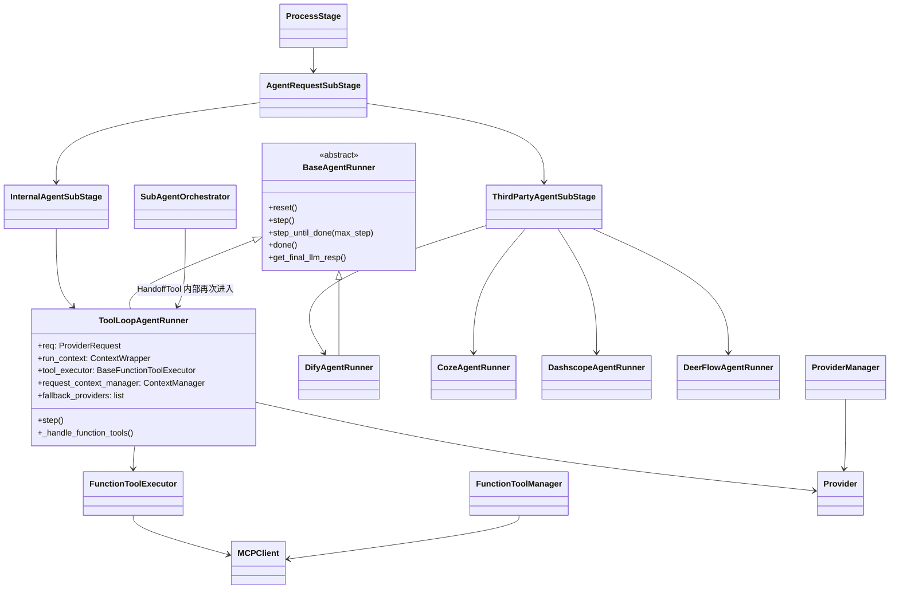
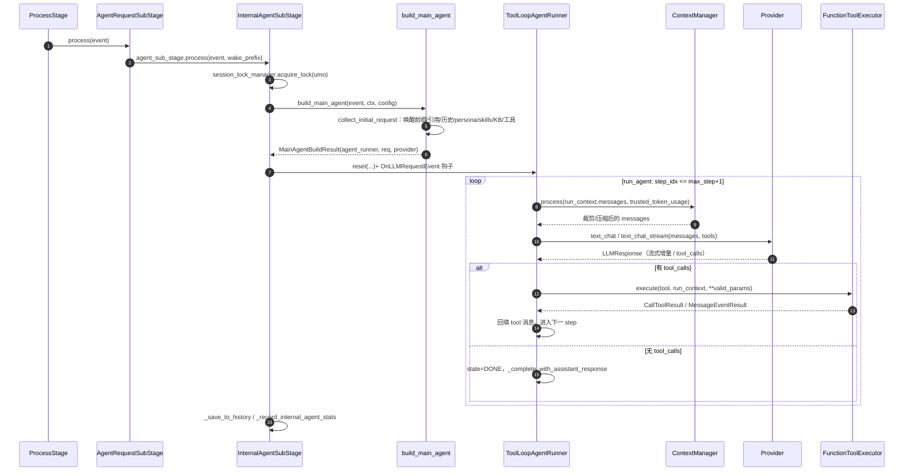

# 03 · Agent 运行时与 LLM 能力栈

> 对象：AstrBot v4.29.3（Python 3.12+），仓库根 `AstrBot-master/AstrBot-master`。
> 方法：只读静态阅读，全部引用格式为 `相对仓库根的路径:行号`，行号取自实际文件；未读到的部分显式标注「未验证」。
> 本文覆盖：pipeline → main agent 构建 → ToolLoop 运行时 → 工具执行 → 上下文管理 → Provider/RAG。

---

## 1. 职责与边界

这一层是 AstrBot 的「大脑」，只做三件事：把一条平台消息变成一次**带工具的多轮 LLM 会话**，把工具/第三方 Agent 的执行结果收敛回消息链路，并保证上下文不炸。

**边界内**：
- 会话入口与 runner 选择：`astrbot/core/pipeline/process_stage/method/agent_request.py:30-37`（`local` → Internal，其余 → ThirdParty）。
- 请求装配（人格、技能、知识库、工具集、系统提示词）：`astrbot/core/astr_main_agent.py:1731-2039`。
- 单轮对话的 Agent 循环、流式增量、中断、工具回填：`astrbot/core/agent/runners/tool_loop_agent_runner.py:111-1660`。
- 上下文裁剪/压缩：`astrbot/core/agent/context/{manager,compressor,truncator,token_counter}.py`。
- Provider 适配与注册：`astrbot/core/provider/**`（46 个适配文件、44 个 `@register_provider_adapter`）。
- RAG：`astrbot/core/knowledge_base/**`（FAISS 稠密 + BM25 稀疏 + 相对分数融合 + 可选 Rerank）。

**边界外**：平台消息收发（01 分区）、插件/Star 生命周期、WebUI、数据库实现细节。注意 `ContextManager` **不是** prompt 拼装者——它只做压缩（见 §4.1），拼装在 `astr_main_agent` 与 runner `reset()` 中完成，这是读代码最容易搞反的一点。

---

## 2. Agent 运行时架构

关键锚点：

| 组件 | 位置 |
|---|---|
| Stage 编排（插件请求优先于直连 LLM） | `astrbot/core/pipeline/process_stage/stage.py:22-27`, `:43-60`, `:75-76` |
| runner 类型分派 | `astrbot/core/pipeline/process_stage/method/agent_request.py:30-37` |
| 主链路实现 | `astrbot/core/pipeline/process_stage/method/agent_sub_stages/internal.py:167-502` |
| 请求装配 | `astrbot/core/astr_main_agent.py:1465-1729`（collect）、`:1731-2039`（build） |
| 运行时基类/状态机 | `astrbot/core/agent/runners/base.py:13-71` |
| ToolLoop 运行时 | `astrbot/core/agent/runners/tool_loop_agent_runner.py:111` |
| 工具执行器协议 | `astrbot/core/agent/tool_executor.py:10-17` → `astrbot/core/astr_agent_tool_exec.py:61-889` |
| 工具注册表/权限 | `astrbot/core/provider/func_tool_manager.py:288-1225` |

---

## 3. 一轮对话的详细调用链

逐段落到代码：

1. **入口与唤醒判定**：`astr_agent_run_util.py` 之外，真正决定「这条消息进不进 LLM」在 `astr_main_agent.py:1441-1463`（`_matches_provider_wake_prefix`）与 `agent_request.py:40-50`（全局开关 + 会话级开关）。
2. **串行化**：同一 umo 的请求用 `session_lock_manager.acquire_lock` 串行，避免并发写历史（`internal.py:239`）。
3. **构建**：`build_main_agent` 顺序为 provider 选择（`:1756`）→ 收集请求（`:1776`）→ 图片/引用/文件抽取（`:1799`, `:1825-1829`, `:1846-1872`）→ 知识库注入（`:1874`）→ 工具修补与 web search（`:1879-1880`）→ 安全模式（`:1882-1883`）→ 沙箱/本地工具（`:1885-1888`）→ 平台主动消息工具与群历史工具（`:1911-1933`）→ 回退 provider（`:1935-1943`）→ 上下文 token 上限解析（`:1945-1955`）→ 工具调用提示词（`:1960-1982`）→ `reset()`（`:1999-2029`）。
4. **首轮消息拼装**：`tool_loop_agent_runner.py:315-329` 用 `bind_checkpoint_messages(history)` 复原历史，`assemble_context` 生成当前 user 消息，system 置顶。
5. **每步压缩**：`:828-840`，注意 `trusted_token_usage` 来自 `req.conversation.token_usage`（上一轮 API 返回值），会直接短路估算（见 §4.3）。
6. **LLM 调用与回退**：`:842` → `:506-540`（真调用，流式/非流式分支）→ `:542-659`（异常时切换 fallback provider；空输出用 tenacity 重试 3 次）。
7. **工具分支**：`:924-925` 无 `tool_calls` 即 done；否则 `:1013-1034` 执行、`:1083-1105` 回填、`:1035-1037` 检查中断。
8. **收尾**：`run_agent` 在 `astr_agent_run_util.py:317-318` 检测 done 后 break；`internal.py:441-467` 取最终响应、记 trace、异步落统计、必要时写历史（被用户中断时也写，`:459`）。

**流式输出**：provider 层 `text_chat_stream`（仅 openai/anthropic/gemini 三个源实现，`provider.py:139-176` 基类为 `NotImplementedError`）；runner 把 chunk 转成 `AgentResponse(type="streaming_delta")`（`tool_loop_agent_runner.py:843-894`）；`run_agent` 侧在 `:292-297` 直接 yield 给下游，`show_reasoning=False` 时丢弃 reasoning 段。工具调用前会额外 yield 一个空 `MessageChain(type="break")`（`astr_agent_run_util.py:218-226`），让平台适配器断开当前流式气泡，保证「工具状态消息」顺序正确。

**中断**：三层。① 事件层 `_should_stop_agent`（`astr_agent_run_util.py:26-27`，看 `event.is_stopped()` 与 `agent_stop_requested`）；② 轮询任务 `_watch_agent_stop_signal` 每 0.5s 检查并 `request_stop()`（`:359-364`）；③ runner 层 `_abort_signal` 贯穿 LLM 等待（`_await_or_stop` `:467-504`）与工具执行（`_iter_tool_executor_results` `:1611-1660`，并发跑 executor 迭代 + abort 任务，超时/中断抛 `_ToolExecutionInterrupted` `:103`）。中断后 `_finalize_aborted_step`（`:1568-1602`）把状态置 DONE 并返回 `type="aborted"`，`run_agent:163-183` 负责清理并标记 `agent_user_aborted`。

---

## 4. 上下文与记忆管理

### 4.1 拼装职责划分（重要）

| 内容 | 拼装位置 |
|---|---|
| 人格 / begin_dialogs | `astr_main_agent.py:567-732`（`_ensure_persona_and_skills`），会话人格解析 `persona_mgr.py:123-205` |
| 技能提示词 | `astr_main_agent.py:645-660` |
| 知识库检索结果 | `astr_main_agent.py:334-366`（`_apply_kb`，注解模式走工具 `knowledge_base_tools.py:106-142`） |
| 历史消息 | `astr_main_agent.py:1712-1720`（`json.loads(conversation.history)`）→ `tool_loop_agent_runner.py:315-329` |
| 工具结果 | `tool_loop_agent_runner.py:1083-1105`（assistant+tool 成对追加） |
| system 提示词追加（安全/沙箱/工具/webchat） | `astr_main_agent.py:1882-1986` |

`ContextManager` 只出现在 `tool_loop_agent_runner.py:250-264`（构造）与 `:830-839`（每步调用），不参与任何 prompt 文本生成。

### 4.2 压缩与截断

`ContextManager.process` 是唯一入口（`astrbot/core/agent/context/manager.py:46-82`），两步顺序固定：

1. **按轮次强制截断**（`enforce_max_turns != -1` 时）：`truncator.truncate_by_turns(keep_most_recent_turns, drop_turns)`，`:61-66`。
2. **按 token 压缩**（`max_context_tokens > 0` 时）：`should_compress` 命中后 `_run_compression`，`:69-77`。

两种压缩策略（`manager.py:32-44` 选择）：
- `TruncateByTurnsCompressor`：阈值 **0.82**（`compressor.py:66`, `:90-93`），每次丢 `truncate_turns` 轮。
- `LLMSummaryCompressor`：保留最近 `keep_recent_ratio`（默认 0.15，配置层 clamp 到 ≤0.3，`config/agent_runner.py:192-194`）的 token 作为原文，其余用 LLM 摘要成「user 摘要 + assistant 确认」两条（`compressor.py:292-313`）；`split_into_rounds` 按 user 边界切轮（`round_utils.py:18-35`），同轮内的 tool 调用与结果不会被拆散。
- 压缩后仍有双检兜底：仍超限则从最旧整轮开始丢，**最新一轮永远保留**（`manager.py:117-155`）。

截断器还有两条硬约束，均来自真实 API 兼容性问题：`fix_messages` 保证 `tool` 消息前必有带 `tool_calls` 的 assistant（`truncator.py:51-98`），`_ensure_user_message` 保证 system 之后紧跟一条 user（`truncator.py:31-49`，注释点名智谱）。

### 4.3 token 计数

`EstimateTokenCounter`（`token_counter.py:48-91`）是纯估算：中文 0.6 token/字、其他 0.3、emoji 2.0，图片 765、音频 500（`:32-45`）。
关键语义：`trusted_token_usage > 0` 时**直接返回该值、完全不看当前消息列表**（`:59-60`）。该值来自 `req.conversation.token_usage`（`tool_loop_agent_runner.py:828`），即上一次 API 返回的 usage——轮次内工具结果回填后，它与实际上下文并不等价。

### 4.4 记忆持久化

`_save_to_history`（`internal.py:504-640`）跳过**第一条** system 消息（`:517-521`）、跳过 `_no_save` 的 user/assistant（`:522-523`），checkpoint 机制用 `CheckpointMessageSegment` 标记增量落盘（`:526-546`）。`_no_save` 语义在 `agent/message.py:19-77`（`mark_as_temp()`），知识库注入正是用它，保证检索内容不写进历史。被包含进上下文但不落盘的内容，provider 发送前会剥掉 `_no_save` 字段（`openai_source.py:986-987`、`anthropic_source.py:846-848`、`gemini_source.py:974-976`）。

---

## 5. 工具系统与 MCP/Subagent

**注册链路**（三条并行）：
1. 插件：`@filter.llm_tool`（别名 `astrbot/api/event/filter/__init__.py:16`）→ `register_llm_tool`（`astrbot/core/star/register/star_handler.py:586-640`，从 docstring 解析参数），写进全局 `llm_tools = FuncCall()`（`provider/register.py:11`）；`@agent.llm_tool` 形式见 `star_handler.py:689-691`。
2. 内置：`@builtin_tool` 装饰的 `FunctionTool` 子类，按需 `get_builtin_tool` 实例化（`func_tool_manager.py:419-441`）。
3. MCP：`MCPTool(FunctionTool)`（`mcp_client.py:794-821`），工具名做 `[^A-Za-z0-9_-] → _` 消毒后暴露给 LLM（`:800-809`）。

**参数校验的真实情况**：不是 JSON-Schema 校验，而是**白名单过滤**——只把 `func_tool.parameters["properties"]` 里出现过的 key 透传给 handler，多余参数仅告警（`tool_loop_agent_runner.py:1251-1277`）。schema 自身在定义时用 Draft202012 元 schema 校验（`agent/tool.py:33-38`），但运行时入参不做类型/必填校验。MCP 工具无 handler，参数全量透传（`:1275-1277`）。

**权限**：内置工具白名单默认放行（`func_tool_manager.py:214-285`）；非内置/插件工具包一层 `_PermissionGuardedTool`（`:496-513`），按 `PermissionType` 默认 `MEMBER`（`:453-494`）过滤会话级可用工具。`_plugin_tool_fix`（`astr_main_agent.py:1087-1114`）会保留 MCP 工具与无 `handler_module_path` 的工具，不参与插件会话过滤。

**并发**：**串行**。`_handle_function_tools` 用 `for func_tool_name, ... in zip(...)` 逐个 await（`tool_loop_agent_runner.py:1197` 起），一次 LLM 响应里 N 个 `tool_calls` 会顺序执行，总耗时是线性累加。单个工具的执行模型见 `astr_agent_tool_exec.py:136-206`（dispatch）与 `:684-779`（`_execute_local`，`asyncio.wait_for` 超时 `:742-745`，超时转为 tool 错误结果 `:774-777`）。

**MCP**：`func_tool_manager.py:540-772` 负责初始化/启用/超时（默认 180s，上限 300s，`:31-35`），`MCPClient` 支持 stdio/SSE/streamable-http（`mcp_client.py:97-130`），断连自动重连重试 2 次（`:727-774`）。stdio 启动有硬性安全校验：命令白名单（`:28-44`）、危险命令拒绝（`:45-82`）、shell 元字符拒绝（`:83`, `:224-225`）、`python -c`/`node -e` 内联代码拒绝（`:165-197`）、docker 危险参数拒绝（`:198-212`），入口 `validate_mcp_stdio_config`（`:215-248`），可用环境变量 `ASTRBOT_MCP_STDIO_ALLOWED_COMMANDS` 覆盖白名单（`:148-157`）。

**Subagent / Handoff**：`SubAgentOrchestrator.reload_from_config`（`subagent_orchestrator.py:29-104`）把配置里的每个 agent 包成 `HandoffTool`（`agent/handoff.py:8-64`，工具名 `transfer_to_<name>`，参数 `input` / `image_urls` / `background_task`）。主 LLM 调用该工具时，`astr_agent_tool_exec.py:323-402` 会**新建一个 `AstrAgentContext` 并递归调用 `context.tool_loop_agent`**（`star/context.py:224-364`），即同一套 `ToolLoopAgentRunner` 再跑一遍；`background_task=true` 走 `astr_agent_tool_exec.py:405-496` 的后台任务路径。子代理可单独指定 `provider_id`（`handoff.py:34`, `subagent_orchestrator.py:97`）。

---

## 6. Provider 体系与多模型适配

### 6.1 抽象与能力矩阵

**能力矩阵**（`provider/provider.py`，五类抽象：`:70` chat、`:238` TTS、`:218` STT、`:324` Embedding、`:419` Rerank；类型枚举 `provider/entities.py:33-38`）。`sources/` 下共 **46 个文件**（其中 `request_retry.py`、`mimo_api_common.py` 为公共模块），**44 个注册适配器**，按 `provider_type` 统计：

| 能力 | 数量 | 代表 |
|---|---|---|
| chat_completion | 16 | `openai_source.py:48`、`anthropic_source.py:35`、`gemini_source.py:44`、`zhipu_source.py:9`、`xai_source.py:5`、`openrouter_source.py:5` |
| text_to_speech | 13 | `edge_tts_source.py:24`、`azure_tts_source.py:211`、`dashscope_tts.py:25`、`volcengine_tts.py:19`、`minimax_tts_api_source.py:16` |
| speech_to_text | 5 | `whisper_api_source.py:10`、`whisper_selfhosted_source.py:15`、`sensevoice_selfhosted_source.py:21`、`xinference_stt_provider.py:14`、`mimo_stt_api_source.py:19` |
| embedding | 5 | `openai_embedding_source.py:21`、`gemini_embedding_source.py:12`、`dashscope_embedding_source.py:17`、`ollama_embedding_source.py:10`、`nvidia_embedding_source.py:10` |
| rerank | 5 | `bailian_rerank_source.py:32`、`tei_rerank_source.py:10`、`vllm_rerank_source.py:8`、`nvidia_rerank_source.py:10`、`xinference_rerank_source.py:17` |

chat 侧 16 个中，10 个继承 `ProviderOpenAIOfficial`（`groq_source.py:8`、`zhipu_source.py:10`、`xai_source.py:8`、`longcat_source.py:8`、`openrouter_source.py:8`、`ssycloud_source.py:12`、`oai_aihubmix_source.py:8`、`mirarouter_source.py:9`、`xiaomi_source.py:18`、`openai_responses_source.py:27`），3 个继承 `ProviderAnthropic`（`kimi_code_source.py:14`、`minimax_token_plan_source.py:13`、`xiaomi_token_plan_source.py:16`），只有 `openai_source.py:52`、`anthropic_source.py:39`、`gemini_source.py:48` 三份真实实现——「OpenAI 兼容」是这个仓库事实上的适配标准。

### 6.2 注册、重试与错误映射、多 provider 回退

**register 机制**：装饰器 `register_provider_adapter`（`provider/register.py:14-53`）把 `ProviderMetaData` 同时写入 `provider_registry`（列表）与 `provider_cls_map`（类型名→元数据），重名直接 `ValueError`；`default_config_tmpl` 自动补 `type`/`enable`/`id`。加载时 `manager.py:414-589` 动态 import（支持第三方包路径），`:663-821` 实例化；会话级 provider 选择走 `sp` 存储（`:153-219`），解析优先级 `_resolve_using_provider`（`:225-290`）。

**重试与错误映射**：
- 通用层 `request_retry.py`：默认 5 次、指数退避 0.2→30s（`:19-22`），可重试判定覆盖连接错误、`APIConnectionError`/`APITimeoutError`、`{408,409,429,500,502,503,504,529}` 与所有 5xx（`:40-59`），429 可开关（`:56-57`）。
- OpenAI 源：每个请求先过 `retry_provider_request`（`openai_source.py:570-579`），外层再套一个**最多 10 次的 key 轮换循环**（`:1224-1273`），流式同样（`:1305-1354`）。
- 错误语义映射全在 `_handle_api_error`（`:1078-1190`）：`"429" in str(e)` 换 key、`"maximum context length"` 弹历史、`"The model is not a VLM"`/内容审核/附件非法 → 去掉图重试、`"Function calling is not enabled"` → 摘掉 tools 重试。**全部靠字符串匹配**。
- 空输出：`EmptyModelOutputError` 用 tenacity 重试 3 次、1–4s 退避（`tool_loop_agent_runner.py:114-117`, `:577-584`）。

**多 provider 回退**：`astr_main_agent.py:1373-1404` 解析 `fallback_provider_ids`（去重、校验类型），runner 在 `_iter_llm_responses_with_fallback`（`tool_loop_agent_runner.py:542-659`）里依次尝试；图片场景会先切到支持 image 的 provider（`astr_main_agent.py:1414-1439`, `:1938-1943`）。**没有负载均衡**，只有「当前 + 有序回退链」。

### 6.3 第三方 Agent 平台与本地 ToolLoop 的差异（对应必答问题 5）

| Runner | 谁管工具 | 谁管上下文 | 关键证据 |
|---|---|---|---|
| 本地 ToolLoop | AstrBot（`FunctionToolExecutor` + `ToolSet`） | AstrBot（`ContextManager` + 全量 messages） | `tool_loop_agent_runner.py:1178-1444` |
| Dify | Dify 应用内 | 远端：只传 `conversation_id`，AstrBot 侧 `contexts` 不发送 | `dify_agent_runner.py:142-215`（`conversation_id` 存 `sp`） |
| Coze | Coze bot | 远端（`auto_save_history`） | `astrbot/core/agent/runners/coze/coze_agent_runner.py:32-117` |
| DashScope | 百炼应用 | 远端 `session_id`（`agent`/`dialog-workflow` 支持多轮）；`_build_request_payload` 收到 `contexts` 但**未放进 payload** | `dashscope_agent_runner.py:219-278`, `:369-395` |
| DeerFlow | DeerFlow 图（可开 subagent、递归上限 1000） | 远端 thread（仅读到 `_ensure_thread_id` `deerflow_agent_runner.py:372`，thread 映射细节**未验证**） | `deerflow_agent_runner.py:50-763`，默认 `deerflow_recursion_limit: 1000`（`config/agent_runner.py:68-81`） |

即：切到第三方后，AstrBot 退化为「输入转发 + 输出渲染」，本地的工具/上下文/压缩能力全部失效（只剩平台消息、图片上传与流式增量解析）。

### 6.4 RAG 链路（embedding / rerank provider 的实际消费方，对应必答问题 6）

完整链路（导入→切块→向量化→混合检索→注入）。注：`parsers/`（pdf / markitdown / text / url / epub）与 `chunking/`（fixed_size / recursive / markdown）只做了列表级确认，各解析器内部实现**未验证**：

1. **导入**：`KBHelper.upload_document`（`kb_helper.py:217-439`）→ parser（`parsers/`：pdf / markitdown / text / url / epub）→ 切块。默认 `RecursiveCharacterChunker`（`kb_mgr.py:21`），`.md/.mdx/.rst/.xlsx` 等结构化文档自动切 `MarkdownChunker`（`kb_helper.py:340-360`）。
2. **切块参数默认**：`chunk_size=512`、`chunk_overlap=50`（`kb_mgr.py:114-118`）。
3. **向量化**：`insert_batch(contents, metadatas, embedding_contents=标题+正文)`（`kb_helper.py:402-437`）——标题前缀参与 embedding，正文入库。
4. **稠密检索**：FAISS，`top_k_dense` 默认 50（`kb_mgr.py:116`），`retrieval/manager.py:112-122`。
5. **稀疏检索**：BM25（FTS 优先 + 停顿词，`sparse_retriever.py:56-80`），`top_k_sparse` 默认 50。
6. **融合**：`RankFusion.fuse`（`rank_fusion.py:58-205`）——稠密相似度**全局 min-max**（`:111-120`）、BM25 **按知识库内 min-max**（`:122-136`）、加权 `0.9*dense + 0.1*sparse`（`:39`, `:143-145`），RRF 仅作同分稳定排序（`:147-154`）；最后按正文去重、不按文档去重（`:168-203`）。
7. **Rerank**：可选 provider 二次排序（`manager.py:249-283`），失败只记日志并跳过（`:172-191` 附近）。
8. **注入**：`kb_mgr.retrieve` 拼 `【知识 i】/来源/内容/相关度`（`kb_mgr.py:342-361`），`retrieve_knowledge_base` 返回 `context_text`（`knowledge_base_tools.py:40-103`），`_apply_kb` 以 `TextPart.mark_as_temp()` 塞进当前 user 消息（`astr_main_agent.py:334-366`），且**不落历史**。`kb_agentic_mode=True` 时改为只注入 `astr_kb_search` 工具让模型自己查（`:106-142`）。

---

## 7. 问题、风险与技术债 + 关键结论

按「会不会真出事」排序，每条附证据：

1. **工具串行执行**：一次响应里的 N 个 tool_call 顺序 await（`tool_loop_agent_runner.py:1197`），无并发、无批处理，长工具链延迟线性叠加，是 step 超时与用户中断的主要诱因。
2. **工具执行无沙箱**：`_execute_local` 只有 `asyncio.wait_for` 超时（`astr_agent_tool_exec.py:742-745`），不限制文件系统/网络/子进程；`astrbot_execute_shell` 类工具依赖自身实现与 local policy（`astr_main_agent.py:1895-1906`）。MCP stdio 的白名单校验（`mcp_client.py:215-248`）只覆盖「启动器」，可被环境变量整体放开（`:148-157`）。
3. **工具返回体可能撑爆上下文**：只有配置了 `astrbot_file_read_tool` 时才启用溢出落盘（`astr_main_agent.py:2021-2028` → `tool_loop_agent_runner.py:247-248`）；阈值是**估算** 27 500 tokens（`:112-114`），而估算器对 JSON/代码是 0.3 token/char（`token_counter.py:85-91`），会低估。
4. **压缩可能静默失效**：`ContextManager.process` 用 `except Exception: return messages` 直接放弃（`manager.py:75-82`）；`LLMSummaryCompressor` 只重试 1 次（`compressor.py:278-281`），失败/空摘要原样返回（`:283-290`），用户侧无任何提示。`trusted_token_usage` 命中即跳过真实计数（`token_counter.py:59-60`）会掩盖轮内膨胀。
5. **压缩后仍超限**：只保留最新一轮并原样发送，仅打一条 warning（`manager.py:149-155`），随后大概率由 provider 报 400。
6. **错误映射靠字符串匹配**：`openai_source.py:1091`（`"429" in str(e)`）、`:1112`（`"maximum context length"`）、`:1165-1169`（function calling 不支持）；日志里有明确注释「各家错误码不统一，只能字符串匹配」（`:1170`）。供应商改文案即失效。
7. **重试层级叠加**：外层 10 次 key 轮换（`openai_source.py:1224`, `:1231`）× 内层 5 次 tenacity（`request_retry.py:19`），最坏 50 次调用且无全局 deadline，单条消息可长时间挂住会话锁（`internal.py:239`）。
8. **上下文长度自救太保守**：`pop_record` 每次只弹 2 条（`openai_source.py:1112-1117` → `Provider.pop_record`），可能把 user 消息弹掉只剩 system+assistant，重试仍超限。
9. **终止条件三套并存**：`run_agent` 的 `max_step+1` 外层（`astr_agent_run_util.py:136-153`，末步摘工具并注入 `MAX_STEPS_REACHED_PROMPT`）、runner 的 `_step_budget`（`tool_loop_agent_runner.py:814-815`, `:1040-1069`，在 80%/90%/95% 注入收敛提醒、100% 注入 `MAX_STEPS_REACHED_PROMPT`，横幅为 `[SYSTEM NOTICE: Agent step budget N%]`）、`step_until_done` 的自有循环（`:1146-1176`）。SDK 与子代理走第三套，行为与外层不一致。
10. **第三方 runner 的 loop 上界形同虚设**：Dify/Coze/DashScope 的 `step_until_done` 忽略 `max_step`（`dify_agent_runner.py:99-104`），循环退出完全依赖 state 流转正确。
11. **工具结果缺失即破坏协议**：`_handle_function_tools` 在 `not req.func_tool` 时直接 return（`tool_loop_agent_runner.py:1223-1224`），此时 assistant 的 `tool_calls` 已追加但没有任何 `tool` 结果（`:1083-1105`），下轮请求可能被 OpenAI 系 API 判为不合法。`skills_like` 模式靠额外一次 requery 修补（`:951-1009`）。
12. **错误吞噬面较大**：`internal.py:482-490`（异常只回一句文本，不区分模型/工具/网络）、`astr_agent_run_util.py:320-356`（打印堆栈后返回 err）、知识库检索失败被吞（`astr_main_agent.py:356-357`）、`_record_internal_agent_stats` 全异常静默（`internal.py:639-640`）。线上排障只能靠 `event.trace`。
13. **硬编码黑名单与定义顺序**：provider API base 的黑名单以 base64 常量写在模块底部（`internal.py:594-597`：`BLOCKED` / `decoded_blocked`），在 `:288-300` 做子串匹配拦截。靠「模块已完整加载」才成立，且无法配置、无法审计（base64 混淆后只能反解）；同一处还混着「安全策略」与「请求构建」两种职责。

### 关键结论（8–12 条）

1. 架构分层干净：`Stage → SubStage → build_main_agent → BaseAgentRunner → Provider`，runner 抽象让本地 ToolLoop 与 4 个第三方平台共用一套入口（`third_party.py:336-347`）。
2. 真正的复杂度在 `ToolLoopAgentRunner`（1660 行）与 `astr_agent_tool_exec.py`（889 行），二者承担了循环、流式、中断、回填、溢出、压缩、hook 共 7 类职责，**单文件职责过载**，是重构首要目标。
3. `ContextManager` 名不副实：它只压缩不拼装。想改 prompt 必须去 `astr_main_agent`，想改裁剪必须去 `context/`，二者没有共同抽象。
4. **上下文压缩与循环终止是按「两条独立防线」实现的**：压缩=按轮截断(`truncator`)→token 阈值(0.82)→按策略压缩(`LLMSummaryCompressor`/按轮丢)→双检再丢最旧轮、保最新轮（`manager.py:46-156`）；终止=`run_agent` 外层 max_step+1 强制收尾 + runner 内 `_step_budget` 三级提醒 + `step_until_done` 自有循环，三重机制互不知道对方（详见 §4.2 与 §7 第 4/5/9 条）。
5. token 计数是估算 + 一个可能陈旧的 `trusted` 值，是整个压缩链路最薄弱的一环（`token_counter.py:59-60`）。
6. 工具协议的执行是「白名单过滤参数 + 无运行时类型校验 + 串行 + 无沙箱」，安全性主要押在**单个工具实现**和 MCP stdio 启动器校验上，不是框架级保证。
7. MCP 支持相当完整（3 种传输、重连、超时分级、stdio 安全校验），是这一层做得最扎实的部分（`mcp_client.py:215-248`, `:727-774`）。
8. Provider 层「一套 openai 兼容实现 + 2 个特例」的收敛策略非常成功：16 个 chat 适配器只维护 3 份真实实现。
9. 但错误处理是**字符串匹配 + 双层重试**的组合，跨供应商脆弱，且没有全局超时预算。
10. Subagent 不是独立运行时，而是「HandoffTool → 递归 tool_loop_agent」（`astr_agent_tool_exec.py:323-402`），因此天然继承主 agent 的全部配置与缺陷（包括串行工具与无沙箱）。
11. RAG 的融合策略有明确工程考量（稠密全局归一 + BM25 库内归一 + RRF 同分，`rank_fusion.py:111-166`），比简单 RRF 更稳；但 `dense_weight=0.9` 硬编码、`top_k` 默认值分散在 KB 记录与全局配置两处，调参入口不统一。
12. 切到第三方 Agent 平台后，本地的工具/上下文/压缩能力**整体失效**且没有降级提示，是产品语义上最容易误解的一处（§6 表）。