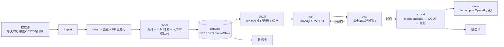

# 10 · 训练工厂（TrainLab）：开源前要补的那一块

> 本模块是「工作台（Workbench）」的功能域之一：见 `docs/specs/11-工作台-Workbench.md`。

> 起因：项目要开源。现在"训练相关"的能力散落在 `tools/train/`、`agi/soul/`、`agi/eval_data/`、`tools/soul_serve/` 里：
> 有的能跑、有的是实验脚本、路径硬编码在 `E:\agent`、没有统一入口、没有数据卡/模型卡、也没有可复现的 manifest。
> **TrainLab = 把「语料 → 清洗 → 标注 → 蒸馏 → 训练 → 评测 → 导出 → 推理」收成一个可配置、可复现、可开源的流水线。**

## 一、目标与非目标

### 目标
1. **一条命令**跑通任一阶段：`python -m trainlab data|label|distill|train|eval|export|serve`
2. **配置驱动**：所有路径/模型/超参写在 YAML profile 里，不再硬编码 `E:\agent`
3. **可复现**：每次运行产出 `manifest.json`（数据哈希、种子、依赖版本、命令、产出 sha256）
4. **开源友好**：示例数据集 + 数据卡 + 模型卡 + CPU/小模型 smoke 测试，clone 下来的仓库不依赖用户私有数据
5. **安全默认**：PII 匿名化、危机/敏感样本默认排除、语料不出本机（除显式 teacher API）

### 非目标（边界）
- 不做通用训练框架（不替代 transformers/peft/TRL）
- 不做分布式训练
- 不做数据标注平台 UI（只提供 CLI + 审核队列文件）

## 二、总架构



## 三、目录布局（仓库内）

```
agi/trainlab/                # 库：可被别的代码 import
├── __init__.py
├── config.py                # YAML profile 加载/校验/覆盖（env TRAINLAB_*）
├── manifest.py              # 运行 manifest：数据哈希/种子/版本/产出 sha256
├── ingest/
│   ├── chat.py              # 从项目 SQLite（turns/traces）抽对话
│   ├── export_files.py      # 从聊天记录导出/OCR 文本
│   └── schema.py            # 统一中间格式
├── clean/
│   ├── filters.py           # 空/过短/纯贴纸/重复/敏感/危机/测试库
│   ├── pii.py               # 手机号/身份证/地址/wxid/邮箱/链接 脱敏
│   └── dedupe.py            # 精确 + 近似（n-gram/MinHash）
├── label/
│   ├── rules.py             # 正/负/修正（否定词、重复问、命中护栏词）
│   ├── llm_label.py         # LLM 辅助标注（可关；带预算与缓存）
│   └── review.py            # 人工审核队列 JSONL（待审/已审/驳回）
├── distill/
│   ├── teacher.py           # DeepSeek/本地 3B 作为 teacher；重试/预算/缓存
│   ├── targets.py           # InnerState JSON / 聊天回复 / 行为标签 的目标模板
│   └── cache.py             # prompt→target 内容寻址缓存（省 token）
├── train/
│   ├── sft.py               # LoRA SFT（已有 smoke_lora 的正式版）
│   ├── dpo.py               # DPO 偏好训练（可选，TRL 或手写）
│   ├── qlora.py             # 4bit 降级
│   └── loop.py              # loss-only-on-assistant、grad accum、checkpoint
├── eval/
│   ├── golden.py            # 黄金集加载/打分
│   ├── judge.py             # 成对裁判（A/B 位置随机 + 双向）
│   └── gate.py              # 回归门禁（≥上版-2 才 candidate）
├── export/
│   ├── merge.py             # peft merge_and_unload（CPU）
│   ├── gguf.py              # convert_hf_to_gguf + llama-quantize
│   └── verify.py            # sha256 / 加载冒烟 / 对话 3 轮
├── serve/
│   ├── llama.py             # llama-server 管理（端口/pid/健康）
│   └── proxy.py             # OpenAI 兼容代理（统一 base_url）
└── cards.py                 # 数据卡 / 模型卡生成（Markdown）

tools/trainlab/              # 只放 CLI 与 profile，不放逻辑
├── profiles/
│   ├── soul-05b-qlora.yaml
│   ├── soul-05b-lora.yaml
│   ├── chat-15b-lora.yaml
│   └── dpo-05b.yaml
└── examples/
    ├── sample_sft.jsonl     # 20 条脱敏示例
    └── sample_dpo.jsonl
```

## 四、命令设计（CLI）

```bash
# 数据
python -m trainlab data collect  --profile soul-05b-qlora --date 2026-10-27
python -m trainlab data clean    --in raw.jsonl --out clean.jsonl
python -m trainlab data label    --in clean.jsonl --out labeled.jsonl --rules --llm off
python -m trainlab data review   --queue review.jsonl     # 人工审核队列
python -m trainlab data split    --in labeled.jsonl --train 0.9 --val 0.1
python -m trainlab data card     --dataset dir/

# 蒸馏
python -m trainlab distill inner-state --in ctx.jsonl --out sft.jsonl --teacher deepseek
python -m trainlab distill chat        --in clean.jsonl --out sft.jsonl --teacher deepseek

# 训练
python -m trainlab train sft  --profile soul-05b-qlora --dry-run
python -m trainlab train sft  --profile soul-05b-qlora
python -m trainlab train dpo  --profile dpo-05b
python -m trainlab train resume --run runs/2026-10-27T...

# 评测
python -m trainlab eval golden --run runs/... --golden data/golden_v1.jsonl
python -m trainlab eval judge  --a runs/v1 --b runs/v2 --pairs 50
python -m trainlab eval gate   --run runs/v2 --baseline v1

# 导出与服务
python -m trainlab export merge  --run runs/v2 --out models/merged_v2
python -m trainlab export gguf   --hf models/merged_v2 --quant q4_k_m
python -m trainlab export verify --gguf models/gguf/soul_v2-q4_k_m.gguf
python -m trainlab serve llama   --gguf ... --port 8123 --status
```

## 五、配置 profile（YAML）

```yaml
# tools/trainlab/profiles/soul-05b-qlora.yaml
name: soul-05b-qlora
paths:
  home: ${AGENT_HOME:<AGENT_HOME>}          # 模型/输出/日志都在这
  base_model: ${AGENT_HOME}/models/Qwen2.5-0.5B-Instruct
  out: ${AGENT_HOME}/output
  logs: ${AGENT_HOME}/logs
data:
  format: inner-state                   # inner-state | chat-sft | dpo
  train: data/soul_sft_v2_train.jsonl
  val:   data/soul_sft_v2_val.jsonl
  max_seq_len: 512
  balance: true                         # 少数类过采样
  reduce_target: true                   # 只训行为字段
train:
  method: qlora                         # lora | qlora
  lora: {r: 16, alpha: 32, dropout: 0.05}
  load_4bit: true
  bf16: true
  batch_size: 1
  grad_accum: 8
  lr: 2.0e-4
  epochs: 1
  seed: 42
  grad_checkpoint: true
eval:
  golden: data/golden_v1.jsonl
  metrics: [exact_field_acc, balanced_acc, human_spot]
export:
  quant: [f16, q4_k_m]
```

## 六、数据格式规范

### SFT（`format: chat-sft` / `inner-state`）
```json
{"id":"S-0001","messages":[{"role":"system","content":"..."},{"role":"user","content":"..."}],
 "response":"...","meta":{"source":"daily_corpus","quality":"positive","date":"2026-10-27"}}
```
### DPO
```json
{"id":"D-0001","prompt":"...","chosen":"...","rejected":"...","meta":{"reason":"用户纠正"}}
```
### 数据集目录（产物）
```
dataset/
├── dataset.json          # 条数/来源/过滤统计/哈希
├── CARD.md               # 数据卡（来源、许可、隐私处理、局限）
├── train.jsonl
├── val.jsonl
└── dpo.jsonl
```
### 运行目录（训练产物）
```
runs/2026-10-27T01-30-soul-05b/
├── manifest.json         # 命令、profile、git sha、依赖版本、数据哈希、种子、产出 sha256
├── config.yaml           # 完整生效配置（含默认值）
├── metrics.jsonl         # 每步 loss/lr/显存/耗时
├── adapter/              # LoRA 权重（65MB）
└── CARD.md               # 模型卡（基座、数据、指标、已知局限）
```

## 七、可复现性

- 每次运行记录：`git rev-parse HEAD`、python/torch/transformers/peft 版本、`nvidia-smi` 摘要
- 数据哈希：文件 sha256 + 行数 + 过滤统计
- 随机种子统一入口（`torch.manual_seed`/`random`/`numpy`）
- `manifest.json` 可直接喂回 `train resume`
- 产物（adapter/gguf）写 sha256，供模型卡引用

## 八、开源与安全

| 项 | 做法 |
|---|---|
| 私有数据不出仓库 | 示例数据 20 条、全部脱敏；真实数据放 `data/`（gitignore） |
| PII | `clean/pii.py`：手机号/身份证/地址/wxid/邮箱/URL 全部替换占位符 |
| 敏感/危机 | 默认排除（可配置 `include_crisis: false`） |
| Teacher API | 显式 `--teacher`；key 从 env 读；预算上限；缓存避免重复付费 |
| 许可 | 数据卡写明"用户自有数据，公开示例采用 CC0 合成文本" |
| 模型卡 | 基座许可（Qwen2.5 Apache-2.0）+ 训练数据来源 + 局限 |

## 九、测试策略（CI 可跑，不需要 GPU）

- 单元：clean/pii/dedupe/label rules/distill 模板/export verify（纯函数）
- 端到端：`--mock` teacher + `tiny` 随机初始化的 2 层模型（CPU，20 步，几秒）
- 数据管线：sample_sft 20 条 → clean → label → split → manifest 校验
- 导出：CPU 上 merge 一个 fake adapter，检查目录结构（不跑 GGUF 转换，太重）
- 找不到 GPU 时自动 skip 真训练，只跑 dry-run

## 十、里程碑（建议顺序）

| 阶段 | 内容 | 验收 |
|---|---|---|
| **M1 骨架 + 数据** | `config.py`/`manifest.py`/`ingest`/`clean`/`label`/`split`/CLI + 示例数据 + 测试 | `data collect→clean→label→split→card` 一条命令跑通；PII 单测全过 |
| **M2 训练** | `train/sft.py`（吸收 smoke_lora 正式化）、`train/qlora.py`、dry-run、manifest、metrics | CPU dry-run 20 步 + 6GB 真训 smoke；manifest 完整 |
| **M3 蒸馏 + 标注** | `distill/*`（teacher 缓存/预算）、`label/llm_label` + 人工队列 | 20 条真 teacher 生成 + 缓存命中；标注报告 |
| **M4 导出 + 服务** | `export/merge|gguf|verify`、`serve/llama|proxy` | 0.5B 链路：adapter→merged→q4_k_m→llama-server→对话 3 轮 |
| **M5 开源化** | 数据卡/模型卡、CI、README、许可、示例 profile | 新机器 clone → `make smoke` 通过 |

## 十一、和现有代码的关系（不重复造）

| 现有 | 迁移到 |
|---|---|
| `tools/train/smoke_lora.py` | `agi/trainlab/train/sft.py`（正式化 + 配置化） |
| `tools/train/balance_target.py` / `reduce_target.py` | `agi/trainlab/data/`（作为 dataset transform） |
| `tools/train/daily_corpus.py` | `agi/trainlab/ingest/chat.py` + `label/rules.py`（复用规则） |
| `agi/soul/dataset.py` / `scenarios*.py` | `agi/trainlab/distill/targets.py`（InnerState 模板） |
| `tools/build_human_tone.py` / `build_qq_tone.py` | `agi/trainlab/ingest/export_files.py` + `clean/pii.py` |
| `tools/soul_serve/merge_adapter.py` / `convert.py` | `agi/trainlab/export/` |
| `tools/soul_serve/serve_local3b.py` | `agi/trainlab/serve/llama.py` |
| `agi/eval_data/*` + `tools/build_golden.py` | `agi/trainlab/eval/` |
| `tools/train/train_gate.py` | `agi/trainlab/eval/gate.py` + `manifest` 门禁 |

## 十二、给开源读者的一句话

> 这个项目不是"又一个聊天机器人"，而是一个**可以把"人格/记忆/语气"训进小模型、再用它替换云端大模型**的完整工作台。
> TrainLab 就是那个工作台：**你的数据进，你的模型出**，中间每一步都可查、可复现、可回滚。
