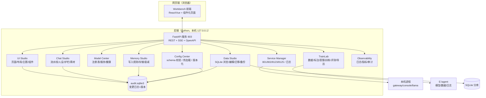

# 11 · 工作台（Workbench）：项目里的一切都可配置、可视化、可改

> 用户定调（2026-10-28）：
> 1. **先适配网页端**，再逐步下放 Windows / macOS / Linux；
> 2. 除了训练工厂（TrainLab），工作台还要能编辑：控制台功能、控制台 UI、模型数据库、记忆写入方式、记忆存储、对话流……**项目里所有被修改过的东西都要收进工作台**；
> 3. 本质：**项目全部功能与配置，一切都可以在工作台里改**。

## 一、定位

现状：控制台（802，原生 JS 单页）只能"看 + 少量操作"，改配置要开文件、改库要 SQL、调流水线要命令。

目标：**Workbench = 这个项目的 IDE**。
浏览器打开一个页面，能完成：

```
启停服务 → 改配置 → 调模型 → 训模型 → 看/改数据库 → 改记忆写入与存储
→ 改对话流水线 → 改人设与护栏 → 改控制台页面/主题 → 回滚版本 → 看日志/审计
```

**一切改动 = 一次可审计的变更**（版本化 + 备份 + 一键回滚），而不是悄悄改文件。

## 二、总架构（Web 优先，桌面是壳）



### 平台策略

| 阶段 | 形态 | 说明 |
|---|---|---|
| **W1 网页端（先做）** | 浏览器访问 `http://127.0.0.1:803` | 全部功能；本地 token；手机也能开 |
| **W2 Windows 桌面壳** | Tauri 2（WebView2）包前端 + Python 边车 | 双击即用，托盘/开机自启 |
| **W3 macOS** | Tauri 2（WKWebView）+ 同一 Python 边车 | 打包 dmg；llama-server 用 Metal 版 |
| **W4 Linux** | Tauri 2（WebKitGTK）+ AppImage | 服务器/桌面两用 |
| W5 Docker | 单镜像（后端+前端） | 给自托管用户 |

> 关键：**前端只依赖 HTTP API**；桌面壳换的是"外壳 + 进程管理"，不是重写业务。Python 后端（含现有网关/控制台/训练管线）作为边车统一拉起。

## 三、工作台的功能域（13 个模块）

### 1. Shell（外壳）
- 登录/token、多主题（亮/暗）、语言、快捷键
- 布局：左侧导航 + 可拖拽面板；**用户可保存自己的布局**
- 全局搜索（配置项/页面/操作/文档）
- 危险操作二次确认 + 自动备份

### 2. Service Manager（服务）
- 卡片：gateway 801 / console 802 / soul 8123 / local3b 8125 / B站插件
- 启动/停止/重启、健康检查、端口冲突检测
- 实时日志（SSE 流）、日志级别、按关键词过滤
- 引擎总开关（已有）、STOP 文件、静默时段可视化

### 3. Model Center（模型）
- 模型注册表：基座、adapter、GGUF、量化、来源、sha256
- 服务：端口/参数（`-ngl/-c/-np`）、健康、显存占用
- 一键切换"当前对话模型/内状态模型"
- 模型卡查看；外部进程识别与安全停止（已实现，迁入）

### 4. TrainLab（训练工厂）
见 `docs/specs/10-训练工厂-TrainLab.md`：数据→清洗→标注→蒸馏→训练→评测→导出→服务，全部在 Workbench 里以向导形式呈现。

### 5. Data Studio（数据库）
- 连接：memory / persona / audit / 各联系人库（只读/读写切换）
- 表浏览、分页、筛选、SQL 控制台（带 EXPLAIN、只允许本机）
- **行编辑**：增删改（有外键/约束校验，写前自动快照）
- 结构：查看 schema、迁移记录、生成迁移脚本、schema diff
- 备份/恢复：一键 dump、定时快照、按日期回滚
- 危险区：清表/重建/脱敏导出（确认短语）

### 6. Memory Studio（记忆）
- **写入方式**：抽取规则（kind/importance/confidence）、合并/冲突策略、去重阈值
- **存储层**：分层 hot/warm/cold 参数、类海马体衰减（半衰期/阶段阈值/唤醒 boost/睡眠时间）
- **检索**：top-k、混合检索权重、时间模糊、注入预算
- **隐私**：PII 规则、敏感类别、危机样本开关
- 记忆时间线可视化（strength 曲线、休眠/唤醒历史）

### 7. Chat Studio（对话）
- **流水线编辑器**：把 `send()` 的步骤做成画布——清洗 → 检索 → 心情 → 内状态 → 提示词 → LLM → 护栏 → 润色 → 气泡 → 媒体 → 记录；每步可开/关/调参/排序（受限步骤标锁）
- **人设**：设定书编辑、prompt 覆盖、few-shot、core 人格层审批
- **护栏**：网感词/金句腔/编造故障/收尾 规则表（增删词、正则、开关、命中动作）
- **主动**：节奏（pacing）、主动度（drive）、内驱力（urges）、冲浪、日记、周复盘 参数
- **实时试跑**：输入一句，右侧显示 8 段链路（复用现有推理过程页）

### 8. Conversation Ops（对话运维）
- 对话流（实时）、推理过程（trace）、失败回放
- A/B：同一输入跑两个配置，并排对比
- 反馈标注（好/差/纠正）→ 直接进 TrainLab 语料

### 9. Config Center（配置中心）
- **schema 驱动**：每个配置项有类型/默认值/说明/范围/安全级别
- 分组：模型/记忆/对话/主动/媒体/心情/训练/服务/安全
- 编辑即校验（类型、范围、互斥）、保存即热加载、失败回滚
- **版本化**：每次保存生成一个 config 版本（diff 视图、一键回滚）
- 导入/导出（JSON/YAML）、预设（保守/平衡/活跃）

### 10. UI Studio（界面定制）
- 页面管理：启用/隐藏页面、排序、自定义页面（JSON 描述）
- 布局：栅格、卡片顺序、每页 widget 配置（数据源/刷新/图表类型）
- 主题：颜色/字体/圆角/密度；导入导出主题包
- 组件白名单：只能组装已有组件（安全），不能注入任意脚本
- 实时预览 + 保存为个人/项目默认

### 11. Extensions（扩展）
- 流水线自定义步骤（Python 插件，放 `agi/extensions/`，注册 schema）
- 自定义 API 路由（受限）
- 扩展市场占位（本地目录 + manifest）

### 12. Git Studio（内置 Git）
- **状态**：working tree、staged/unstaged、最近提交、当前分支、ahead/behind、冲突提示
- **diff**：文件级/行级 diff；配置/人设/流水线/UI 变更可直接看出"改了什么"
- **提交**：写提交信息（自动生成"改了什么"摘要）、选择文件、提交、**自动推送**
- **分支**：创建/切换/合并/删除；推荐工作流——Workbench 的每次"大改"落到 `wb/<日期>-<主题>` 分支，验收后合并回主线
- **自动提交（默认开、可关）**：
  - 触发：配置保存 / 数据库写 / 记忆规则 / 流水线 / 人设 / 护栏词表 / UI 布局主题 / 训练产物 manifest
  - 提交信息模板：`wb: <模块> <操作> <摘要>` + 变更项列表 + 操作者 + 时间
  - 合并策略：同一次操作内的多次写合并成一个 commit（防碎片化）
- **自动上传（可选，默认关）**：
  - 配置 `git.auto_push=true` + `git.remote=origin` + `git.branch_mode=fixed|daily|per-change`
    - `fixed`：推到指定分支（如 `main` 或 `wb-workbench`）
    - `daily`：自动建/复用 `wb/2026-10-28`，当天所有变更推这个分支
    - `per-change`：每次大改新分支，便于 review
  - 推送前检查：有远程、有凭证（token 从本机配置/环境变量读，**不写进仓库**）、先 fetch 防冲突
  - 失败处理：本地 commit 一定保留；推送失败进重试队列并在 UI 提示（网络/凭证/冲突）
- **回滚**：按 commit / 按配置版本 / 按时间点；回滚前自动建 `backup/pre-rollback-<ts>` 分支
- **安全**：`.env`/密钥/`agi/data/`/模型文件默认 gitignore；提交前扫描密钥与超大文件，命中则阻止并提示
- **与 audit 的关系**：audit 记录"谁改了什么"（细到字段），git 记录"代码/配置/数据结构的版本"（可 diff、可回滚、可协作）

### 13. Observability（可观测）
- 指标：延迟 P50/P95、token 用量与预算、通过率、护栏命中、记忆命中率
- 日志检索、审计日志（谁在什么时候改了什么、前后 diff）
- 告警：预算超限、连续失败、服务掉线（本机通知）

## 四、变更模型（工作台的核心）

| 变更类型 | 落地方式 | 审计 | 回滚 |
|---|---|---|---|
| 配置项 | Config Center → 文件/DB | audit（key, old, new, by, ts） | 版本快照 |
| 数据库行 | Data Studio → 事务 | audit（表/主键/字段 diff） | 写前快照 |
| 记忆规则/存储参数 | Memory Studio → 配置 | audit | 版本快照 |
| 流水线（步骤/参数/顺序） | Chat Studio → pipeline.json | audit + 图 hash | 历史版本 |
| 人设/护栏词表 | prompt_store / guard 规则表 | audit | 版本快照 |
| 页面/主题 | UI Studio → ui.json | audit | 版本快照 |
| 模型/训练产物 | TrainLab → manifest | 产物 sha256 | 保留旧版本 |
| **任意变更** | **Git Studio：自动 commit（可选自动 push）** | git 历史 + audit | `git revert` / checkout 版本 |

原则：**任何写操作 = 备份 + 审计 + 可回滚**；批量/危险操作需输入确认短语。

## 五、API 设计（草案）

```
GET  /api/wb/health
GET  /api/wb/config/schema                 # 全量配置 schema
GET  /api/wb/config                        # 当前值（脱敏）
POST /api/wb/config/validate               # 校验不保存
POST /api/wb/config/save                   # 保存 + 热加载 + 版本
GET  /api/wb/config/versions               # 历史版本
POST /api/wb/config/rollback               # 回滚到版本

GET  /api/wb/services                      # 服务状态
POST /api/wb/services/{name}/{action}      # start/stop/restart
GET  /api/wb/services/{name}/logs/stream   # SSE

GET  /api/wb/db/{conn}/tables
GET  /api/wb/db/{conn}/rows?table=&limit=
POST /api/wb/db/{conn}/rows                # 增改删（需 confirm）
POST /api/wb/db/{conn}/backup

GET  /api/wb/memory/config
POST /api/wb/memory/config
GET  /api/wb/memory/timeline?contact=

GET  /api/wb/pipeline
POST /api/wb/pipeline
POST /api/wb/pipeline/test                 # 试跑一句，返回 8 段链路
GET  /api/wb/guard/rules
POST /api/wb/guard/rules

GET  /api/wb/ui/pages
POST /api/wb/ui/pages
GET  /api/wb/ui/theme
POST /api/wb/ui/theme

GET  /api/wb/git/status                    # 分支/ahead/behind/变更
GET  /api/wb/git/diff?file=
POST /api/wb/git/commit                    # {message, files, push?}
POST /api/wb/git/branch                    # {action: create|switch|merge, name}
POST /api/wb/git/push                      # {remote, branch}
GET  /api/wb/git/log?limit=
POST /api/wb/git/rollback                  # {commit|version}

POST /api/wb/train/{stage}                 # 透传 TrainLab
GET  /api/wb/audit?limit=
```

技术选型（建议）：**FastAPI + Uvicorn**（OpenAPI 自动文档、SSE 容易、异步）、前端 **Vue 3 + Naive UI**（或 React+shadcn），桌面壳 **Tauri 2**。

## 六、与现有控制台的关系

| 现有 | 去哪 |
|---|---|
| `tools/console/server.py`（stdlib HTTP，802） | 保留为兼容层；新增 803 Workbench（FastAPI）消费同一批函数 |
| `tools/console/static/*`（原生 JS 页面） | 逐步迁到 Workbench 前端；旧页面保留到迁移完成 |
| 各 `GET /api/*` 只读接口 | 直接复用或在 Workbench 里包装 |
| 推理过程 / 素材库 / B站 / 模型 / 内驱力 / 成长 | 平移进 Chat Studio / Data Studio / Model Center 等模块 |

## 七、实施路线（按用户"先网页端，再下放系统"）

| 阶段 | 内容 | 验收 |
|---|---|---|
| **M0 骨架** | FastAPI 803 + 前端壳 + 登录 + 服务卡片 + 配置中心（schema/校验/热加载/审计）+ **Git Studio 最小版（status/diff/commit/自动提交）** | 浏览器能开、能启停服务、改配置后自动产生一次本地 commit |
| **M1 数据** | Data Studio（浏览/编辑/SQL/备份）+ Memory Studio（写入规则/存储/衰减/时间线）+ **Git 自动推送（可选）** | 改一条记忆规则并生效；改一行数据可回滚；开启 auto_push 后分支自动上传 |
| **M2 对话** | Chat Studio（流水线编辑器 + 人设/护栏 + 试跑 8 段链路） | 关掉某一步/改词表，试跑立即反映 |
| **M3 模型+训练** | Model Center + TrainLab（data/label/distill/train/eval/export） | 0.5B 全链路：数据→训练→导出→服务 |
| **M4 UI Studio** | 页面/布局/主题编辑、组件白名单、主题包 | 自定义一个页面并保存 |
| **M5 桌面化** | Windows（Tauri 2）→ macOS → Linux → Docker | 双击安装包可用，后端边车自动拉起 |
| **M6 开源化** | 文档/CI/许可/示例/截图/数据卡模型卡 | 新机器 clone 后 `make dev` 可用 |

## 八、开源与安全

- 默认只监听 `127.0.0.1`；远程访问需显式开启 + token + 可选 HTTPS
- token 存本机文件；UI 不显示完整密钥
- Data Studio 默认只读，写需解锁；所有写操作自动快照
- 不可在 UI Studio 注入任意脚本（组件白名单）
- 审计日志保留 90 天，可导出

## 九、一句话总结

> **Workbench = 项目的 IDE + 控制台 + 训练台 + 数据库客户端 + 配置中心**，网页优先，桌面为壳；
> 目标：任何人拿到这个项目，不打开代码编辑器，也能把它调到"像自己的那个人"。
