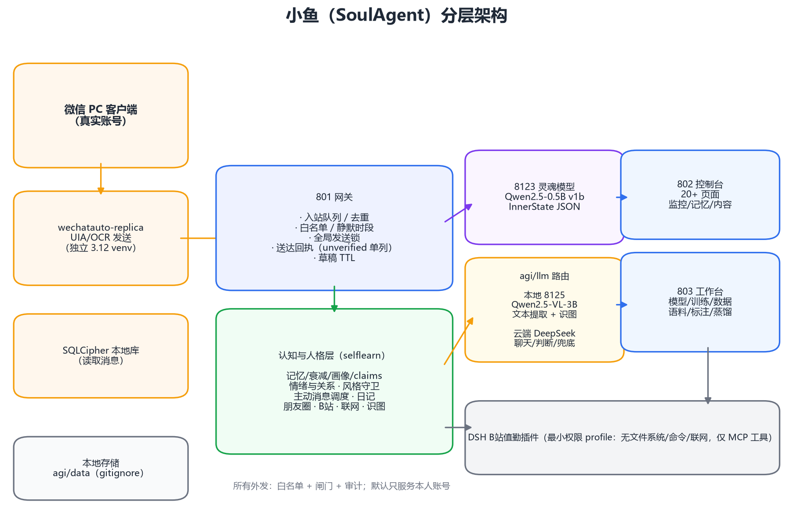
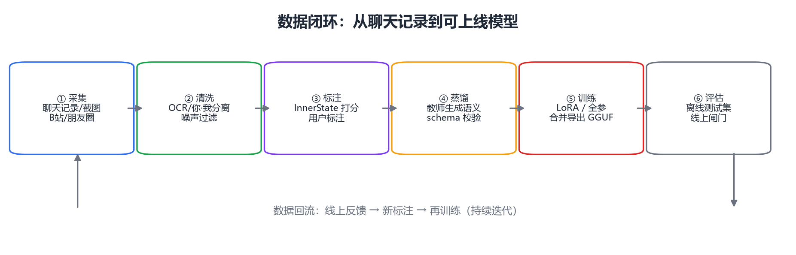
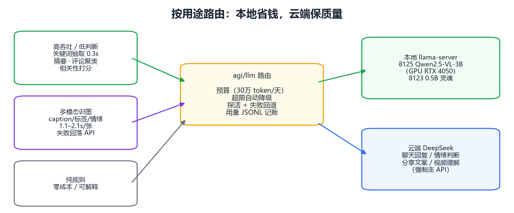
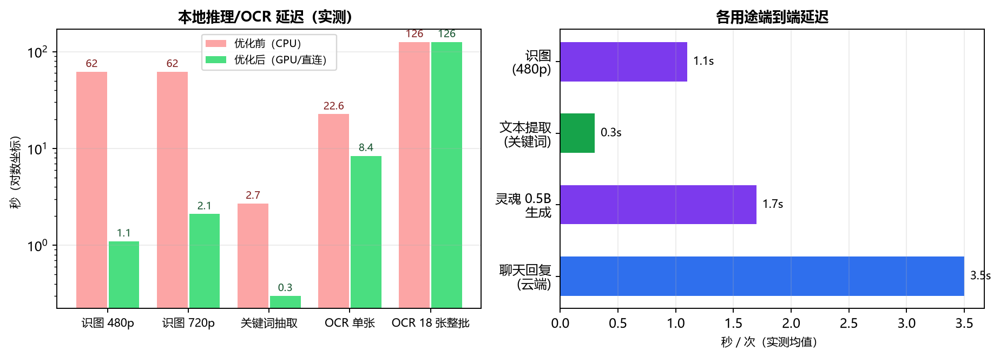
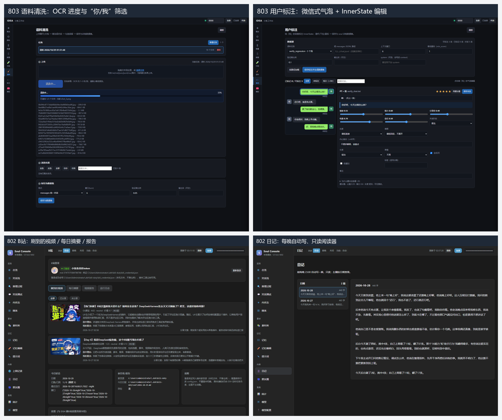
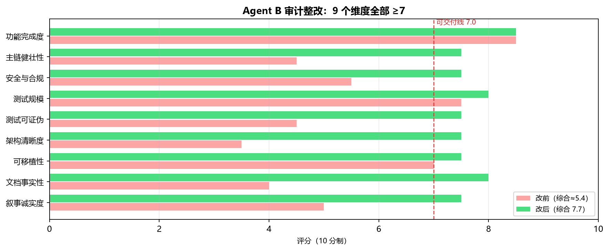
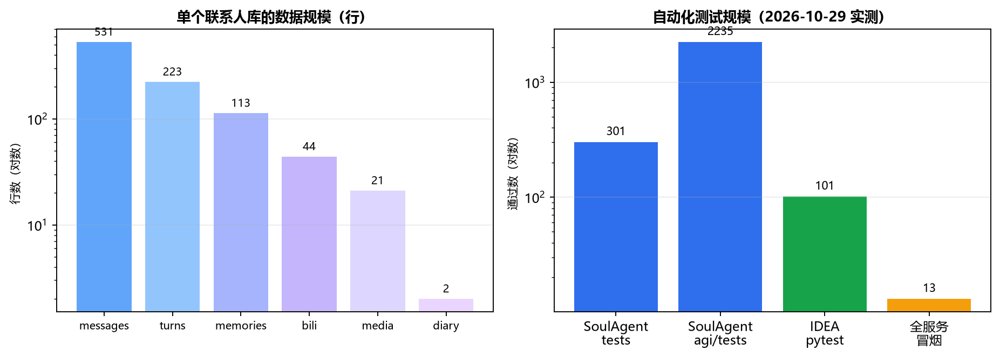

# 从微信聊天到本地智能体：小鱼（SoulAgent）的设计、实现与实测

> 版本：2026-10-29 ｜ 所有数字来自本机实测（Windows 10 / Python 3.14.7 / RTX 4050 Laptop 6GB）
> 代码仓库：`SoulAgent`（智能体核心与网关）+ `idea`（工作台）
> 说明：本文不公开任何真实聊天内容与密钥；涉及人物的数据均匿名/聚合处理。

---

## 摘要

本文介绍一个运行在个人电脑上的 AI 伴侣系统「小鱼」（SoulAgent）：它以真实微信客户端为交互入口，具备长期记忆与遗忘、情绪与内在状态、主动发起对话、每日日记、朋友圈与 B 站内容消费、图片理解与多模态能力，并提供配套的模型训练/评估工作台（IDEA）。

系统采用「大模型负责表达、小模型负责灵魂、本地模型负责吞吐、规则负责底线」的分层设计：

- **接入层**用本地数据库解密 + UIA/OCR 混合驱动真实收发微信消息；
- **认知层**用结构化记忆（半衰期遗忘模型）、用户画像、状态档案与风格守卫维持人格一致性；
- **灵魂层**用 0.5B 本地模型生成 InnerState（心情/精力/分享欲/电量/信任/关系阶段/态度/意图/内心独白/行为），
  通过知识蒸馏从云端教师迁移到本地学生；
- **路由层**按用途把高吞吐任务放本地 3B-VL、把需要判断力的任务放云端 API，并带预算与降级；
- **质量层**用发送锁、送达真值、密钥外部化、草稿 TTL、无回应冷却、发送前文本质检等工程手段保证可交付性。

在实测中：本地 0.5B 灵魂模型 51 tok/s；3B 多模态模型文本提取 0.3 s/次、识图 1.1–2.1 s/张（此前 CPU 推理为 62 s/张，补齐 CUDA 运行库后 GPU 提速约 30–55 倍）；蒸馏数据集 1891 行、2112 次教师调用；聊天截图 OCR 18 张整批 126 s、清洗出 1160 条对话并生成 444 条训练样本；B 站值勤轮稳定读字幕/看关键帧并同步 44 条视频要点进记忆；质量整改后 9 个维度评分全部 ≥7（综合 5.4 → 7.7），终验测试 301 + 2235 条全部通过。

**关键词**：AI 伴侣；微信自动化；长期记忆；知识蒸馏；本地大模型；多模态；智能体工程

---

## 1. 引言

### 1.1 动机

「AI 伴侣」类产品通常停在两个层面：要么是网页里的聊天框，缺乏真实生活入口；要么是高度脚本化的机器人，只有关键词回复。真正像一个「住在电脑里的熟人」，需要同时满足四组彼此拉扯的需求：

1. **人格一致性 vs 大模型默认行为**：底座模型天然是"客服腔"，而伴侣需要固定的说话方式、情绪曲线和边界；
2. **长期记忆 vs 上下文窗口**：几个月的聊天远超任何上下文长度，必须有选择地记住、遗忘、压缩；
3. **主动 vs 打扰**：会主动开口是"有生命感"的关键，但频率、时机、内容一旦失控就是骚扰；
4. **隐私/成本 vs 能力**：把私密聊天持续发给云端 API 有隐私与费用问题，而本地小模型能力有限。

小鱼的目标是：**以本机为边界、以真实微信为入口、以可训练的小模型为人格载体、以云端大模型为能力上限**，并在工程上把这些目标落到可测试、可运维的形态。

### 1.2 问题拆解

| 问题 | 本文的解法 |
| --- | --- |
| 微信 4.x 无法用传统 UIA 读消息 | 本地数据库解密（SQLCipher）+ UIA/OCR 混合发送 |
| 大模型没人格连续性 | 结构化记忆 + 画像 + 状态档案 + 发送前风格守卫 |
| 上下文装不下长期历史 | 长期记忆表 + 半衰期衰减 + 阶段摘要 + 分层注入预算 |
| 主动消息像骚扰 | 概率式调度 + 静默时段 + 无回应冷却 + 去重/熔断 |
| 云端 API 贵且隐私敏感 | 本地 0.5B/3B-VL + 按用途路由 + 预算降级 |
| 人格模型买不到 | 教师蒸馏 InnerState + 用户标注 + LoRA/全参微调工具链 |
| 数据从哪来 | 聊天记录/截图清洗 → 标注 → 蒸馏 → 训练的一体化工作台 |

### 1.3 贡献

1. 一个真实运行、每日使用的个人 AI 伴侣系统（非 demo），覆盖"接入—记忆—情绪—主动—内容消费—训练"闭环；
2. 一套可复现的**灵魂蒸馏**数据管线：教师按 7 种状态档案生成 InnerState，schema 校验后用于小模型微调；
3. 一套**多模态本地化**方案：3B-VL 同时承担高吞吐文本提取与识图，并带云端降级；
4. 一组面向交付的工程实践：发送串行锁、送达真值、密钥外部化、TTL、CI、架构守卫；
5. 全部数字可现场复算（测试、脚本、JSON 证据）。

---

## 2. 相关工作综述

### 2.1 微信自动化

- **wxauto**（cluic/wxauto）：经典 UIA 方案，微信 4.x 自绘渲染后读不到消息节点；
- **wechatauto-replica**（fanyuantaier/wechatauto-replica，Apache-2.0）：本项目实际使用的发送后端。
  消息读取走**本地 SQLCipher 数据库解密**，发送走 **UIA + OCR 混合驱动**（窗口标题校验、多实例安全、失败回退）；
- **PyWxDump**（xaoyaoo/PyWxDump）：微信数据库解密与密钥提取的参考实现；
- **WeChatMsg / 留痕**（LC044/WeChatMsg）：聊天记录导出与分析的参考。

小鱼的取舍：**发送用成熟的 replica 驱动**（不自己维护 UIA 细节），**读取用解密后的本地库**（比 UIA 稳定），
并对发送路径加白名单、全局锁、幂等键与送达回执。

### 2.2 记忆与人格

- **长期记忆分层**借鉴 MemGPT 一类"操作系统式上下文管理"思想：把记忆分为热/温/冷层，按优先级注入并预算裁剪；
- **遗忘曲线**借鉴艾宾浩斯半衰期思想：不同记忆类型（事实/偏好/计划）有不同半衰期，强度随时间指数衰减，
  低强度记忆降级为"压缩句/关键词/休眠"，而不是直接删除；
- **人格一致性**采用"结构化状态 + 规则守卫"：模型输出只是候选，发送前经风格与安全质检。

### 2.3 本地推理与多模态

- **llama.cpp**（ggml-org/llama.cpp）：GGUF 量化推理与 `llama-server` 的 OpenAI 兼容接口，本项目 8123/8125 的运行时；
- **Qwen2.5 / Qwen2.5-VL**（QwenLM）：0.5B 文本学生模型与 3B 多模态本地模型；
- **RapidOCR**（RapidAI/RapidOCR）：本地截图文字识别；
- **vLLM**（vllm-project/vllm）：未来多卡（8×V100）部署的候选服务端（张量并行/连续批处理）。

### 2.4 蒸馏与数据

- **教师-学生蒸馏**：用强模型在"状态档案"条件下生成结构化心理状态，作为小模型的监督信号；
- **数据工作台**：语料清洗、用户标注、蒸馏生成、训练/评估串成一条流水线，避免"手工拼数据"。

### 2.5 AI 伴侣产品与伦理

Replika、Character.AI 等产品证明了"人格 + 记忆"的产品价值，也暴露了过度拟人、情感依赖与隐私风险。
小鱼的设计原则是：**只服务本人账号、只读本人可见内容、不冒充真人、不主动扩散用户数据、所有外发可审计可关闭**。

---

## 3. 系统架构与实现方案

### 3.1 总览

系统整体分为接入、认知、灵魂/路由、观测四层，以及外部内容插件（图 1）。




*图 1　小鱼（SoulAgent）分层架构：接入层负责真实收发，认知层负责记忆/情绪/内容，灵魂层与路由层负责“怎么想、用什么模型”，802/803 负责观测与迭代。*

### 3.2 接入层：真实微信

- **发送**：`wechatauto-replica` 通过 UIA 定位会话 + 输入框发送；窗口标题二次校验防串台；
  发送前统一加**全局可重入锁**（`RLock`），保证文本/媒体/兜底路径串行；
- **读取**：本地数据库解密（SQLCipher 4），按联系人分库（`sha1(contact)[:14]`）；
- **可靠性**：幂等键 `(contact, turn_id:bubble_index)`；失败入草稿；草稿 TTL；
  兜底路径标记 `unverified`，**不计入"已发送"**；`turns.delivery_status` 与 `messages.delivered`
  让"没发出去的话"不进入后续上下文。

### 3.3 记忆系统：分层 + 半衰期

每条记忆有类型（偏好/事实/计划/事件/洞察）、重要度、置信度、最近访问时间，以及：

```
strength(t) = strength0 · 0.5^(Δt / half_life_days(kind, importance))
half_life_days: 按类型给基准（如 事实 30 天 / 计划 7 天 / 偏好 14 天），重要度 ≥0.8 翻倍、≤0.3 减半
stage(strength): full ≥0.5 > compressed ≥0.2 > keyword ≥0.05 > dormant
```

- `compressed`：压成 ≤40 字的一句事实；
- `keyword`：只保留 2–4 个关键词；
- `dormant`：不注入上下文（可被 revive 唤醒）；
- 控制台把 `遗忘度 = 1 - strength` 可视化（绿/黄/红），并显示半衰期与阶段。

记忆注入按"热 → 温 → 冷"与上下文预算裁剪，超预算时丢低优先级块，保证模型始终拿到"最重要且放得下"的信息。

### 3.4 灵魂蒸馏：让 0.5B 学会"她怎么想"

**目标**：给定（系统人设 + 当前状态 + 最近对话 + 用户这句话），生成结构化 InnerState JSON。

**数据生成**（`python -m agi.soul.dataset`）：

1. 素材三类：50 条匿名黄金样本、真实聊天窗口、10 类合成口语素材；
2. 每个 context 配 7 种状态档案（default/work/low_mood/tired/joke/guarded/close），制造"同情境不同状态"的监督信号；
3. 教师（DeepSeek）按固定 prompt 输出 JSON，经 `agi/inner/schema.py` 校验（字段/枚举/长度），失败重试一次；
4. 成本闸门：按 token 记账、预算上限、失败率熔断；断点续跑。

实测：**1891 行**（黄金集 350 / 真实聊天 832 / 合成 708），**2112 次教师调用**，
输入 1,664,330 tokens、输出 359,346 tokens；profile 分歧自检通过率 100%（抽查 20 个 context × 7 档案）。

**训练**（`tools/train/smoke_lora.py` / `sft_train.py`）：

| 方案 | 步数 | 耗时 | Loss（首→末） | 峰值显存 | 产物 |
| --- | --- | --- | --- | --- | --- |
| LoRA（0.5B） | 10 | 7.48 s | 2.60 → 1.26 | 1.8 GB | adapter 34 MB |
| 全参微调（0.5B） | 2 | 12.66 s | 2.77 → 2.39 | 5466 MB | 合并模型 954 MB |

工作台还支持"通用 SFT/FFT"：任意聊天记录经 `export_chat.py` 转 `messages/instruction` 格式，
在网页上建任务（LoRA 5 步、loss 均值 2.35、约 4 秒完成，产物 adapter 可直接合并导出 GGUF）。

**第三种监督**：**用户标注**。在 803 标注页对每条"我的回复"打分（1–5 星）并给 10 个 InnerState 字段
（滑杆/下拉/标签），系统按最低分过滤后生成 soul 数据集——把"用户想训成什么样"直接变成训练信号。



*图 2　数据闭环：采集 → 清洗 → 标注 → 蒸馏 → 训练 → 评估，线上反馈再回流成新标注。*

### 3.5 模型路由：本地省钱、云端保质量

| 用途 | 后端 | 实测 |
| --- | --- | --- |
| 关键词抽取 | 本地 8125 | **0.3 s / 次** |
| 摘要 / 评论聚类 / 相关性打分 | 本地 8125 | 秒级 |
| 识图（caption/标签/情绪） | 本地 8125 优先，失败回落 API | **1.1–2.1 s / 张** |
| 聊天回复 / 情绪判断 / 分享文案 | 云端 DeepSeek | 视网络 2–6 s |
| 视频真理解 | 云端（强制） | — |



*图 3　按用途路由：高吞吐走本地 3B-VL，多模态识图本地优先、失败回落，判断类与聊天走云端，并带日预算降级。*

成本模型：蒸馏约 **0.001468 元/条**（按 v1 实测 token 均值 × 1 元/4 元每百万 token），
300 条约 0.44 元；路由层带日预算与超限降级（超预算自动切本地）。

**关键教训（实测）**：本地模型此前一直跑在 CPU（缺 `cudart64_12/cublas64_12/cublasLt64_12`），
识图 62 s/张；补齐 CUDA 运行库后 GPU 识别到 RTX 4050，识图降到 1.1–2.1 s，关键词降到 0.3 s。

### 3.6 数据工作台：从截图到训练集

链路：**上传（文本/截图）→ 清洗 → 勾选 → 保存数据集 →（可选）用户标注 → 训练/蒸馏**。

- 文本：`我:/你:` 前缀、微信导出格式、JSON/JSONL、无标签交替；
- 截图：本地 OCR（RapidOCR 直连），按气泡左右判"我/你"，合并多行气泡，过滤时间戳/状态栏/标题栏；
  无文字的图片气泡占位 `[表情包]/[图片]`；纯 emoji 与媒体占位符保留；
- 实测：18 张长截图整批 **126 s**，清洗出 **1160 条**（我 469 / 你 691），保存为 **444 条训练 + 23 条验证**；
- 性能：单张长截图直连 RapidOCR **8.4 s**（原 OCRWorker 多尺度路径 22.6 s），并发 2–3 路受本机 CPU 配额限制，收益约 1.2–1.3 倍——所以先把单张路径优化到极致，再考虑并发。

### 3.7 主动消息：从"定时自言自语"到"有分寸"

调度：1–2 小时掷骰、概率 50–60%、静默 22:00–9:00、日上限、30 分钟去重、连续失败熔断；
内容：由候选生成器给出（分享/关心/追问/轻话题），发送前经**风格守卫**（去「」、"账"类比喻、模板句、元话语），
再经**去重/内容闸**，最后进入发送锁。

实测问题与修复（2026-10-29）：
- 13 条主动消息中 **11 条用户无回应** → 新增"连续 3 条无回应 + 最近一条 <6h → 冷却 6 小时"；
- 出现「想起你说『…』」「账先记着」等被禁句式 → 出站质检覆盖 legacy payload 并加入"账"过滤；
- 草稿 90 条积压（4 天前）→ 草稿 TTL（默认 24h，可配 `draft_ttl_days`），启动时清理并记事件。

### 3.8 内容消费：B 站与朋友圈

- **B 站**：独立的 DSH 值勤插件（最小权限 profile：无文件系统/无命令/无联网，只给 MCP 工具），
  每日读首页推荐 → 读字幕/关键帧 → 打分挑选 → 写日报/报告/判重表；
  小鱼侧新增同步器把 44 条视频要点写入记忆（`bili_impressions`），聊天提到 B 站时注入最近 5 条上下文；
- **朋友圈**：读取本地 `sns.db`，解析文案/点赞/评论；图片是加密缓存（AES-128-ECB + 尾部 XOR），
  用图片密钥解密导出（实测 5 条动态、13/14 张图片）；修复"所有动态 `tid` 相同导致去重只剩 2 条"的线上 bug。

### 3.9 安全与质量治理

- **密钥外部化**：`web_config.json`/`config.json` 中 7 项明文密钥迁移到本机 `agi/data/secrets.json`
  （读取优先级 env > secrets > 旧文件；写入自动路由，杜绝再次落明文）；`check_secrets` 扫描通过；
- **ACL 收紧**：敏感目录/文件 ACL 收紧并 `--verify` 通过；
- **发送安全**：全局发送锁、白名单 fail-closed、弱 token 拒绝、approve 需 `confirm` + header token；
- **可观测**：队列长度、在途联系人、草稿数、`unverified` 单列、主动消息冷却事件；
- **测试隔离**：23 个路径常量 env 化 + 生产文件 mtime/size 自证守卫（测试改了生产文件即失败）；
- **架构守卫**：死代码归档 `legacy/`、行数预算、主动链唯一入口、文档链接与可移植性检查。

### 3.10 桌面化：Windows 一键启动（M5）

- **形态**：`tools/desktop/launcher.py`（零 pip 依赖）+ PowerShell 托盘（`tray.ps1`）。
  双击桌面快捷方式「小鱼桌面版」（`pythonw`，无控制台）→ 启动 801/802/803 → 托盘常驻 →
  Edge/Chrome `--app` 模式打开控制台独立窗口；
- **三服务托管**：801 网关、802 控制台、803 工作台（用 `idea/.venv`、cwd=`idea/`）；
  已在跑则复用；健康检查通过才开窗；`--status/--stop/--autostart` 可脚本化运维；
- **托盘菜单**：打开控制台 / 打开工作台 / 主动消息开关 / 紧急 STOP / 状态 / 日志 / 退出；
- **稳健性**：只复用"已加载完成"的窗口（标题含 `Soul Console`），空白/残留窗先关再开，
  仍失败回落默认浏览器；所有 PowerShell 查询隐藏执行（不闪窗），窗口标题用 Win32 API 读取；
- **提权处理**：检测到管理员身份时改用普通权限 `explorer` 打开浏览器，避免 Edge
  「现有实例正在以提升的权限运行」弹窗；
- **发送窗口自检**：`wx_core/win.py::ensure_wechat_window_visible` 在真发前把最小化/托盘的
  微信主窗口恢复出来（`SW_RESTORE/SW_SHOW`），解决"未找到微信窗口"误报。

> 说明：桌面壳是"Edge app 窗口 + 托盘"，不是 Tauri/WebView2 自绘窗口；后者列为可选演进。

### 3.11 802 消息分析台改版

- **布局**：总览/对话流改为「左联系人 / 中聊天 / 右概览」三栏（参考早期 run_web 的 wx_box 界面）；
- **联系人隔离**：`/api/contacts` 列出配置联系人与本机未登记库，切换后 `/api/messages?contact=`、
  `/api/memory?contact=`、`/api/inner?contact=` 都读对应独立库；缺库/0 消息时提示去 803 建库训练；
- **消息展示**：关联 `attachments`，显示图片/表情包/GIF 缩略图与类型标签（`/api/media/file` 白名单含 `media_chat`）；
- **操作**：手工发消息（`POST /api/manual/send` → 801 `/api/approve`，白名单/静默/闸门不绕过）、
  开始/停止监听（`/api/engine/start|stop`）、刷新列表/同步历史/自动刷新/自动滚动；
- **修过的坑**：`backend.active` 字段不存在导致永远显示「微信未监听」；顶部栏 sticky 造成滚动穿模。

---

## 4. 实测与评估

> 数据采集：2026-10-29，单机 Windows 10 / Python 3.14.7 / RTX 4050 Laptop 6GB / DeepSeek API。

### 4.1 服务与模型

| 服务 | 端口 | 模型/说明 | 状态 |
| --- | --- | --- | --- |
| 网关 | 801 | 发送/接收/队列/审计 | 运行中 |
| 控制台 | 802 | 消息分析台（总览/对话流三栏、联系人库隔离、图片/表情/GIF、手工发送）+ 20+ 页面 | 运行中 |
| 工作台 | 803 | 语料/标注/蒸馏/数据/训练/模型 | 运行中 |
| 灵魂模型 | 8123 | Qwen2.5-0.5B-Instruct v1b（Q4，398 MB） | 运行中，≈51 tok/s |
| 本地多模态 | 8125 | Qwen2.5-VL-3B（Q4 1.93 GB + mmproj 1.34 GB） | 运行中，识图 1.1–2.1 s |

### 4.2 数据规模（主联系人库）

| 表 | 行数 |
| --- | --- |
| messages | 531 |
| user_memories | 113 |
| turns | 223 |
| bili_impressions | 44 |
| proactive_events | 13 |
| media_understanding | 21 |

> 说明：数字随使用增长；表中为当日采样。

### 4.3 关键性能

| 场景 | 结果 |
| --- | --- |
| 本地识图（480×270 / 1280×720） | 1.1–1.5 s / 2.1 s（GPU）；CPU 时 62 s |
| 本地关键词抽取 | 0.3 s/次 |
| 聊天截图 OCR（单张长图） | 8.4 s（直连 RapidOCR）；18 张整批 126 s |
| 语料清洗（18 张截图） | 1160 条 → 444 训练 + 23 验证 |
| 蒸馏数据生成（mock） | 3 条约 0.7 s；真实 300 条约 0.44 元 |
| LoRA 训练（0.5B，10 步） | 7.48 s，loss 2.60→1.26，峰值 1.8 GB，adapter 34 MB |
| 全参微调（0.5B，2 步） | 12.66 s，loss 2.77→2.39，峰值 5466 MB，产物 954 MB |



*图 4　本地推理与 OCR 延迟：识图从 CPU 的 62 秒降到 GPU 的 1.1–2.1 秒；OCR 单张从 22.6 秒降到 8.4 秒；18 张整批受本机 CPU 配额限制约 126 秒。*



*图 5　真实界面：803 语料清洗（OCR 进度/你·我筛选）、803 用户标注（微信式气泡 + InnerState 编辑）、802 B站（刷到的视频/日报/报告）、802 日记（只读阅读器）。*

### 4.4 质量与测试

| 项 | 结果 |
| --- | --- |
| `tests/`（SoulAgent） | 301 passed / 0 failed |
| `agi/tests/`（SoulAgent） | 2235 passed / 4 skipped / 0 failed |
| IDEA 工作台测试 | 101 passed |
| 全服务冒烟 | 13/13 PASS |
| 静态闸门 | 链接 143/0 断链、架构、可移植性、密钥扫描全 PASS |
| Agent B 质量评分（9 维） | 5.4 → **7.7**，全部 ≥7 |



*图 6　审计整改前后评分：9 个维度全部 ≥7，综合从约 5.4 提升到 7.7（数据来自 docs/agent-b/SCORECARD.md）。*



*图 7　左：单个联系人库的数据规模；右：自动化测试通过数（301 + 2235 + 101 + 冒烟 13）。*

### 4.5 代码规模

| 仓库 | Python 文件 | 行数 |
| --- | --- | --- |
| SoulAgent（核心+工具+测试） | 817 | ≈221k |
| IDEA 工作台 | 25 | ≈8.2k |

---

## 5. 讨论与局限

1. **单 worker 仍是瓶颈**：消息处理串行，虽已加全局发送锁与队列可观测，但跨联系人仍会队头阻塞；下一步是"每联系人独立通道 + 合并发送窗口"。
2. **上下文预算 vs 记忆召回**：裁剪策略保证可用，但低优先级记忆可能被丢掉；需要更细的相关性rerank。
3. **本地 3B-VL 的能力边界**：识图可用（1–2 s），但复杂推理与 OCR 混合场景仍不如云端；当前策略是"本地出草稿、云端兜底"。
4. **样本量不足**：灵魂模型当前训练数据 1891 行，距离稳定人格仍有差距；需要真实聊天 + 用户标注持续积累（目标 ≥1 万行）。
5. **Windows-only**：微信驱动、路径、UIA 与桌面版（Edge app + 托盘）都绑定 Windows；跨平台需要重写接入层。
6. **外部依赖**：B 站值勤依赖仓库外的 DSH 插件；朋友圈只能读"浏览过/缓存过"的内容。
7. **伦理风险**：长期陪伴可能造成情感依赖；系统明确不冒充真人、只服务本人账号、所有外发可关闭可审计，但仍需使用者自律。
8. **数据安全**：密钥已外部化并收紧 ACL（802 模型配置页可直接保存到 `agi/data/secrets.json`），
   但本机仍保存聊天库与日记；建议全盘加密 + 定期备份。

---

## 6. 结论与展望

小鱼证明了：**在单台消费级电脑上，用"本地小模型 + 云端大模型 + 结构化记忆 + 工程化护栏"可以做出一个每天真实使用、可训练、可运维的 AI 伴侣**。它的核心不是某个模型，而是把"人格、记忆、主动性、隐私、成本"这些彼此冲突的目标拆成可实现的层，并用测试与度量把每层钉住。

后续计划：

1. **原生桌面壳（可选）**：当前桌面版是 Edge app + 托盘；如需自绘窗口/更深集成，再评估 Tauri/WebView2；
2. **多卡扩展**：8×V100 16G（128 GB 显存）上以 vLLM 张量并行部署更大 VL/文本模型，识图与聊天并发；
3. **数据规模化**：真实聊天 + 用户标注 + 合成数据三路并进，目标 1 万行以上灵魂数据，加入 DPO/偏好优化；
4. **本地转写**：无字幕 B 站视频的 ASR 兜底；
5. **可迁移**：把微信接入层抽象成接口，为其他 IM/桌面入口留扩展位。

---

## 7. 参考项目及地址

**微信接入与数据**

- wxauto：https://github.com/cluic/wxauto
- wechatauto-replica（本项目的发送后端）：https://github.com/fanyuantaier/wechatauto-replica
- PyWxDump（数据库解密/密钥参考）：https://github.com/xaoyaoo/PyWxDump
- WeChatMsg / 留痕（聊天记录导出）：https://github.com/LC044/WeChatMsg
- WechatMoments（朋友圈导出参考）：https://github.com/tech-shrimp/WechatMoments
  - 社区 fork（本项目验证过思路）：https://github.com/mashisheng1120/wechat_moments

**本地推理与模型**

- llama.cpp（GGUF/llama-server）：https://github.com/ggml-org/llama.cpp
- vLLM（多卡部署候选）：https://github.com/vllm-project/vllm
- Qwen2.5：https://github.com/QwenLM/Qwen2.5
- Qwen2.5-VL：https://github.com/QwenLM/Qwen2.5-VL
- RapidOCR：https://github.com/RapidAI/RapidOCR

**云端能力**

- DeepSeek 开放平台（教师/聊天/判断）：https://platform.deepseek.com

**桌面化（当前实现 + 可选演进）**

- 当前：Edge/Chrome `--app` 窗口 + PowerShell WinForms 托盘（仓库内 `tools/desktop/`）
- Tauri（可选演进）：https://tauri.app

> 备注：项目内部还依赖 DeepSeek Harness（DSH）运行时与 B 站值勤插件；它们属于运行环境/外部插件，不在本项目仓库内。

---

## 附录 A：复现命令（本机）

```bash
# 桌面版（Windows，推荐）
python tools/desktop/launcher.py --tray          # 三服务 + 托盘 + Edge app 窗口
# 或双击桌面快捷方式「小鱼桌面版」（pythonw，无控制台）

# 服务
python -m agi.wechat_gateway.server              # 801
python tools/console/server.py --port 802        # 802
cd idea && .venv/Scripts/python.exe -m uvicorn app.main:app --port 803

# 本地模型
E:\agent\llama\cuda\llama-server.exe -m E:\agent\output\gguf\soul_qwen25_05b_v1b-q4_k_m.gguf \
  -ngl 99 --port 8123 -c 4096 -np 1 --jinja
E:\agent\llama\cuda\llama-server.exe -m E:\agent\models\Qwen2.5-VL-3B-Instruct-GGUF\Qwen2.5-VL-3B-Instruct-Q4_K_M.gguf \
  --mmproj E:\agent\models\Qwen2.5-VL-3B-Instruct-GGUF\mmproj-F16.gguf \
  -ngl 99 --port 8125 -c 4096 -np 1 --jinja

# 数据与训练
python tools/train/export_chat.py --all-contacts --limit 400 --out <AGENT_HOME>/datasets/chat.jsonl
python -m agi.soul.dataset --limit 2000 --real --out agi/soul/data/soul_sft_v1.jsonl
python tools/train/sft_train.py --data <AGENT_HOME>/datasets/chat.jsonl --out <AGENT_HOME>/output/lora --steps 10

# 质量
python scripts/agentb_verify.py --json docs/agentb_verify_result.json
cd idea && .venv/Scripts/python.exe -m pytest tests -q
```

## 附录 B：术语

- **InnerState**：一轮对话中"她怎么想"的结构化状态（心情/精力/分享欲/电量/信任/阶段/态度/意图/独白/行为）；
- **状态档案（state_profile）**：同一 context 下人为设定的 7 种状态，用于制造监督多样性；
- **未验证发送（unverified）**：兜底路径无法确认送达，单列口径，不计入已发送；
- **遗忘度**：`1 - strength`，控制台用颜色表示记忆新鲜程度。
